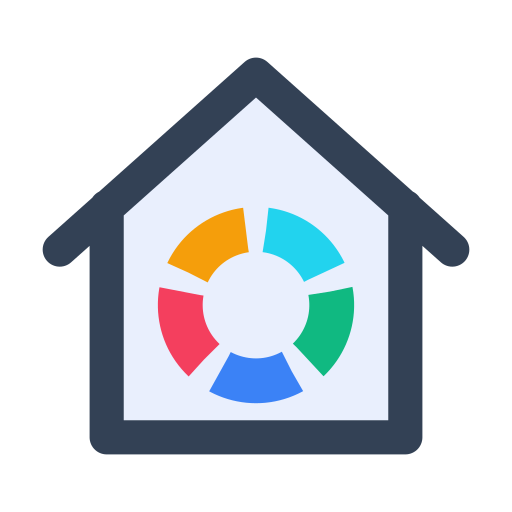
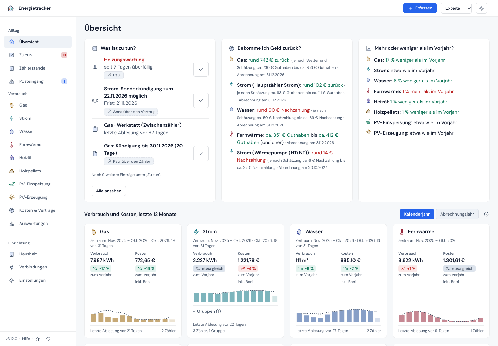
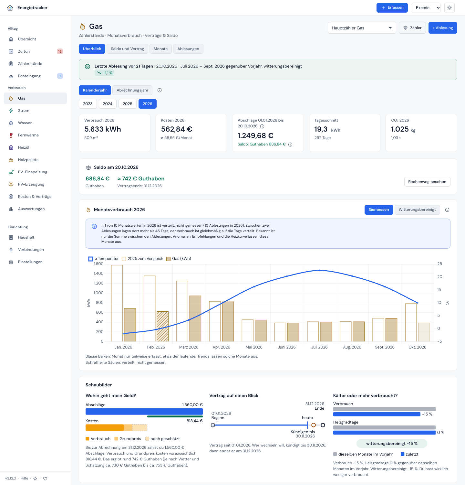
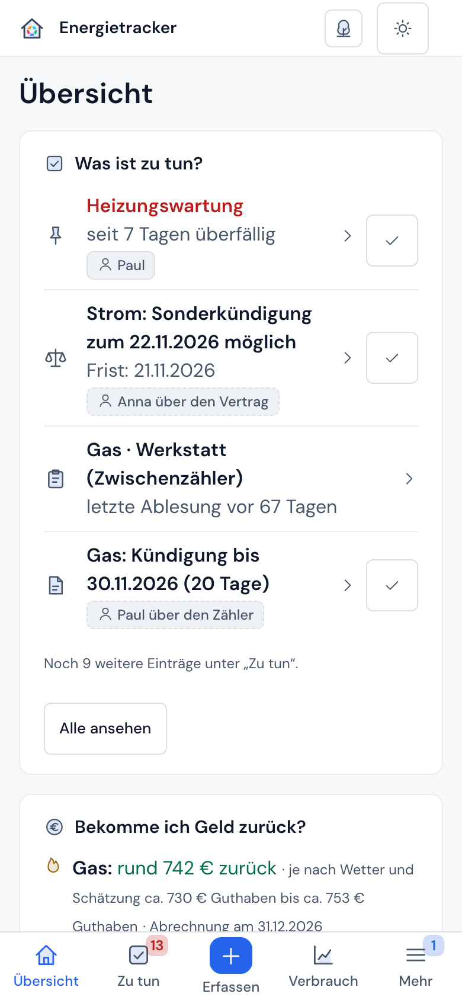

<p align="center"></p>
<h1 align="center">Energietracker</h1>
<p align="center"><a href="README.md">English</a> · <b>Deutsch</b></p>

<p align="center"><b>Home Assistant misst, der Energietracker rechnet ab.</b><br>
Zählerstände rein, Antworten raus: Bekomme ich Geld zurück? Stimmt die Rechnung? Lohnt der Wechsel?<br>
Selbst gehostet, ohne Konto und ohne Datenbank. Und auf Wunsch mit deiner KI im Heimnetz.</p>

<p align="center">
  <a href="https://bingerminger.github.io/energietracker/"><b>Demo</b></a> ·
  <a href="docs/README.md"><b>Hilfe</b></a> ·
  <a href="roadmap.md"><b>Roadmap</b></a> ·
  <a href="https://github.com/Bingerminger/energietracker/discussions"><b>Discussions</b></a>
</p>

<p align="center">
  <a href="CHANGELOG.md"></a>
  <a href="https://github.com/Bingerminger/energietracker/actions/workflows/ci.yml"></a>
  <a href="LICENSE"></a>
  <a href="docs/betrieb/docker.md"></a>
  <a href="https://bingerminger.github.io/energietracker/"></a>
</p>

<p align="center"><picture><source media="(prefers-color-scheme: dark)" srcset="docs/assets/promo/screens/uebersicht-dunkel.de.png"></picture></p>

## Auf einen Blick

<!-- doc-claim: readme-auf-einen-blick (ReadmeClaimsTest) -->
| | Was du bekommst |
|:---:|---|
|  | **Frag deine KI, wie es um Strom und Gas steht.** Über MCP liest sie mit 20 Werkzeugen Saldo, Verbrauch, Verträge und Fristen nach und nennt zu jeder Zahl, woher sie kommt. Sie ändert nichts ohne dich: Ab Werk bestätigst du jeden Vorschlag in der App. Ab Werk aus, geprüft mit Open WebUI und einem lokalen Modell über Ollama, andere Programme und Cloud-KI experimentell. [Anleitung](docs/anleitungen/ki-assistent.md) |
|  | **Deine Rechte als Kunde, mit Quelle.** Sieben Prüfungen nach deutschem Recht: Rechnung zu spät, Abschlag zu hoch, Sonderkündigung nach einer Preiserhöhung, fehlender Bonus und mehr. Den passenden Brief gibt es als Text und PDF, auf Deutsch. Ein Hinweis, keine Rechtsberatung. [Rechte](docs/verstehen/17-rechte.md) |
|  | **Post vom Versorger ablegen statt abtippen.** PDF in den Posteingang, eine KI im Heimnetz liest es aus, jede Zahl steht mit ihrer Stelle im Dokument da. Ein Klick übernimmt sie, auch einen ganzen Haushalt aus einem Stapel Briefe. [Posteingang](docs/anleitungen/posteingang.md) |
|  | **Bekomme ich Geld zurück?** Saldo je Vertrag: gemessen bis zur letzten Ablesung, geschätzt bis heute, erwartet bei der Abrechnung, mit ehrlicher Spanne. Wie auf der Rechnung: „Guthaben“ oder „Nachzahlung“. [Saldo](docs/verstehen/00-overview.md#saldo-aus-einem-guss-seit-v3100) |
|  | **Was kostet ein kalter Winter?** Die Prognose-Werkstatt rechnet Winter, Dämmung, Raumtemperatur und Tarif mit deinen Daten durch, mit Rangliste und Ergebnis als PDF. [Was wäre wenn](docs/anleitungen/was-waere-wenn.md) |
|  | **Sparen, wo es belegbar ist.** Abschlag passend einstellen, Wechsel mit Kündigungsfrist und Gewinnschwelle prüfen, die Jahresrechnung je Abschnitt nachrechnen. Keine erfundenen Sparbeträge: Du siehst deine eigenen Zahlen. [Jahresabrechnung](docs/anleitungen/jahresabrechnung.md) |
|  | **Home Assistant misst, der Energietracker rechnet ab.** Zählerstände kommen aus Home Assistant, Fristen und neue Post gehen als Benachrichtigung zurück. Als App für Home Assistant OS, Sensoren über die HACS-Integration ohne YAML. [Home Assistant](docs/anleitungen/home-assistant.md) |
|  | **Deine Daten bleiben bei dir.** Keine Konten, keine Werbung, keine Telemetrie, keine Datenbank, nur Dateien auf deinem Server. Hinaus geht ab Werk nur der Wetterabgleich, abschaltbar; alles andere schaltest du selbst ein. [Deine Daten](#deine-daten) |

**Neun Verbrauchsarten:** Gas, Strom, Wasser, Fernwärme, Heizöl, Pellets, PV-Einspeisung, PV-Erzeugung und
Heizwärme. **In sieben Sprachen:** Deutsch, Englisch, Französisch, Italienisch, Spanisch, Portugiesisch und
Niederländisch. Dazu Zählertausch, Subzähler, Messkonzepte mit Wärmepumpe und HT/NT, Wetterbereinigung mit
Heizgradtagen, Mietverhältnis und eine Hilfe in der App mit Glossar und ⓘ neben Fachbegriffen.
→ [Alle Funktionen](docs/einstieg/funktionen.md) · [Alle Ansichten mit Bildern](docs/referenz/ansichten.md)

<p align="center"> </p>

## Schnellstart

```bash
docker run -d --name energietracker --restart unless-stopped -p 8080:80 \
  -v energietracker-data:/data \
  ghcr.io/bingerminger/energietracker:3
```

Dann <http://localhost:8080> öffnen. **„Mit Beispieldaten ausprobieren“** zeigt sofort, wie alles aussieht;
eigene Daten gehen dabei nicht verloren.

- **Home Assistant OS:** als App installieren, mit Eintrag in der Seitenleiste und Anmeldung über Home
  Assistant ([Schritt für Schritt](docs/anleitungen/home-assistant.md#als-app-in-home-assistant-os)).

  [](https://my.home-assistant.io/redirect/supervisor_add_addon_repository/?repository_url=https%3A%2F%2Fgithub.com%2FBingerminger%2Fenergietracker-ha)
- **Sensoren in Home Assistant ohne YAML:** die Integration über HACS,
  [energietracker-hacs](https://github.com/Bingerminger/energietracker-hacs).
- **Ohne Docker** genügt PHP ab 8.3: `git clone`, dann `php -S 127.0.0.1:8080 router.php`.
- **Für den Dauerbetrieb:** [Installation](docs/betrieb/installation.md) ·
  [Docker, auch auf der Synology](docs/betrieb/docker.md) · [Apache und nginx](docs/betrieb/webserver.md) ·
  [Auf dem Handy nutzen](docs/einstieg/handy.md).

> [!WARNING]
> **Ohne Anmeldung kann jeder, der die App erreicht, alles lesen und ändern.** Im eigenen Heimnetz ist das in
> Ordnung. Vor dem Zugriff von außen die Anmeldung einschalten: [Sicherheit & Netzbetrieb](docs/betrieb/sicherheit.md).

## Für wen

| | Home Assistant (Energie) | Energietracker |
|---|---|---|
| Zählerstände | automatisch, in Echtzeit | von Hand, per CSV, aus der Versorgerpost oder von Home Assistant |
| Kosten | ein Preis je Einheit | Vertrag mit Arbeits- und Grundpreis, Boni, Abschlägen, tagesgenauen Preiswechseln |
| Abrechnung | — | Saldo, erwartete Abrechnung, Rechnungsprüfung, Kündigungsfristen, Rechte als Kunde |
| Wetter | — | Heizgradtage vom Standort, Wetterbereinigung |
| Vorausschau | — | Kostenprognose fürs Jahr, Wechselentscheidung, Was wäre wenn |

- **Haushalte** in der Mietwohnung wie im Eigenheim, die ihre Jahresabrechnung verstehen und vorhersehen wollen.
- **Home-Assistant-Nutzer:** Home Assistant misst, der Energietracker rechnet Verträge, Abschläge und Prognosen.
- **KI-Nutzer:** eine KI im Heimnetz, die nachliest statt rät, und nichts ohne dich ändert.
- **Tüftler:** offene REST-API, CSV und JSON-Backup, keine Datenbank.

## Deine Daten

**Alles bleibt auf deinem Server:** keine Konten, keine Werbung, keine Telemetrie, keine Datenbank, nur
JSON-Dateien. Nach außen spricht die App nur mit Open-Meteo: beim täglichen Wetterabgleich (übermittelt wird
der auf rund 1 km gerundete Standort, abschaltbar) und bei der Ortssuche, wenn du sie benutzt.

**Wege, die du selbst einschaltest:**

- dein eigener Texterkennungsdienst im Heimnetz, wenn du ihn einträgst (für Zählerfotos und zum Auslesen der
  Versorgerpost im Posteingang);
- dein evcc im Heimnetz, wenn du die Ladevorgänge abrufst;
- dein Home Assistant, wenn du Benachrichtigungen dorthin einschaltest;
- die Börsenstrompreise für den Dynamik-Check, wenn du auf „Von SMARD laden“ tippst (Bundesnetzagentur; dabei
  geht nichts von dir hinaus);
- der Hinweis auf neue Versionen (einmal am Tag wird GitHub nach der neuesten Versionsnummer gefragt;
  sichtbar ist nur die Adresse deines Servers).

**Auslesen in der Cloud ist aus,** bis es jemand einschaltet, der die Installation verwaltet. Dann gehen
Dokumente an den gewählten Dienst: an Claude (Anthropic) unter `api.anthropic.com`, OpenAI (`api.openai.com`),
Mistral (`api.mistral.ai`), OpenRouter (`openrouter.ai`), Google Gemini (`generativelanguage.googleapis.com`)
oder an eine eigene OpenAI-kompatible Adresse, die nur mit diesem Opt-in angesprochen wird. Jeden dieser Hosts
spricht die App nur mit Opt-in an: nach dem Speichern des Schlüssels für die Liste der Modelle, nach dem
Einschalten zum Auslesen. Alle Cloud-Wege sind experimentell. Die KI-Schnittstelle (MCP) ist ab Werk aus und
nimmt nur Anfragen mit eigenem Schlüssel an. Schriften, Chart.js und PDF.js liegen im Repository.

## Hilfe und Gemeinschaft

- **In der App:** Hilfe unten in der Seitenleiste (am iPhone unter „Mehr“) mit Wegweiser, ersten Schritten
  und Glossar, dazu ein ⓘ neben Fachbegriffen.
- **Handbuch:** [Erste Schritte](docs/einstieg/erste-schritte.md) ·
  [Fragen und Antworten](docs/einstieg/faq.md) ·
  [Jahresabrechnung eintragen und prüfen](docs/anleitungen/jahresabrechnung.md) ·
  [Fehlersuche](docs/betrieb/fehlersuche.md) · das ganze [Kompendium](docs/README.md), auch auf
  [Englisch](docs/en/README.md).
- **Fragen und Ideen:** [Discussions](https://github.com/Bingerminger/energietracker/discussions), Ideen mit
  Abstimmung unter [Ideas](https://github.com/Bingerminger/energietracker/discussions/categories/ideas).
- **Fehler:** [Issues](https://github.com/Bingerminger/energietracker/issues).
  Sicherheitslücken bitte vertraulich, wie in [SECURITY.md](SECURITY.md) beschrieben.
- **Was kommt:** [Roadmap](roadmap.md).

## Länder und Annahmen

Länderprofile für Deutschland, Österreich, die Schweiz, Frankreich, Italien, Spanien, Portugal, die
Niederlande und das Vereinigte Königreich setzen Währung, Formate, Zeitzone, Wetterstandort, Heizgrenze,
CO₂-Faktor und Gaseinheiten. **Fachlich ist der Energietracker in Deutschland zu Hause:** Effizienzklassen nach
GModG (bis Juli 2026 GEG), CO₂-Faktoren nach BAFA und Umweltbundesamt, Sonderkündigungsrecht nach EnWG, die
Prüfungen der Rechte nach deutschem Recht. Anderswo rechnet er ohne Klassen und sagt warum; Währungen rechnet
er nicht um. [Länderprofile](docs/verstehen/14-laenderprofile.md)

## Stand

**v3.12.0** ist die aktuelle Version, was sich geändert hat, steht im [CHANGELOG](CHANGELOG.md).
**Schnittstellen, CSV-Formate und das Backup-Format ändern sich nur additiv;** entfernt wird erst mit einer
neuen Hauptversion und nach Ankündigung. Was als Nächstes kommt, steht in der [Roadmap](roadmap.md). Wer von
einer privaten v0.9.0 kommt: Seit 3.4.0 liest keine Version deren Backups mehr ein; 3.3.0 installieren, dort
migrieren, dann aktualisieren.

## Mitwirken

**Pull Requests sind willkommen.** Einrichtung, Tests und die Doku-Regeln stehen in
[CONTRIBUTING.de.md](CONTRIBUTING.de.md), für alle gelten die [Verhaltensregeln](CODE_OF_CONDUCT.md#deutsch).
Eine neue Sprache ist vor allem Übersetzung: ein Katalog, ein Eintrag in `languages.json` und die Schreibweise
unter `format.*`, dazu wenige Zeilen Code für Pluralregel und Länderzuordnung
([Übersetzen und Sprachen](docs/entwicklung/uebersetzen.md)).

## Unterstützen

Der Energietracker ist unabhängig: keine Firma dahinter, keine Werbung, kein Cloud-Konto, keine Datensammlung.
Wenn er dir Geld oder Zeit spart und du etwas zurückgeben möchtest, kannst du mir
[einen Kaffee spendieren](https://buymeacoffee.com/bingerminger), ganz freiwillig. **Ein Stern auf GitHub,
Fehlermeldungen und Weitersagen helfen genauso.** Beides erreichst du auch in der App, unten in der
Seitenleiste.

## Lizenz

Seit Version 3.0.0 steht der Energietracker unter der [GNU AGPL v3.0 oder neuer](LICENSE). In einfachen Worten:

- **Zu Hause gehört er dir:** kostenlos nutzen, verändern, weitergeben, ohne Bedingungen, ohne Konto, ohne
  Gebühr.
- **Nur eine Regel:** Wer eine *veränderte* Fassung anderen als Webdienst anbietet, gibt ihnen auch deren
  Quellcode. So bleibt die App für alle frei und offen.
- **Nichts versteckt:** Unter Einstellungen → System führt ein Link zum Quellcode genau der laufenden Version.

Versionen bis 2.16.0 bleiben unter der MIT-Lizenz verfügbar, unter der sie erschienen sind.

Mitgeliefert werden [Chart.js](https://www.chartjs.org/) (MIT), [PDF.js](https://mozilla.github.io/pdf.js/)
(Apache-2.0) und die Schriften DM Sans und DM Mono (SIL Open Font License 1.1); die Wetterdaten stammen von
[Open-Meteo.com](https://open-meteo.com/) unter [CC BY 4.0](https://creativecommons.org/licenses/by/4.0/).
Einzelheiten in [CREDITS.md](CREDITS.md), Produktnamen in [TRADEMARKS.md](TRADEMARKS.md).
