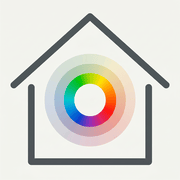
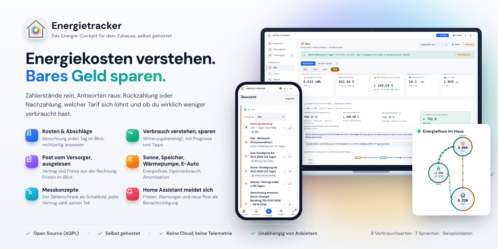

<p align="center"></p>
<p align="center"><a href="README.md">English</a> · <b>Deutsch</b></p>

# Energietracker

<p align="center"></p>

**Home Assistant misst — der Energietracker rechnet ab.** Zählerstände rein,
Antworten raus: Bekomme ich Geld zurück? Stimmt die Gasrechnung? Lohnt sich der
Wechsel? Habe ich mehr verbraucht, oder war es nur kälter?

**[▶ Live-Demo ansehen](https://bingerminger.github.io/energietracker/)** — ein
Beispielhaushalt, bis heute fortgeschrieben, in sieben Sprachen, ohne Installation.

[](https://github.com/Bingerminger/energietracker/actions/workflows/ci.yml)
[](https://github.com/Bingerminger/energietracker/actions/workflows/docker-publish.yml)
[](CHANGELOG.md)
[](LICENSE)
[](composer.json)
[](composer.json)
[](tests/)
[](public/locales/)
[](docs/einstieg/funktionen.md)
[](docker-compose.yml)
[](https://github.com/Bingerminger/energietracker-ha)
[](https://buymeacoffee.com/bingerminger)

<p align="center"></p>

## Was er beantwortet

| Frage | Antwort in der App |
|---|---|
| Was wäre, wenn …? | **Prognose-Werkstatt** *(neu in v3.6.0)*: Regler für Winter, Dämmung, Raumtemperatur und Tarif — sofort sehen, was ein kalter Winter kostet oder die Dämmung bringt; Rangliste, beste Kombination unter einem Budget, Ergebnis als Bild oder PDF |
| Bekomme ich Geld zurück? | **Saldo** je Vertrag nach Kalender, erwartete Abrechnung und Abschlagsvorschlag — „Guthaben“ oder „Nachzahlung“ wie auf der Rechnung |
| Stimmt meine Jahresabrechnung? | **Rechnungsprüfung** für Gas, Strom, Wasser und Fernwärme: je Abschnitt nachgerechnet, gegen die Rechnung gehalten, das Ergebnis als Sonderzahlung gebucht |
| Soll ich wechseln? | **Wechselentscheidung** mit Kündigungsfrist, Kosten ab dem zweiten Jahr und Gewinnschwelle |
| Mehr verbraucht oder nur kälter? | **Wetterbereinigung** mit Heizgradtagen vom eigenen Standort und einem Heizmodell |
| Was kommt auf mich zu? | **Prognose** mit Unsicherheitsband und Kosten je Monat aus dem gültigen Tarif |
| Wie effizient ist das Haus? | **Effizienz** in kWh/m²·a und eine energieausweis-nahe Kennzahl; mit Wärmepumpe die Jahresarbeitszahl |
| Reicht die Vorauszahlung zur Miete? | **Mietverhältnis**: Heizung und Wasser gegen die Nebenkostenvorauszahlung, Fristen im Kalender, CO₂-Kosten mit dem Vermieter teilen |
| Was steht in der Post vom Versorger? | **Posteingang**: PDF ablegen, auslesen lassen, jede Zahl mit ihrer Belegstelle prüfen und übernehmen; *neu in v3.9.0* legt eine Jahresrechnung auch den Vertrag an, mit Preisen je Abschnitt und Abschlägen alle zwei oder drei Monate |
| Wärmepumpe mit eigenem Tarif, HT/NT, PV? | **Messkonzept** *(neu in v3.9.0)*: ein Assistent fragt nach dem Aufbau im Zählerschrank, zeichnet das Schaltbild und legt Zähler, Zählwerke und Verträge an; hat ein Subzähler einen eigenen Vertrag, rechnet der Elternzähler nur den Rest |
| Muss ich die App öffnen, um nichts zu verpassen? | **Benachrichtigungen an Home Assistant** *(neu in v3.9.0)*: Fristen, Termine, Warnungen und neue Post erscheinen in Home Assistant, jede nur einmal; dazu ein Sensor „Zu tun“ |
| Stimmt dieser Zählerstand? | **Ablesung prüfen** *(neu in v3.9.0)*: Ein vertippter Stand zwischen zwei richtigen verzieht sonst still die Monate. Die App fragt nach und korrigiert nie selbst |

Neun Verbrauchsarten: Gas, Strom, Wasser, Fernwärme, Heizöl und Pellets (mit
Tankbuch), PV-Einspeisung und PV-Erzeugung (Eigenverbrauch, Autarkie, Speicher)
und Heizwärme (Wärmemengenzähler oder monatliche Verbrauchsinfo). Dazu
Zählertausch, Subzähler und Gruppen — auch mit einem Vertrag für Hoch- und
Niedertarif —, Zählwerke mit OBIS-Kennzahl, Personen im Haushalt auch ohne
Anmeldung, Belege und Fotos der Zähler, Termine als Kalender-Abo,
Empfehlungen, PDF-Jahresbericht und eine Übersicht für Home Assistant — und eine
Hilfe in der App mit Glossar und ⓘ an jeder Kennzahl.
→ [Alle Funktionen](docs/einstieg/funktionen.md) ·
[Alle Ansichten mit Screenshots](docs/referenz/ansichten.md)

<p align="center"> </p>

## Für wen

- **Haushalte**, die ihre Jahresabrechnung verstehen und vorhersehen wollen —
  in der Mietwohnung wie im Eigenheim.
- **Home-Assistant-Nutzer**: Home Assistant pusht die Zählerstände, der
  Energietracker rechnet Verträge, Abschläge und Prognosen —
  [Anleitung](docs/anleitungen/home-assistant.md). Seit 3.9.0 meldet er
  Fristen, Warnungen und neue Post selbst an Home Assistant zurück.
- **Tüftler**: offene REST-API, CSV und JSON-Backup, keine Datenbank.

| | Home Assistant (Energie) | Energietracker |
|---|---|---|
| Zählerstände | automatisch, in Echtzeit | von Hand, per CSV oder von Home Assistant |
| Kosten | ein Preis je Einheit | Vertrag mit Arbeits- und Grundpreis, Boni, Abschlägen, tagesgenauen Preiswechseln |
| Abrechnung | — | Saldo, erwartete Abrechnung, Rechnungsprüfung, Kündigungsfristen |
| Wetter | — | Heizgradtage vom Standort, Wetterbereinigung |
| Vorausschau | — | Kostenprognose fürs Jahr, Wechselentscheidung |

## Schnellstart

```bash
docker run -d --name energietracker -p 8080:80 \
  -v energietracker-data:/data \
  ghcr.io/bingerminger/energietracker:3
```

Dann <http://localhost:8080> öffnen. **„Mit Beispieldaten ausprobieren“** zeigt
sofort, wie alles aussieht; eigene Daten gehen dabei nicht verloren.

Mit **Home Assistant OS** brauchst du keinen eigenen Docker-Host: als App
installieren, mit Eintrag in der Seitenleiste und Anmeldung über Home
Assistant (neu seit 3.5.0, Repository
[energietracker-ha](https://github.com/Bingerminger/energietracker-ha)):

[](https://my.home-assistant.io/redirect/supervisor_add_addon_repository/?repository_url=https%3A%2F%2Fgithub.com%2FBingerminger%2Fenergietracker-ha)

Schritt für Schritt: [Als App in Home Assistant OS](docs/anleitungen/home-assistant.md#als-app-in-home-assistant-os).

Ohne Docker genügt PHP ab 8.2: `git clone`, dann
`php -S 127.0.0.1:8080 router.php`. Für den Dauerbetrieb:
[Installation](docs/betrieb/installation.md) ·
[Docker, auch auf der Synology](docs/betrieb/docker.md) ·
[Apache und nginx](docs/betrieb/webserver.md) ·
[Auf dem Handy nutzen](docs/einstieg/handy.md).

> 🔐 Ohne Anmeldung kann jeder, der die App erreicht, alles lesen und ändern —
> im eigenen Heimnetz in Ordnung. Vor dem Zugriff von außen die Anmeldung
> einschalten: [Sicherheit & Netzbetrieb](docs/betrieb/sicherheit.md).

## Deine Daten

Alles bleibt auf deinem Server: keine Konten, keine Werbung, keine Telemetrie,
keine Datenbank — nur JSON-Dateien. Nach außen spricht die App nur mit
Open-Meteo: beim täglichen Wetterabgleich (übermittelt wird der auf rund 1 km
gerundete Standort, abschaltbar) und bei der Ortssuche, wenn du sie benutzt.
Dazu kommen Wege, die du selbst einschaltest: dein eigener
Texterkennungsdienst im Heimnetz, wenn du ihn einträgst (für Zählerfotos und
zum Auslesen der Versorgerpost im Posteingang), dein evcc im
Heimnetz, wenn du die Ladevorgänge abrufst, dein Home Assistant, wenn du
Benachrichtigungen dorthin einschaltest, die
Börsenstrompreise für den Dynamik-Check, wenn du auf „Von SMARD laden“ tippst
(Bundesnetzagentur; dabei geht nichts von dir hinaus), und der Hinweis auf neue
Versionen (einmal am Tag wird GitHub nach der neuesten Versionsnummer gefragt;
sichtbar ist nur die Adresse deines Servers). Das Auslesen im Posteingang über
einen Cloud-Dienst ist aus, bis es jemand einschaltet, der die Installation
verwaltet; dann gehen Dokumente an den gewählten Dienst — an Claude (Anthropic)
unter `api.anthropic.com`, OpenAI (`api.openai.com`), Mistral (`api.mistral.ai`),
OpenRouter (`openrouter.ai`), Google Gemini (`generativelanguage.googleapis.com`)
oder an eine eigene OpenAI-kompatible Adresse, die nur mit diesem Opt-in
angesprochen wird. Jeden dieser Hosts spricht die App nur mit Opt-in an: nach dem
Speichern des Schlüssels für die Liste der Modelle, nach dem Einschalten zum
Auslesen. Alle Cloud-Wege sind experimentell. Schriften, Chart.js und PDF.js
liegen im Repository.

## Hilfe und Dokumentation

- In der App: **Hilfe** unten in der Seitenleiste (am iPhone unter „Mehr“) mit
  ersten Schritten und Glossar, dazu ein ⓘ an jeder Kennzahl.
- [Erste Schritte](docs/einstieg/erste-schritte.md) ·
  [Fragen und Antworten](docs/einstieg/faq.md) ·
  [Jahresabrechnung eintragen und prüfen](docs/anleitungen/jahresabrechnung.md) ·
  [Fehlersuche](docs/betrieb/fehlersuche.md)
- Das ganze [Kompendium](docs/README.md): Einstieg · Anleitungen · Verstehen ·
  Referenz · Betrieb · Entwicklung — auf Deutsch und
  [Englisch](docs/en/README.md).
- Fragen, Wünsche und Fehler:
  [GitHub-Issues](https://github.com/Bingerminger/energietracker/issues).

## Länder und Annahmen

Die Oberfläche gibt es auf Deutsch, Englisch, Französisch, Italienisch,
Spanisch, Portugiesisch und Niederländisch; Länderprofile für Deutschland,
Österreich, die Schweiz, Frankreich, Italien, Spanien, Portugal, die
Niederlande und das Vereinigte Königreich setzen Währung, Formate, Zeitzone,
Wetterstandort, Heizgrenze, CO₂-Faktor und Gaseinheiten. Fachlich ist der
Energietracker in Deutschland zu Hause: Effizienzklassen nach GModG (bis Juli
2026 GEG), CO₂-Faktoren nach BAFA und Umweltbundesamt, Sonderkündigungsrecht nach EnWG. Anderswo rechnet
er ohne Klassen und sagt warum; Währungen rechnet er nicht um —
[Länderprofile](docs/verstehen/14-laenderprofile.md).

## Stand und Ausblick

**v3.9.0** ist die aktuelle Version — [CHANGELOG](CHANGELOG.md). Schnittstellen,
CSV-Formate und das Backup-Format ändern sich nur additiv; entfernt wird erst
mit einer neuen Hauptversion und nach Ankündigung. 3.9.0 enthält, was als
3.7.1 und 3.8.0 angekündigt war: Messkonzepte mit Wärmepumpe, HT/NT und PV, bei
denen jeder Vertrag nur bezahlt, was er wirklich misst; Benachrichtigungen an
Home Assistant; der Vertrag aus der Jahresrechnung, auch für Wasser mit
Abschlägen alle zwei Monate; die Prüfung von Zwischenablesungen; eine Rechnung
für Saldo-Karte, Werkstatt und Jahresbericht; die Heizgrenze dort, wo sie
wirkt; Personen im Haushalt ohne Anmeldung. 3.7.0 liest die Post vom
Versorger: PDF in den Posteingang, eine KI im eigenen Heimnetz (oder, als
experimentelles Opt-in, ein Cloud-Dienst) liest es aus, belegt jede Zahl mit
ihrer Stelle im Dokument, und ein Klick übernimmt sie — auch einen ganzen
Haushalt aus einem Stapel Briefe. Monatswerte sagen jetzt, ob sie gemessen oder
zwischen zwei Ablesungen verteilt sind. Mit 3.6.0 kamen das Abrechnungsjahr
neben dem Kalenderjahr — Perioden wie auf deinen erfassten Rechnungen — und der
Hinweis auf neue Versionen. In 3.5.0 ging es um wer,
wann und wohin: Termine bekommen eine zuständige Person, fehlende
Versorgerrechnungen fallen auf, und der Energiefluss spielt einen Tag in
Viertelstunden ab. Mit Home Assistant OS läuft die App als App, es gibt ein
Image ohne root, und die Einrichtung fragt zuerst nach Sprache und Land. Seit
3.4.0 kommt das Handbuch vom eigenen Server, mit Jahresbericht für alle und
einem Verlauf, wer was erledigt hat. Seit 3.3.0 bewertet die
App Flexibilität mit Viertelstundenwerten, seit 3.2.0 gibt es den
Einrichtungsassistenten, Nutzungsstufen, mehrere Personen im Haushalt und evcc.
Was als Nächstes
kommt, steht in der [Roadmap](roadmap.md). Wer von einer privaten
v0.9.0 kommt: Seit 3.4.0 liest keine Version deren Backups mehr ein —
3.3.0 installieren, dort migrieren, dann aktualisieren.

## Mitwirken

Pull Requests sind willkommen — Einrichtung, Tests und die Doku-Regeln stehen
in [CONTRIBUTING.de.md](CONTRIBUTING.de.md). Eine neue Sprache ist vor allem
Übersetzung — ein Katalog, ein Eintrag in `languages.json` und die
Schreibweise unter `format.*` —, dazu wenige Zeilen Code für Pluralregel und
Länderzuordnung; die Checkliste steht unter
[Übersetzen und Sprachen](docs/entwicklung/uebersetzen.md).
Sicherheitslücken bitte nicht öffentlich melden, sondern wie in
[SECURITY.md](SECURITY.md) beschrieben.

## Unterstützen

Der Energietracker ist unabhängig: keine Firma dahinter, keine Werbung, kein
Cloud-Konto, keine Datensammlung. Wenn er dir Geld oder Zeit spart und du
etwas zurückgeben möchtest, kannst du mir
[einen Kaffee spendieren](https://buymeacoffee.com/bingerminger) — ganz
freiwillig. Sterne, Fehlermeldungen und Weitersagen helfen genauso.

## Lizenz

Seit Version 3.0.0 steht der Energietracker unter der
[GNU AGPL v3.0 oder neuer](LICENSE). In einfachen Worten:

- **Zu Hause gehört er dir:** kostenlos nutzen, verändern, weitergeben — ohne
  Bedingungen, ohne Konto, ohne Gebühr.
- **Nur eine Regel:** Wer eine *veränderte* Fassung anderen als Webdienst
  anbietet, gibt ihnen auch deren Quellcode. So bleibt die App für alle frei
  und offen.
- **Nichts versteckt:** Unter Einstellungen → System führt ein Link zum
  Quellcode genau der laufenden Version.

Versionen bis 2.16.0 bleiben unter der MIT-Lizenz verfügbar, unter der sie
erschienen sind.

Mitgeliefert werden [Chart.js](https://www.chartjs.org/) (MIT),
[PDF.js](https://mozilla.github.io/pdf.js/) (Apache-2.0) und die Schriften
DM Sans und DM Mono (SIL Open Font License 1.1); die Wetterdaten
stammen von [Open-Meteo.com](https://open-meteo.com/) unter
[CC BY 4.0](https://creativecommons.org/licenses/by/4.0/) — Einzelheiten in
[CREDITS.md](CREDITS.md), Produktnamen in [TRADEMARKS.md](TRADEMARKS.md).
