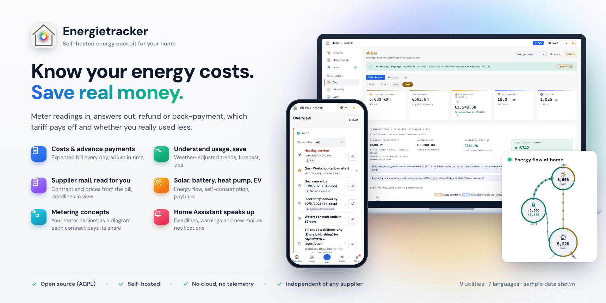

<p align="center"></p>
<p align="center"><b>English</b> · <a href="README.de.md">Deutsch</a></p>

# Energietracker

<p align="center"></p>

**Home Assistant measures — the Energietracker does the billing.** Meter
readings in, answers out: Will I get money back? Is my gas bill right? Is
switching worth it? Did I use more, or was it just colder?

**[▶ Try the live demo](https://bingerminger.github.io/energietracker/)** — a
sample household carried forward to today, in seven languages, nothing to install.

[](https://github.com/Bingerminger/energietracker/actions/workflows/ci.yml)
[](https://github.com/Bingerminger/energietracker/actions/workflows/docker-publish.yml)
[](CHANGELOG.md)
[](LICENSE)
[](composer.json)
[](composer.json)
[](tests/)
[](public/locales/)
[](docs/en/einstieg/funktionen.md)
[](docker-compose.yml)
[](https://github.com/Bingerminger/energietracker-ha)
[](https://buymeacoffee.com/bingerminger)

<p align="center"></p>

## What it answers

| Question | Answer in the app |
|---|---|
| What if …? | **Forecast workshop** *(new in v3.6.0)*: sliders for winter, insulation, room temperature and tariff — see at once what a cold winter costs or insulation brings; ranking, best combination within a budget, result as an image or PDF |
| Will I get money back? | **Balance** per contract by calendar, the expected bill and a suggested advance — "credit" or "additional payment", as on the bill |
| Is my annual bill right? | **Bill check** for gas, electricity, water and district heating: recalculated per section, held against the bill, the result booked as a special payment |
| Should I switch? | **Switch decision** with notice period, cost from year two and break-even |
| Used more, or just colder? | **Weather adjustment** with heating degree days from your own location and a heating model |
| What lies ahead? | **Forecast** with an uncertainty band and the cost per month from the valid tariff |
| How efficient is the house? | **Efficiency** in kWh/m²·yr and a certificate-style figure; with a heat pump the seasonal performance factor |
| Does my rent prepayment cover it? | **Tenancy**: heating and water against the service charge prepayment, deadlines in the calendar, CO₂ costs shared with the landlord |
| What does my supplier’s mail say? | **Inbox**: drop a PDF, have it read, check every figure against its quote and take it over; *new in v3.9.0* an annual bill also creates the contract, with prices per section and advance payments every two or three months |
| Heat pump on its own tariff, peak/off-peak, solar? | **Metering concept** *(new in v3.9.0)*: an assistant asks about the layout in the meter cabinet, draws the diagram and creates meters, registers and contracts; if a sub-meter has its own contract, the parent meter only bills the remainder |
| Do I have to open the app not to miss anything? | **Notifications to Home Assistant** *(new in v3.9.0)*: deadlines, reminders, warnings and new mail show up in Home Assistant, each only once; plus a “To do” sensor |
| Is this meter reading right? | **Check a reading** *(new in v3.9.0)*: a mistyped reading between two correct ones would otherwise silently skew the months. The app asks and never corrects on its own |

Nine utilities: gas, electricity, water, district heating, heating oil and
pellets (with a tank book), PV feed-in and PV generation (self-consumption,
self-sufficiency, storage) and heat (heat meter or monthly consumption
information). Plus meter swaps, sub-meters and groups — also with one contract
for peak and off-peak —, registers with OBIS code, people in the household
without sign-in, receipts and meter photos, reminders as a calendar
feed, recommendations, a PDF annual report and a summary for Home Assistant —
and help inside the app with a glossary and an ⓘ next to every key figure.
→ [All features](docs/en/einstieg/funktionen.md) ·
[All views with screenshots](docs/en/referenz/ansichten.md)

<p align="center"> </p>

## Who it is for

- **Households** that want to understand and foresee their annual bill — in a
  rented flat or their own house.
- **Home Assistant users**: Home Assistant pushes the readings, the
  Energietracker works out contracts, advances and forecasts —
  [guide](docs/en/anleitungen/home-assistant.md). Since 3.9.0 it reports
  deadlines, warnings and new mail back to Home Assistant by itself.
- **Tinkerers**: open REST API, CSV and JSON backup, no database.

| | Home Assistant (Energy) | Energietracker |
|---|---|---|
| Readings | automatic, real time | by hand, by CSV or from Home Assistant |
| Cost | one price per unit | a contract with unit price and standing charge, bonuses, advances, price changes to the day |
| Billing | — | balance, expected bill, bill check, notice deadlines |
| Weather | — | heating degree days from your location, weather adjustment |
| Looking ahead | — | cost forecast for the year, switch decision |

## Quick start

```bash
docker run -d --name energietracker -p 8080:80 \
  -v energietracker-data:/data \
  ghcr.io/bingerminger/energietracker:3
```

Then open <http://localhost:8080>. **"Try with sample data"** shows right away
what everything looks like; your own data is not lost.

With **Home Assistant OS**, no Docker host of your own is needed: install it as
an app with an entry in the sidebar and sign-in via Home Assistant (new since
3.5.0, repository [energietracker-ha](https://github.com/Bingerminger/energietracker-ha)):

[](https://my.home-assistant.io/redirect/supervisor_add_addon_repository/?repository_url=https%3A%2F%2Fgithub.com%2FBingerminger%2Fenergietracker-ha)

Step by step: [As an app in Home Assistant OS](docs/en/anleitungen/home-assistant.md#as-an-app-in-home-assistant-os).

Without Docker, PHP 8.2 or later is enough: `git clone`, then
`php -S 127.0.0.1:8080 router.php`. For permanent use:
[Installation](docs/en/betrieb/installation.md) ·
[Docker, also on Synology](docs/en/betrieb/docker.md) ·
[Apache and nginx](docs/en/betrieb/webserver.md) ·
[Use on your phone](docs/en/einstieg/handy.md).

> 🔐 Without sign-in, anyone who can reach the app can read and change
> everything — fine on your own home network. Before allowing access from
> outside, switch sign-in on: [Security & network operation](docs/en/betrieb/sicherheit.md).

## Your data

Everything stays on your server: no accounts, no ads, no telemetry, no
database — just JSON files. The app talks only to Open-Meteo: for the daily
weather sync (it sends your location rounded to about 1 km, and can be switched
off) and the place search, if you use it. More paths are yours to switch
on: your own text recognition service in your home network, if you set one up
(for meter photos and for reading supplier mail in the inbox),
your evcc in your home network, when you fetch its charging sessions,
your Home Assistant, when you switch on notifications to it,
wholesale electricity prices for the dynamic tariff check, when you tap
“Load from SMARD” (Federal Network Agency; nothing of yours is sent), and the
note about new versions (once a day GitHub is asked for the newest version
number; only your server’s address is visible). Reading in the inbox through a
cloud service is off until someone who manages the installation switches it on;
then documents go to the chosen service — Claude (Anthropic) at
`api.anthropic.com`, OpenAI (`api.openai.com`), Mistral (`api.mistral.ai`),
OpenRouter (`openrouter.ai`), Google Gemini (`generativelanguage.googleapis.com`)
or your own OpenAI-compatible address, which is only contacted with this opt-in.
The app contacts each of these hosts only with the opt-in: for the list of
models once the key is saved, and for reading once it is switched on. All cloud
paths are experimental. Fonts, Chart.js and PDF.js ship with the repository.

## Help and documentation

- In the app: **Help** at the bottom of the sidebar (on the iPhone under
  "More") with first steps and a glossary, plus an ⓘ next to every key figure.
- [Getting started](docs/en/einstieg/erste-schritte.md) ·
  [Questions and answers](docs/en/einstieg/faq.md) ·
  [Enter and check the annual bill](docs/en/anleitungen/jahresabrechnung.md) ·
  [Troubleshooting](docs/en/betrieb/fehlersuche.md)
- The full [compendium](docs/en/README.md): getting started · guides ·
  concepts · reference · operation · development — in English and
  [German](docs/README.md).
- Questions, wishes and bugs:
  [GitHub issues](https://github.com/Bingerminger/energietracker/issues).

## Countries and assumptions

The interface is available in German, English, French, Italian, Spanish,
Portuguese and Dutch; country profiles for Germany, Austria, Switzerland,
France, Italy, Spain, Portugal, the Netherlands and the United Kingdom set
currency, formats, time zone, weather location, heating limit, CO₂ factor and
gas units. In substance the Energietracker is at home in Germany: efficiency
classes per the GModG (formerly GEG), CO₂ factors from BAFA and the German
Environment Agency,
the special right to cancel under the EnWG. Elsewhere it calculates without
classes and says why; it does not convert currencies —
[Country profiles](docs/en/verstehen/14-laenderprofile.md).

## Status and outlook

**v3.9.0** is the current version — [CHANGELOG](CHANGELOG.en.md) (German
version: [CHANGELOG.md](CHANGELOG.md)). APIs, CSV formats and the backup format
change only additively; anything is removed only with a new major version and
after notice. 3.9.0 contains what was announced as 3.7.1 and 3.8.0: metering
concepts with heat pump, peak/off-peak and solar, where every contract pays only
for what it really measures; notifications to Home Assistant; the contract from
the annual bill, for water with advance payments every two months too; checks of
intermediate readings; one calculation for balance card, workshop and annual
report; the heating limit where it matters; people in the household without
sign-in. 3.7.0 reads your supplier mail: drop a PDF into the inbox, an AI
in your own home network (or, as an experimental opt-in, a cloud service) reads
it, backs every figure with its quote in the document, and one click takes it
over — a whole household from a stack of letters, too. Monthly values now say
whether they are measured or spread between two readings. 3.6.0 added the
billing year next to the calendar year — periods as on your recorded bills —
and the note about new versions. 3.5.0 was about who, when and where to: reminders get someone
responsible, missing supplier bills stand out, and the energy flow plays a day
in quarter hours. Home Assistant OS users can install it as an app, there is
an image without root, and the setup asks for language and country first.
Since 3.4.0 the handbook comes from your own server, with a yearly report for
everyone and a history of who did what. Since 3.3.0 the app values flexibility with
quarter-hour data, since 3.2.0 there is a setup assistant, experience levels,
several people per household and evcc. What comes
next is in the [roadmap](roadmap.md) (in German). Coming from a
private v0.9.0: since 3.4.0 no version reads its backups any more — install
3.3.0, migrate there, then update.

## Contributing

Pull requests are welcome — setup, tests and the documentation rules are in
[CONTRIBUTING.md](CONTRIBUTING.md). A new language is mostly translation — a
catalogue, an entry in `languages.json` and its notation under `format.*` — plus
a few lines of code for the plural rule and the country assignment; the
checklist is in [Translating and languages](docs/en/entwicklung/uebersetzen.md).
Please do not report security issues publicly, but as described in
[SECURITY.md](SECURITY.md).

## Support

The Energietracker is independent: no company behind it, no advertising, no
cloud account, no data collection. If it saves you money or time and you want
to give something back, you can
[buy me a coffee](https://buymeacoffee.com/bingerminger) — entirely voluntary.
Stars, bug reports and telling others about it help just as much.

## Licence

Since version 3.0.0 the Energietracker is under the
[GNU AGPL v3.0 or later](LICENSE). In plain words:

- **At home it is yours:** use it for free, change it, pass it on — no
  conditions, no account, no fee.
- **Only one rule:** whoever offers a *modified* version to others as a web
  service also gives them its source code. That keeps the app free and open
  for everyone.
- **Nothing hidden:** under Settings → System a link leads to the source code
  of exactly the running version.

Versions up to 2.16.0 remain available under the MIT licence they were
published with.

It ships [Chart.js](https://www.chartjs.org/) (MIT), [PDF.js](https://mozilla.github.io/pdf.js/)
(Apache-2.0) and the fonts DM Sans and DM Mono (SIL Open Font License 1.1);
weather data comes from
[Open-Meteo.com](https://open-meteo.com/) under
[CC BY 4.0](https://creativecommons.org/licenses/by/4.0/) — details in
[CREDITS.md](CREDITS.md), product names in [TRADEMARKS.md](TRADEMARKS.md).
