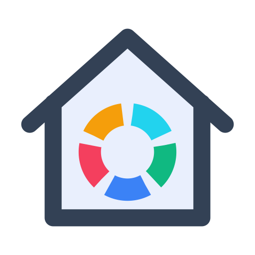
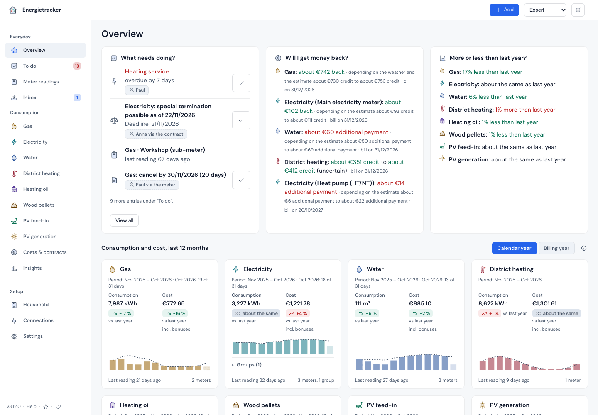
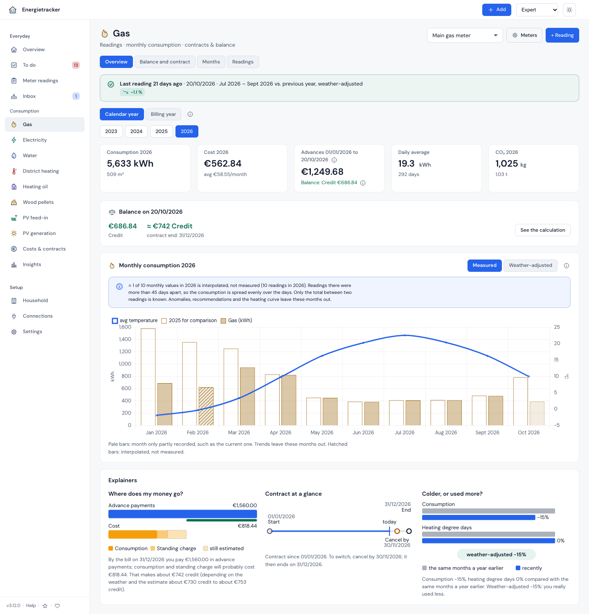
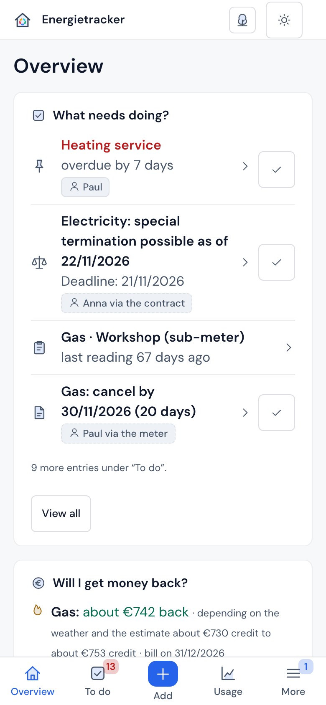

<p align="center"></p>
<h1 align="center">Energietracker</h1>
<p align="center"><b>English</b> · <a href="README.de.md">Deutsch</a></p>

<p align="center"><b>Home Assistant measures, Energietracker settles the bill.</b><br>
Meter readings in, answers out: Will I get money back? Is the bill right? Is switching worth it?<br>
Self-hosted, no account and no database. And, if you like, with your own AI in your home network.</p>

<p align="center">
  <a href="https://bingerminger.github.io/energietracker/"><b>Demo</b></a> ·
  <a href="docs/en/README.md"><b>Help</b></a> ·
  <a href="roadmap.en.md"><b>Roadmap</b></a> ·
  <a href="https://github.com/Bingerminger/energietracker/discussions"><b>Discussions</b></a>
</p>

<p align="center">
  <a href="CHANGELOG.en.md"></a>
  <a href="https://github.com/Bingerminger/energietracker/actions/workflows/ci.yml"></a>
  <a href="LICENSE"></a>
  <a href="docs/en/betrieb/docker.md"></a>
  <a href="https://bingerminger.github.io/energietracker/"></a>
</p>

<p align="center"><picture><source media="(prefers-color-scheme: dark)" srcset="docs/assets/promo/screens/uebersicht-dunkel.en.png"></picture></p>

## At a glance

<!-- doc-claim: readme-auf-einen-blick (ReadmeClaimsTest) -->
| | What you get |
|:---:|---|
|  | **Ask your AI how electricity and gas are doing.** Over MCP it looks up balance, consumption, contracts and deadlines with 20 tools and says where every figure comes from. It changes nothing without you: by default you confirm every proposal in the app. Off by default, tested with Open WebUI and a local model through Ollama, other programs and cloud AI experimental. [Guide](docs/en/anleitungen/ki-assistent.md) |
|  | **Your rights as a customer, with a source.** Seven checks under German law: late bill, advance payment too high, special termination after a price increase, missing bonus and more. The matching letter comes as text and PDF, in German. A note, not legal advice. [Rights](docs/en/verstehen/17-rechte.md) |
|  | **File supplier mail instead of typing it.** Drop the PDF into the inbox, an AI in your home network reads it, every figure shows its place in the document. One click takes it over, even a whole household from a stack of letters. [Inbox](docs/en/anleitungen/posteingang.md) |
|  | **Will I get money back?** Balance per contract: measured up to the last reading, estimated up to today, expected at the bill, with an honest range. As on the bill: “credit” or “additional payment”. [Balance](docs/en/verstehen/00-overview.md#balance-in-one-piece-since-v3100) |
|  | **What does a cold winter cost?** The forecast workshop runs winter, insulation, room temperature and tariff through your own data, with a ranking and the result as a PDF. [What if](docs/en/anleitungen/was-waere-wenn.md) |
|  | **Save where it can be shown.** Set the advance payment right, check a switch with notice period and break-even point, recalculate the annual bill section by section. No made-up savings: you see your own figures. [Annual bill](docs/en/anleitungen/jahresabrechnung.md) |
|  | **Home Assistant measures, Energietracker settles the bill.** Readings come from Home Assistant, deadlines and new mail go back as notifications. As an app for Home Assistant OS, sensors through the HACS integration without YAML. [Home Assistant](docs/en/anleitungen/home-assistant.md) |
|  | **Your data stays with you.** No accounts, no ads, no telemetry, no database, just files on your server. By default only the weather sync goes out, and it can be switched off; everything else you switch on yourself. [Your data](#your-data) |

**Nine utilities:** gas, electricity, water, district heating, heating oil, pellets, PV feed-in, PV generation
and heat. **In seven languages:** German, English, French, Italian, Spanish, Portuguese and Dutch. Plus meter
swaps, sub-meters, metering concepts with heat pump and peak/off-peak, weather adjustment with degree days,
tenancy and in-app help with a glossary and an ⓘ next to technical terms.
→ [All features](docs/en/einstieg/funktionen.md) · [All views with pictures](docs/en/referenz/ansichten.md)

<p align="center"> </p>

## Quick start

```bash
docker run -d --name energietracker --restart unless-stopped -p 8080:80 \
  -v energietracker-data:/data \
  ghcr.io/bingerminger/energietracker:3
```

Then open <http://localhost:8080>. **“Try with sample data”** shows right away what everything looks like;
your own data is not lost.

- **Home Assistant OS:** install it as an app, with an entry in the sidebar and sign-in through Home
  Assistant ([step by step](docs/en/anleitungen/home-assistant.md#as-an-app-in-home-assistant-os)).

  [](https://my.home-assistant.io/redirect/supervisor_add_addon_repository/?repository_url=https%3A%2F%2Fgithub.com%2FBingerminger%2Fenergietracker-ha)
- **Sensors in Home Assistant without YAML:** the integration through HACS,
  [energietracker-hacs](https://github.com/Bingerminger/energietracker-hacs).
- **Without Docker,** PHP 8.2 or later is enough: `git clone`, then `php -S 127.0.0.1:8080 router.php`.
- **For permanent use:** [Installation](docs/en/betrieb/installation.md) ·
  [Docker, also on Synology](docs/en/betrieb/docker.md) · [Apache and nginx](docs/en/betrieb/webserver.md) ·
  [Use on your phone](docs/en/einstieg/handy.md).

> [!WARNING]
> **Without sign-in, anyone who can reach the app can read and change everything.** On your own home network
> that is fine. Before allowing access from outside, switch sign-in on:
> [Security & network operation](docs/en/betrieb/sicherheit.md).

## Who it is for

| | Home Assistant (Energy) | Energietracker |
|---|---|---|
| Meter readings | automatic, real time | by hand, by CSV, from supplier mail or from Home Assistant |
| Costs | one price per unit | contract with energy and standing charge, bonuses, advance payments, price changes to the day |
| Billing | — | balance, expected bill, bill check, notice periods, your rights as a customer |
| Weather | — | degree days from your location, weather adjustment |
| Outlook | — | cost forecast for the year, switching decision, what if |

- **Households,** rented or owned, who want to understand and foresee their annual bill.
- **Home Assistant users:** Home Assistant measures, Energietracker works out contracts, advance payments and
  forecasts.
- **AI users:** an AI in your home network that looks things up instead of guessing, and changes nothing
  without you.
- **Tinkerers:** open REST API, CSV and JSON backup, no database.

## Your data

**Everything stays on your server:** no accounts, no ads, no telemetry, no database, just JSON files. The app
talks only to Open-Meteo: for the daily weather sync (it sends your location rounded to about 1 km, and can be
switched off) and the place search, if you use it.

**Paths you switch on yourself:**

- your own text recognition service in your home network, if you set one up (for meter photos and for reading
  supplier mail in the inbox);
- your evcc in your home network, when you fetch its charging sessions;
- your Home Assistant, when you switch on notifications to it;
- wholesale electricity prices for the dynamic tariff check, when you tap “Load from SMARD” (Federal Network
  Agency; nothing of yours is sent);
- the note about new versions (once a day GitHub is asked for the newest version number; only your server’s
  address is visible).

**Reading in the cloud is off** until someone who manages the installation switches it on. Then documents go to
the chosen service: Claude (Anthropic) at `api.anthropic.com`, OpenAI (`api.openai.com`),
Mistral (`api.mistral.ai`), OpenRouter (`openrouter.ai`), Google Gemini (`generativelanguage.googleapis.com`) or your
own OpenAI-compatible address, which is only contacted with this opt-in. The app contacts each of these hosts
only with the opt-in: for the list of models once the key is saved, and for reading once it is switched on.
All cloud paths are experimental. The AI interface (MCP) is off by default and only accepts requests with a key
of its own. Fonts, Chart.js and PDF.js ship with the repository.

## Help and community

- **In the app:** Help at the bottom of the sidebar (on the iPhone under “More”) with the guide, first steps
  and a glossary, plus an ⓘ next to technical terms.
- **Handbook:** [Getting started](docs/en/einstieg/erste-schritte.md) ·
  [Questions and answers](docs/en/einstieg/faq.md) ·
  [Enter and check the annual bill](docs/en/anleitungen/jahresabrechnung.md) ·
  [Troubleshooting](docs/en/betrieb/fehlersuche.md) · the full [compendium](docs/en/README.md), also in
  [German](docs/README.md).
- **Questions and ideas:** [Discussions](https://github.com/Bingerminger/energietracker/discussions), ideas
  with voting under [Ideas](https://github.com/Bingerminger/energietracker/discussions/categories/ideas).
- **Bugs:** [Issues](https://github.com/Bingerminger/energietracker/issues).
  Please report security issues confidentially, as described in [SECURITY.md](SECURITY.md).
- **What comes next:** [Roadmap](roadmap.en.md).

## Countries and assumptions

Country profiles for Germany, Austria, Switzerland, France, Italy, Spain, Portugal, the Netherlands and the
United Kingdom set currency, formats, time zone, weather location, heating limit, CO₂ factor and gas units.
**In substance Energietracker is at home in Germany:** efficiency classes per the GModG (formerly GEG), CO₂
factors from BAFA and the German Environment Agency, the special right to cancel under the EnWG, the rights
checks under German law. Elsewhere it calculates without classes and says why; it does not convert currencies.
[Country profiles](docs/en/verstehen/14-laenderprofile.md)

## Status

**v3.12.0** is the current version; what changed is in the [CHANGELOG](CHANGELOG.en.md) (German version:
[CHANGELOG.md](CHANGELOG.md)). **APIs, CSV formats and the backup format change only additively;** anything is
removed only with a new major version and after notice. What comes next is in the [roadmap](roadmap.en.md).
Coming from a private v0.9.0: since 3.4.0 no version reads its backups any more; install 3.3.0, migrate there,
then update.

## Contributing

**Pull requests are welcome.** Setup, tests and the documentation rules are in [CONTRIBUTING.md](CONTRIBUTING.md),
and the [code of conduct](CODE_OF_CONDUCT.md) applies to everyone. A new language is mostly translation: a
catalogue, an entry in `languages.json` and its notation under `format.*`, plus a few lines of code for the
plural rule and the country assignment ([Translating and languages](docs/en/entwicklung/uebersetzen.md)).

## Support

Energietracker is independent: no company behind it, no advertising, no cloud account, no data collection. If
it saves you money or time and you want to give something back, you can
[buy me a coffee](https://buymeacoffee.com/bingerminger), entirely voluntary. **A star on GitHub, bug reports
and telling others about it help just as much.** You reach both from the app too, at the bottom of the sidebar.

## Licence

Since version 3.0.0 Energietracker is under the [GNU AGPL v3.0 or later](LICENSE). In plain words:

- **At home it is yours:** use it for free, change it, pass it on, with no conditions, no account, no fee.
- **Only one rule:** whoever offers a *modified* version to others as a web service also gives them its source
  code. That keeps the app free and open for everyone.
- **Nothing hidden:** under Settings → System a link leads to the source code of exactly the running version.

Versions up to 2.16.0 remain available under the MIT licence they were published with.

It ships [Chart.js](https://www.chartjs.org/) (MIT), [PDF.js](https://mozilla.github.io/pdf.js/) (Apache-2.0)
and the fonts DM Sans and DM Mono (SIL Open Font License 1.1); weather data comes from
[Open-Meteo.com](https://open-meteo.com/) under [CC BY 4.0](https://creativecommons.org/licenses/by/4.0/).
Details in [CREDITS.md](CREDITS.md), product names in [TRADEMARKS.md](TRADEMARKS.md).
