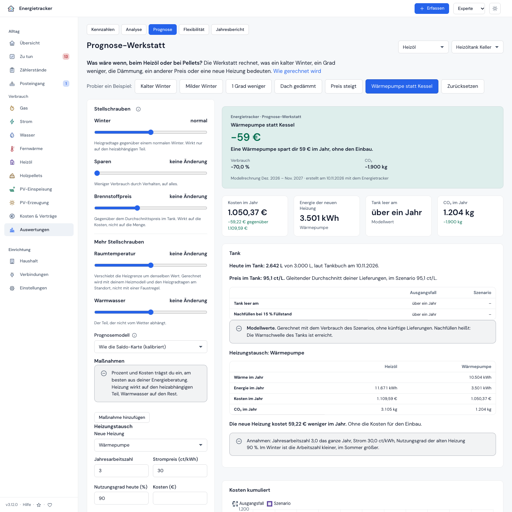
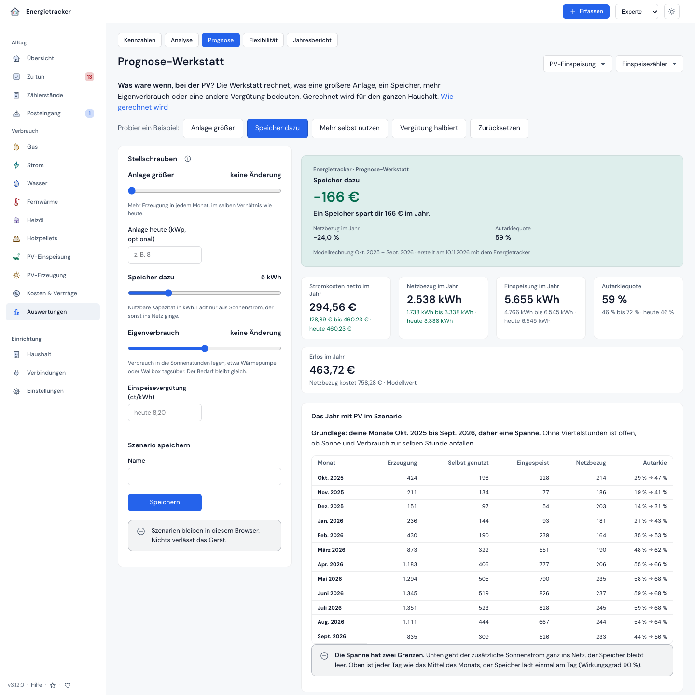

# Was wäre wenn? Die Prognose-Werkstatt

**Deutsch** · [English](../en/anleitungen/was-waere-wenn.md)

[← Kompendium-Index](../README.md)

Was kostet ein kalter Winter? Was bringt die Dämmung? Lohnt der Wechsel zum
günstigeren Angebot? Seit **v3.6.0** beantwortet die **Prognose-Werkstatt**
solche Fragen mit deinen eigenen Zahlen: Regler bewegen, Ergebnis sofort
sehen — als eine große Zahl, als Kurve und als Rangliste „Was bringt am
meisten?“. Gerechnet wird auf deinem Server, mit deinem Heizmodell, deinen
Verträgen und deiner Abrechnungsperiode. Nichts verlässt dein Gerät, bis du
selbst ein Bild oder eine PDF weitergibst.

> **In einer Minute:** Auswertungen → **Prognose** öffnen (auch in der Stufe
> Einsteiger), oben **„Kalter Winter“** anklicken. Die Karte sagt dir, was ein
> Winter, wie ihn etwa jedes zehnte Jahr bringt, mehr kostet. Dann den Regler
> **„Sparen“** auf 10 % ziehen und zusehen, wie die Zahl kippt.

---

## 1. Was du brauchst

- Mindestens **sechs Monate Verbrauch** eines Zählers mit Zählerständen und
  einem Vertrag — Gas, Strom, Wasser oder Fernwärme.
- Seit **v3.12.0** auch **Heizöl und Pellets**: ein Tank mit Lieferungen, aus
  denen die App sechs Monate Verbrauch verteilen kann (§ 6a).
- Seit **v3.12.0** auch die **PV**: zwölf volle Monate mit Erzeugung,
  Einspeisung und Netzbezug, oder ein volles Jahr Viertelstunden (§ 6b).
- Für **Winter, Raumtemperatur und Dämmung** ein Heizmodell: Gas oder
  Fernwärme mit Temperaturen (Wetterabgleich), bei Heizöl und Pellets das
  Tankbuch. Mit [Klimanormal](../verstehen/09-glossar.md) sind die
  Heizgradtage die von 30 Jahren am Standort.
- Für **Tarifwechsel** eingetragene Angebote (Wechsel prüfen → Angebot
  eintragen) oder einen eigenen Preis.

## 2. Die Stellschrauben

| Regler | Was er bewegt | ab Stufe |
|---|---|---|
| **Winter** (± % Heizgradtage) | nur den heizabhängigen Teil, proportional | Einsteiger |
| **Sparen** (%) | den ganzen Verbrauch — Verhalten | Einsteiger |
| **Tarif** | laufender Vertrag, ein Angebot, das günstigste Angebot, ab Erfahren ein eigener Arbeits- und Grundpreis | Einsteiger |
| **Raumtemperatur** (± °C) | die Heizgrenze um denselben Wert (§ 6) | Erfahren |
| **Grundlast** (± %) | Warmwasser, Kochen, Geräte — den Teil ohne Wetterbezug | Erfahren |
| **Maßnahmen** | je Maßnahme % auf den Heizanteil, % auf die Grundlast, Kosten | Erfahren |
| **Prognosemodell** | witterungsbereinigt (die Prognose), wie im Vorjahr, Trend | Erfahren |
| **Heizkurve** | das Regressionsmodell der Prognose (linear, robust …), nur wo ein Heizmodell wirkt (Gas, Fernwärme) | Experte |
| **E-Auto** | Strom: km im Jahr × kWh/100 km, gleichmäßig auf die Tage | Erfahren (seit v3.7.0, bis v3.6 Experte) |
| **Wärmepumpe (JAZ)** | Strom eines Zählers mit der Rolle Wärmepumpe: Menge × JAZ heute ÷ JAZ im Szenario | Erfahren (seit v3.7.0, bis v3.6 Experte) |
| **Budget** | sucht die beste Kombination der Maßnahmen (§ 7) | Experte |
| **Brennstoffpreis** (± %) | Heizöl, Pellets: der Preis je Liter bzw. kg gegenüber dem Durchschnitt im Tank | Einsteiger (seit v3.12.0) |
| **Heizungstausch** | Heizöl, Pellets: dieselbe Wärme mit einer Wärmepumpe oder einer Pelletheizung (§ 6a) | Erfahren (seit v3.12.0) |
| **Anlage größer** (%) | PV: mehr Erzeugung in jedem Monat, im selben Verhältnis | Einsteiger (seit v3.12.0) |
| **Speicher dazu** (kWh) | PV: lädt aus Sonnenstrom, der sonst ins Netz ginge | Einsteiger (seit v3.12.0) |
| **Eigenverbrauch** (± %) | PV: Verbrauch wandert in die Sonnenstunden, etwa Wärmepumpe oder Wallbox | Einsteiger (seit v3.12.0) |
| **Einspeisevergütung** (ct/kWh) | PV: statt der Vergütung deines Vertrags | Einsteiger (seit v3.12.0) |

Die Prozente einer Maßnahme trägst du selbst ein, am besten aus deiner
Energieberatung oder dem Angebot des Handwerkers. Die Werkstatt gibt bewusst
keine „typischen“ Werte vor — die hängen vom Haus ab.

## 3. Was du siehst

- **Ergebniskarte:** eine Aussage, eine große Zahl — „Ein kalter Winter kostet
  dich 214 € mehr im Jahr.“ Dazu Verbrauch, CO₂ und der empfohlene Abschlag.
- **Kennzahlen:** Kosten im Jahr (gegen den Ausgangsfall), Verbrauch im Jahr,
  empfohlener Abschlag; ab Erfahren Saldo zur nächsten Abrechnung und CO₂.
- **Kosten kumuliert:** Ausgangsfall gestrichelt, Szenario farbig — wo sich
  die Linien trennen, wirkt die Änderung.
- **Monat für Monat** (ab Erfahren): Verbrauch je Monat, beim Experten mit
  Unsicherheitsband.
- **Was bringt am meisten?** (ab Erfahren): jede Stellschraube allein gegen
  den Ausgangsfall (normaler Winter, laufender Vertrag), Ersparnis im ersten
  Jahr und — wo du Kosten eingetragen hast — die Amortisation.
- **Prognosemodelle im Vergleich** (Experte): dieselbe Frage mit drei
  Modellen; liegen sie weit auseinander, ist die Antwort unsicher.

Unter der Werkstatt steht aufklappbar die **Prognose im Detail** wie bisher:
Verlauf mit Band, Monatstabelle mit Kosten, Abschlag, Saldo und Methode.

## 4. Beispielszenarien und Maßnahmen je Art

Wasser ist keine Fernwärme und Strom kein Gas. **Jede Art bekommt ihre eigenen
Beispiele, Maßnahmen und Worte.** Gerechnet wird dabei mit derselben Rechnung.

| Gruppe | Arten | Beispiele | Maßnahmen |
|---|---|---|---|
| **Wärme aus Brennstoff** | Gas | Kalter Winter, Milder Winter, 1 Grad weniger, Dach gedämmt, Fenster getauscht, Günstigstes Angebot | Dach, Fassade, Fenster, Kellerdecke, Hydraulischer Abgleich, Heizungspumpe, Thermostate, Warmwasser sparen, Andere |
| **Wärme aus dem Netz** | Fernwärme | Kalter Winter, Milder Winter, 1 Grad weniger, Dach gedämmt, Preis steigt, Günstigstes Angebot | wie Gas, ohne Heizungspumpe |
| **Strom im Haushalt** | Strom, Rolle Haushalt | Grundlast senken, E-Auto, Günstigstes Angebot, 10 % sparen | Geräte tauschen, Standby vermeiden, Beleuchtung tauschen, Warmwasser sparen, Andere |
| **Strom der Wärmepumpe** | Strom, Rolle Wärmepumpe | Bessere Arbeitszahl, Günstigstes Angebot, 10 % sparen | Hydraulischer Abgleich, Dach, Fassade, Fenster, Andere |
| **Strom der Wallbox** | Strom, Rolle Wallbox | E-Auto, Günstigstes Angebot, 10 % sparen | Andere |
| **Wasser** | Wasser | Sparbrause, Spülkasten, 10 % sparen | Sparbrause, Spülkasten, Waschmaschine und Geschirr, Garten, Leck beheben, Andere |
| **Wärme aus Lieferungen** (seit v3.12.0) | Heizöl, Pellets | Kalter Winter, Milder Winter, 1 Grad weniger, Dach gedämmt, Preis steigt, Wärmepumpe statt Kessel | wie Gas |
| **PV** (seit v3.12.0) | PV-Einspeisung, PV-Erzeugung | Anlage größer, Speicher dazu, Mehr selbst nutzen, Vergütung halbiert | keine |

**Alle Zahlen eines Beispiels sind angenommene Beispielwerte, keine Richtwerte
und kein Sparversprechen.** Die Werkstatt sagt das unter dem Ergebnis dazu. Trag
deine eigenen Werte ein, am besten aus einer Energieberatung oder vom Fahrzeug.

| Beispiel | Was es setzt |
|---|---|
| **Kalter Winter**, **Milder Winter** | Heizgradtage wie etwa in jedem zehnten Winter (aus der Streuung im Klimanormal), ohne Klimanormal 10 % als Annahme |
| **1 Grad weniger** | Raumtemperatur −1 °C, gerechnet mit deinem Heizmodell |
| **Dach gedämmt**, **Fenster getauscht** | eine Maßnahme mit 15 % bzw. 10 % weniger Heizwärme |
| **Preis steigt** | dein Arbeits- und Grundpreis, 10 % höher, als eigener Preis |
| **Günstigstes Angebot** | das günstigste deiner Angebote, Bonus nicht eingerechnet |
| **Grundlast senken** | Grundlast −5 % |
| **E-Auto** | 10.000 km im Jahr mit 18 kWh je 100 km, kostet mehr Strom |
| **Bessere Arbeitszahl** | Jahresarbeitszahl von 3 auf 3,5 |
| **Sparbrause**, **Spülkasten** | eine Maßnahme mit 10 % bzw. 5 % weniger Wasser |
| **10 % sparen** | zehn Prozent weniger Verbrauch durch Verhalten |
| **Preis steigt** (Heizöl, Pellets) | 10 % mehr je Liter bzw. kg |
| **Wärmepumpe statt Kessel** | Jahresarbeitszahl 3, Strom 30 ct/kWh, Nutzungsgrad des Kessels 90 % |
| **Anlage größer** | 50 % mehr Leistung |
| **Speicher dazu** | 5 kWh nutzbare Kapazität |
| **Mehr selbst nutzen** | 10 % mehr Eigenverbrauch |
| **Vergütung halbiert** | die Hälfte deiner heutigen Einspeisevergütung |

**Ein Beispiel erscheint nur, wenn es etwas bewirken kann:**

- **Ohne Heizmodell kein Winter und keine Dämmung.** Bei Gas und Fernwärme sagt das
  ein Hinweis, „10 % sparen“ bleibt.
- **Beim Strom gibt es kein Heizmodell, auch nicht bei der Wärmepumpe.** Darum dort
  weder Winter noch Raumtemperatur. Die Prozente einer Maßnahme wirken auf den ganzen
  Strom des Zählers, und Grundlast und Sparen rechnen gleich.
- **Ohne eingetragenes Angebot kein Wechsel.** „Preis steigt“ braucht einen Preis.
- **Beim Wasser gibt es keinen Tarif zur Wahl:** Du wechselst dort nicht den
  Anbieter, die Werkstatt rechnet mit dem laufenden Vertrag.

**Gespeicherte Szenarien rechnen gleich weiter.** Eine Maßnahme, die nicht mehr zur
Art passt, etwa „Dach“ an einem Stromzähler, bleibt mit ihren Werten sichtbar und
ist markiert. Der Sprung `#/forecast?preset=…` funktioniert weiter.

**Heizöl, Pellets und PV rechnet die Werkstatt seit v3.12.0** (§ 6a, § 6b). Ohne
Werkstatt bleibt nur die Heizwärme; die Seite sagt das, die Prognose im Detail
steht dort weiter zur Verfügung.

In der öffentlichen Demo sind Ausgangsfall und Beispiele vorgerechnet, ein Klick
zeigt sofort ein Ergebnis.

## 5. Speichern, vergleichen, teilen

- **Speichern:** Namen eingeben, „Speichern“. Szenarien liegen **im Browser
  dieses Geräts** (höchstens 20); ein anderes Gerät sieht sie nicht.
- **Vergleichen:** rechnet alle gespeicherten Szenarien neu und stellt Kosten,
  Differenz, Verbrauch und CO₂ nebeneinander.
- **Ergebnis als Bild speichern:** die Karte als PNG (1200 × 630, das Format
  von Vorschaubildern) — gezeichnet im Browser, ohne Dienst nach außen.
- **Drucken oder als PDF:** die Druckansicht mit Annahmen, Ausgangsfall gegen
  Szenario, Kurven, Monatstabelle und Rangliste, sauber auf A4. Über den
  Druckdialog des Browsers wird daraus eine PDF.
- **Monatswerte als CSV** (Experte): Menge, Kosten und kumulierte Kosten je
  Monat für Ausgangsfall und Szenario.

## 6. Wie gerechnet wird

**Eine Quelle.** Der Ausgangsfall ist die Prognose der nächsten zwölf Monate
mit allen ihren Regeln: Klimanormal, Heizmodell, Analyse-Zäsur, Verträge
tagesgenau, Abschläge nach Plan. Die Menge je Monat schätzt er seit v3.10.0
wie die Saldo-Karte (je Tag, mit dem Kalibrierfaktor der Karte); Werkstatt und
Saldo-Verlauf zeigen so dieselben Monatskosten. Bis v3.9 nahm er die
Monatsmengen der Prognose, bei schlecht passendem Heizmodell rund ein Zehntel
daneben ([Grundlagen §10](../verstehen/00-overview.md#saldo-aus-einem-guss-seit-v3100)).
Deshalb heißt die Zeile des Ausgangsfalls „Wie die Saldo-Karte (kalibriert)“.
Die Tabelle „Prognose im Detail“ auf derselben Seite zeigt weiter die Prognose
ohne Kalibrierfaktor; liegen beide mindestens 2 % auseinander, sagt ein Satz
darunter, um wie viel.
Die Werkstatt ändert nur Mengen — und beim Tarif Preise. Die Kosten eines Monats
sind in der Prognose eine lineare Funktion der Menge (Arbeitspreis × Menge +
Grundpreis − Boni); genau diese Funktion bewertet auch die Szenario-Mengen.
Ohne Änderung kommt deshalb auf den Cent der Ausgangsfall heraus.

**Heizanteil.** Das Heizmodell beschreibt den Verbrauch als a × Heizgradtage
+ c × Tage. Der heizabhängige Teil eines Monats ist a × HGT; nur er reagiert
auf Winter, Raumtemperatur und Dämmung. Sommermonate ohne Heizgradtage
ändern sich dadurch nicht.

**Raumtemperatur.** Ein Grad weniger im Raum senkt die Heizgrenze um ein Grad.
Die Werkstatt nimmt die Heizgradtage bei der verschobenen Grenze aus dem
Klimanormal (sonst aus deiner Temperaturhistorie) und multipliziert die
Differenz mit a — dein eigenes Modell, keine Faustregel; dieselbe Überlegung
wie beim Temperaturversatz der Prognose seit v2.8.0.

**Maßnahmen wirken nacheinander.** Zweimal 30 % weniger Heizwärme ergibt
0,7 × 0,7 = 49 % weniger, nicht 60 %. Die Rangliste rechnet jede Maßnahme
allein, die Kombination rechnet sie zusammen.

**Tarif.** Ein Angebot wird mit derselben Preisregel wie in der
[Wechselentscheidung](../referenz/ansichten.md#wechselentscheidung) gerechnet:
Arbeitspreis × Menge + Grundpreis je Monat, Bonus nicht eingerechnet. Beim
Wasser (drei Preisbestandteile) bleibt der laufende Vertrag.

**Modelle.** *Witterungsbereinigt* ist die Prognose. *Wie im Vorjahr* nimmt
die gemessenen Monate ein Jahr früher (Tagesrate × Tage); fehlt ein Monat,
füllt ihn die Prognose, und die Werkstatt sagt, wie viele. *Trend* schreibt
das Vorjahr mit der Veränderung zum Jahr davor fort, höchstens ± 25 % — und
nur mit zwei vollen Jahren Messung. Das Unsicherheitsband gehört zum
Prognosemodell.

**Abschlag.** Mit laufender Abrechnungsperiode (F1030) wie der Vorschlag im
Vertragsstatus: heutiger Abschlag + erwarteter Endsaldo ÷ verbleibende
Monate. Sonst ein Zwölftel der Jahreskosten, aufgerundet.

**Saldo zur nächsten Abrechnung.** Der bisher gemessene Saldo der laufenden
Abrechnungsperiode plus die Prognosemonate bis zu ihrem Ende (Kosten −
Abschlag), der letzte Monat anteilig.

**CO₂.** Verbrauch × der Faktor, mit dem die Verbrauchsansicht der letzten
zwölf Monate gerechnet hat.

## 6a. Heizöl und Pellets (seit v3.12.0)

**Ausgangsfall ist die Prognose des Tanks, unverändert.** Die Menge je Monat
kommt aus der Prognose, die Kosten aus dem gleitenden Durchschnittspreis im
Tank. Abschlag und Abrechnung gibt es bei Lieferungen nicht.



- **Heizanteil aus dem Tankbuch.** Die App verteilt Lieferungen mit
  „je Heizgradtag × HGT + je Tag × Tage“ auf die Tage. Der Heizanteil eines
  Monats ist der erste Teil durch die Summe. Winter, Raumtemperatur, Dämmung
  und Warmwasser rechnen damit wie beim Gas.
- **Brennstoffpreis ± %:** Kosten = Menge × Preis × (1 + %). Die Menge bleibt.
- **Tank leer am, nachfüllen ab:** Vom Bestand heute Tag für Tag mit der Menge
  des Szenarios. Nachfüllen heißt, die Warnschwelle des Tanks ist erreicht
  (Einstellung `tank_warn_pct`). Künftige Lieferungen kennt die Rechnung nicht.
- **Heizungstausch: eine zweite Rechnung über dieselbe Wärme.** Wärme =
  Brennstoff × Nutzungsgrad des alten Kessels. Eine Wärmepumpe braucht Wärme ÷
  Jahresarbeitszahl an Strom, eine Pelletheizung Wärme ÷ ihren Nutzungsgrad an
  Pellets. Die Arbeitszahl gilt das ganze Jahr; im Winter ist sie in
  Wirklichkeit kleiner, im Sommer größer. Leere Felder rechnen mit genannten
  Beispielwerten, keinen Richtwerten. Die Kosten für den Einbau sind nicht
  eingerechnet, mit eingetragenen Kosten nennt die Werkstatt die Amortisation.

<!-- doc-claim: werkstatt-heat-pump-example (ScenarioDeliveryTest) -->
```text
Heizöl im Jahr   1.000 kWh
Wärme            1.000 kWh × 0,9 = 900 kWh
Strom            900 kWh ÷ 3 = 300 kWh
Kosten           300 kWh × 30 ct = 90,00 €
```

## 6b. PV (seit v3.12.0)

**Ein Modell des ganzen Haushalts über Erzeugung, Einspeisung und Netzbezug.**
Grundlage ist ein gemessenes Jahr, kein Wetter-Modell. Prognose und Saldo
ändern sich dadurch nicht.



- **Mit Viertelstunden ein Wert.** Gibt es ein volles Kalenderjahr
  Viertelstunden für Erzeugung, Einspeisung und Netzbezug, rechnet die Werkstatt
  jede Viertelstunde nach.
- **Ohne Viertelstunden eine Spanne.** Dann ist offen, ob Sonne und Verbrauch
  zur selben Stunde anfallen. **Untere Grenze:** Der zusätzliche Sonnenstrom
  geht ganz ins Netz, der Speicher bleibt leer. **Obere Grenze:** Jeder Tag ist
  wie das Mittel des Monats, der Speicher lädt einmal am Tag. Die Zahlen nennen
  die Mitte.
- **Anlage größer:** Mehr Sonne deckt erst den Netzbezug, der Rest geht ins
  Netz. Je Monat höchstens die Mehrerzeugung, der Netzbezug und
  „% × selbst genutzt“.
- **Eigenverbrauch ± %:** Verbrauch wandert innerhalb des Tages in die Sonne.
  Der Bedarf bleibt gleich, höchstens Einspeisung und Netzbezug wandern.
- **Speicher dazu:** lädt nur aus Sonnenstrom, der sonst ins Netz ginge, und
  nie über seine Kapazität. Wirkungsgrad 90 % (genannte Annahme), mit
  Viertelstunden dazu eine Leistung von halber Kapazität je Stunde. Ein
  vorhandener Speicher arbeitet wie gemessen.
- **Kosten und Erlös:** Netzbezug × Arbeitspreis des Stroms je Monat,
  Einspeisung × Vergütung. Der Grundpreis ändert sich nicht und fehlt.
  Autarkie wie in der PV-Übersicht.

<!-- doc-claim: werkstatt-pv-month-example (ScenarioPvTest) -->
```text
Ein Monat mit 30 Tagen: Erzeugung 500 kWh, Einspeisung 300 kWh, Netzbezug 200 kWh
Anlage + 50 %:  untere Grenze Einspeisung 550 kWh, Netzbezug 200 kWh
                obere Grenze  Einspeisung 450 kWh, Netzbezug 100 kWh
Speicher 5 kWh: obere Grenze  geladen 150 kWh, entladen 135 kWh,
                              Einspeisung 150 kWh, Netzbezug 65 kWh
```

## 7. Die beste Kombination unter einem Budget

Trag ein **Budget** ein und bei den Maßnahmen die **Kosten**. Die Werkstatt
rechnet dann **jede Kombination**, die ins Budget passt, mit dem echten Modell
— Wechselwirkungen eingeschlossen — und nennt die mit der größten Ersparnis
im Jahr (bei Gleichstand die billigere). Bei höchstens zehn Maßnahmen sind
das höchstens 1 024 Kombinationen; das Ergebnis ist exakt.

Daneben löst ein kleiner **Simplex-Löser** die lineare Relaxierung: Er darf
Maßnahmen auch anteilig nehmen und rechnet mit den Einzelersparnissen. Das
ergibt eine **obere Schranke** und den **Schattenpreis des Budgets** — was ein
weiterer Euro Budget dort im Jahr bringen würde. „Auswahl übernehmen“ setzt
die gefundenen Maßnahmen ins Szenario.

## 8. Grenzen

- Ein Szenario ist eine **Modellrechnung, keine Messung**. Die Werkstatt
  sagt dazu, bis wann gemessen wurde und wie groß der Heizanteil ist.
- Die Werkstatt rechnet für Gas, Strom, Wasser und Fernwärme mit
  Zählerständen und Vertrag, seit v3.12.0 auch für Heizöl, Pellets und die PV;
  die Heizwärme nicht.
- Die PV rechnet mit einem gemessenen Jahr. Ein anderes Wetter, das Altern der
  Module und die Verschattung kennt sie nicht.
- Dynamische Tarife (Börsenpreis je Monat) bietet sie nicht als Angebot an —
  die rechnet [Wechsel prüfen](../referenz/ansichten.md#wechselentscheidung).
- Lastverschiebung gegen Viertelstundenpreise rechnet sie nicht; was das
  Verschieben gebracht hat, zeigt [Flexibilität bewerten](flexibilitaet.md).
- Maßnahmen-Prozente und Kosten sind deine Eingaben.

## 9. Für Entwickler

Die Werkstatt ruft `POST /api/forecast/scenario` auf — eine Route, die nur
rechnet und nichts schreibt (auch mit einem Lese-Schlüssel erlaubt). Felder,
Grenzen und Antwort: [API-Referenz](../referenz/api.md).
