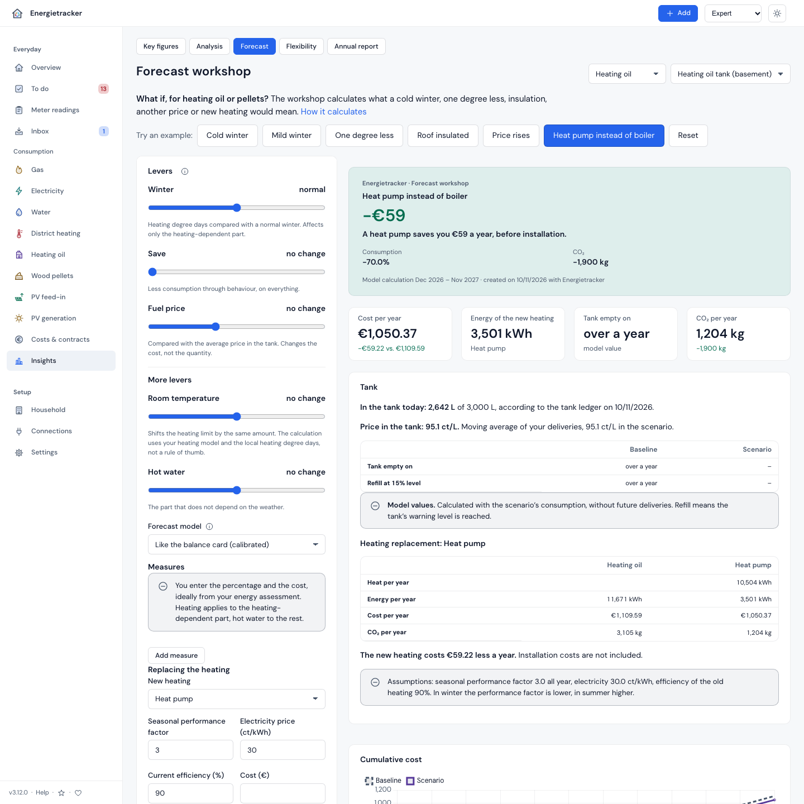
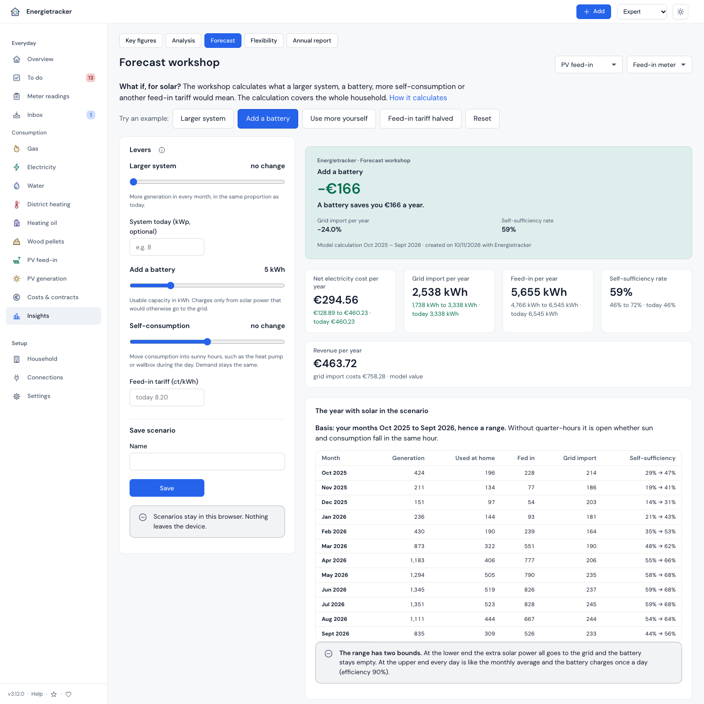

# What if? The forecast workshop

**English** · [Deutsch](../../anleitungen/was-waere-wenn.md)

[← Compendium index](../README.md)

What does a cold winter cost? What does insulation bring? Is switching to the
cheaper offer worth it? Since **v3.6.0** the **forecast workshop** answers
such questions with your own numbers: move a slider, see the result at once —
as one big number, as a curve and as a ranking “What makes the biggest
difference?”. It calculates on your server, with your heating model, your
contracts and your billing period. Nothing leaves your device until you pass
on an image or a PDF yourself.

> **In one minute:** open Insights → **Forecast** (also at the Beginner
> level), click **“Cold winter”** at the top. The card tells you what a winter
> like roughly one in ten costs extra. Then drag the **“Save”** slider to 10%
> and watch the number turn.

---

## 1. What you need

- At least **six months of consumption** of a meter with readings and a
  contract — gas, electricity, water or district heating.
- Since **v3.12.0** also **heating oil and pellets**: a tank with deliveries
  from which the app can distribute six months of consumption (§ 6a).
- Since **v3.12.0** also **solar (PV)**: twelve full months with generation,
  feed-in and grid import, or a full year of quarter-hours (§ 6b).
- For **winter, room temperature and insulation** a heating model: gas or
  district heating with temperatures (weather sync), for heating oil and
  pellets the tank log. With a [climate normal](../verstehen/09-glossar.md) the
  heating degree days are those of 30 years at your location.
- For a **tariff switch** offers you entered (Tariff switch → add an offer) or
  your own price.

## 2. The levers

| Slider | What it moves | from level |
|---|---|---|
| **Winter** (± % heating degree days) | only the heating-dependent part, proportionally | Beginner |
| **Save** (%) | all consumption — behaviour | Beginner |
| **Tariff** | current contract, an offer, the cheapest offer, from Experienced your own unit price and standing charge | Beginner |
| **Room temperature** (± °C) | the heating threshold by the same amount (§ 6) | Experienced |
| **Base load** (± %) | hot water, cooking, appliances — the part without weather influence | Experienced |
| **Measures** | per measure % on the heating part, % on the base load, cost | Experienced |
| **Forecast model** | weather-adjusted (the forecast), same as last year, trend | Experienced |
| **Heating curve** | the regression model of the forecast (linear, robust …), only where a heating model applies (gas, district heating) | Expert |
| **Electric car** | electricity: km per year × kWh/100 km, evenly over the days | Experienced (since v3.7.0, up to v3.6 Expert) |
| **Heat pump (SPF)** | electricity of a meter with the heat pump role: quantity × SPF today ÷ SPF in the scenario | Experienced (since v3.7.0, up to v3.6 Expert) |
| **Budget** | finds the best combination of measures (§ 7) | Expert |
| **Fuel price** (± %) | heating oil, pellets: the price per litre or kg against the average in the tank | Beginner (since v3.12.0) |
| **Replacing the heating** | heating oil, pellets: the same heat from a heat pump or a pellet boiler (§ 6a) | Experienced (since v3.12.0) |
| **Larger system** (%) | solar: more generation in every month, in the same proportion | Beginner (since v3.12.0) |
| **Add a battery** (kWh) | solar: charges from solar power that would otherwise go to the grid | Beginner (since v3.12.0) |
| **Self-consumption** (± %) | solar: consumption moves into sunny hours, for instance heat pump or wallbox | Beginner (since v3.12.0) |
| **Feed-in tariff** (ct/kWh) | solar: instead of the rate in your contract | Beginner (since v3.12.0) |

You enter the percentages of a measure yourself, ideally from your energy
assessment or the tradesperson’s quote. The workshop deliberately offers no
“typical” values — they depend on the house.

## 3. What you see

- **Result card:** one statement, one big number — “A cold winter costs you
  €214 more a year.” Plus consumption, CO₂ and the recommended advance payment.
- **Key figures:** cost per year (against the baseline), consumption per
  year, recommended advance payment; from Experienced the balance at the next
  bill and CO₂.
- **Cumulative cost:** baseline dashed, scenario in colour — where the lines
  part, the change takes effect.
- **Month by month** (from Experienced): consumption per month, for experts
  with the uncertainty range.
- **What makes the biggest difference?** (from Experienced): each lever on its
  own against the baseline (normal winter, current contract), saving in the
  first year and — where you entered a cost — the payback.
- **Forecast models compared** (Expert): the same question with three models;
  if they are far apart, the answer is uncertain.

Below the workshop the **detailed forecast** is still there, collapsible:
history with range, monthly table with cost, advance payment, balance and
method.

## 4. Example scenarios and measures per utility

Water is not district heating and electricity is not gas. **Each utility gets its
own examples, measures and words.** The calculation behind them stays the same.

| Group | Utilities | Examples | Measures |
|---|---|---|---|
| **Heat from fuel** | Gas | Cold winter, Mild winter, One degree less, Roof insulated, Windows replaced, Cheapest offer | Roof, facade, windows, basement ceiling, hydraulic balancing, heating pump, thermostats, save hot water, other |
| **Heat from the grid** | District heating | Cold winter, Mild winter, One degree less, Roof insulated, Price rises, Cheapest offer | as for gas, without heating pump |
| **Household electricity** | Electricity, role household | Lower base load, Electric car, Cheapest offer, Save 10% | Replace appliances, avoid standby, replace lighting, save hot water, other |
| **Heat pump electricity** | Electricity, role heat pump | Better performance factor, Cheapest offer, Save 10% | Hydraulic balancing, roof, facade, windows, other |
| **Wallbox electricity** | Electricity, role wallbox | Electric car, Cheapest offer, Save 10% | Other |
| **Water** | Water | Low-flow shower head, Toilet cistern, Save 10% | Low-flow shower head, toilet cistern, washing machine and dishes, garden, fix a leak, other |
| **Heat from deliveries** (since v3.12.0) | Heating oil, pellets | Cold winter, Mild winter, One degree less, Roof insulated, Price rises, Heat pump instead of boiler | as for gas |
| **Solar** (since v3.12.0) | PV feed-in, PV generation | Larger system, Add a battery, Use more yourself, Feed-in tariff halved | none |

**All figures in an example are assumed examples, not guide values and not a
promise of savings.** The workshop says so below the result. Enter your own values,
ideally from an energy assessment or for your vehicle.

| Example | What it sets |
|---|---|
| **Cold winter**, **Mild winter** | heating degree days as in roughly one winter in ten (from the spread in the climate normal), without a climate normal 10% as an assumption |
| **One degree less** | room temperature −1 °C, calculated with your heating model |
| **Roof insulated**, **Windows replaced** | a measure with 15% or 10% less heating energy |
| **Price rises** | your working and base price, 10% higher, as your own price |
| **Cheapest offer** | the cheapest of your offers, bonus not included |
| **Lower base load** | base load −5% |
| **Electric car** | 10,000 km a year at 18 kWh per 100 km, costs more electricity |
| **Better performance factor** | seasonal performance factor from 3 to 3.5 |
| **Low-flow shower head**, **Toilet cistern** | a measure with 10% or 5% less water |
| **Save 10%** | ten percent less consumption through behaviour |
| **Price rises** (heating oil, pellets) | 10% more per litre or kg |
| **Heat pump instead of boiler** | performance factor 3, electricity 30 ct/kWh, boiler efficiency 90% |
| **Larger system** | 50% more capacity |
| **Add a battery** | 5 kWh usable capacity |
| **Use more yourself** | 10% more self-consumption |
| **Feed-in tariff halved** | half of your current feed-in tariff |

**An example only appears if it can have an effect:**

- **No heating model, no winter and no insulation.** For gas and district heating a
  note says so, “Save 10%” stays.
- **Electricity has no heating model, not even for a heat pump.** So there is
  neither winter nor room temperature. The percentages of a measure apply to all
  electricity on the meter, and base load and saving calculate the same.
- **No offer entered, no switch.** “Price rises” needs a price.
- **Water has no tariff to choose:** you do not change supplier there, the workshop
  calculates with your current contract.

**Saved scenarios keep calculating the same.** A measure that no longer fits the
utility, such as “roof” on an electricity meter, stays visible with its values and
is marked. The jump `#/forecast?preset=…` keeps working.

**The workshop calculates heating oil, pellets and solar since v3.12.0** (§ 6a,
§ 6b). Only heat output has no workshop; the page says so, and the detailed
forecast is still available there.

In the public demo the baseline and the examples are precomputed, one click shows a
result straight away.

## 5. Save, compare, share

- **Save:** enter a name, “Save”. Scenarios live **in this device’s browser**
  (at most 20); another device does not see them.
- **Compare:** recalculates all saved scenarios and puts cost, difference,
  consumption and CO₂ side by side.
- **Save result as image:** the card as a PNG (1200 × 630, the size of preview
  images) — drawn in the browser, without any outside service.
- **Print or save as PDF:** the print view with assumptions, baseline against
  scenario, curves, monthly table and ranking, neatly on A4. The browser’s
  print dialog turns it into a PDF.
- **Monthly values as CSV** (Expert): quantity, cost and cumulative cost per
  month for baseline and scenario.

## 6. How it calculates

**One source.** The baseline is the forecast for the next twelve months with
all its rules: climate normal, heating model, analysis baseline, contracts to
the day, advance payments by plan. Since v3.10.0 it estimates the quantity per
month like the balance card (per day, with the card’s calibration factor); the
workshop and the balance path therefore show the same monthly costs. Up to v3.9
it took the forecast’s monthly quantities, about a tenth off with a poorly
fitting heating model ([basics §10](../verstehen/00-overview.md#balance-in-one-piece-since-v3100)).
That is why the baseline row reads “Like the balance card (calibrated)”. The
table “Forecast in detail” on the same page still shows the forecast without
the calibration factor; if the two differ by at least 2 %, a sentence below it
says by how much.
The workshop changes only quantities — and prices for the tariff. In the
forecast the cost of a month is a linear function of the quantity (unit price ×
quantity + standing charge − bonuses); exactly this function also values the
scenario quantities. Without a change you therefore get the baseline to the cent.

**Heating part.** The heating model describes consumption as a × heating
degree days + c × days. The heating-dependent part of a month is a × HDD;
only it responds to winter, room temperature and insulation. Summer months
without heating degree days do not change.

**Room temperature.** One degree less in the room lowers the heating threshold
by one degree. The workshop takes the heating degree days at the shifted
threshold from the climate normal (otherwise from your temperature history)
and multiplies the difference by a — your own model, not a rule of thumb; the
same reasoning as the forecast’s temperature offset since v2.8.0.

**Measures act one after another.** Twice 30% less heating energy gives
0.7 × 0.7 = 49% less, not 60%. The ranking calculates each measure on its own,
the combination calculates them together.

**Tariff.** An offer is calculated with the same price rule as in the
[switching decision](../referenz/ansichten.md#switching-decision): unit price ×
quantity + standing charge per month, bonus not included. For water (three
price components) the current contract stays.

**Models.** *Weather-adjusted* is the forecast. *Same as last year* takes the
measured months one year earlier (daily rate × days); if a month is missing,
the forecast fills it and the workshop says how many. *Trend* continues last
year with the change from the year before, at most ± 25% — and only with two
full years of readings. The uncertainty range belongs to the forecast model.

**Advance payment.** With a running billing period (F1030) like the
suggestion in the contract status: today’s advance payment + expected final
balance ÷ remaining months. Otherwise a twelfth of the annual cost, rounded up.

**Balance at the next bill.** The balance measured so far in the running
billing period plus the forecast months up to its end (cost − advance
payment), the last month pro rata.

**CO₂.** Consumption × the factor the consumption view used over the last
twelve months.

## 6a. Heating oil and pellets (since v3.12.0)

**The baseline is the forecast of the tank, unchanged.** The quantity per
month comes from the forecast, the cost from the moving average price in the
tank. Deliveries have no advance payment and no bill.



- **Heating part from the tank log.** The app spreads deliveries over the days
  with “per heating degree day × HDD + per day × days”. The heating part of a
  month is the first term over the sum. Winter, room temperature, insulation
  and hot water calculate with it as for gas.
- **Fuel price ± %:** cost = quantity × price × (1 + %). The quantity stays.
- **Tank empty on, refill from:** from today’s stock day by day with the
  scenario’s quantity. Refill means the tank’s warning level is reached
  (setting `tank_warn_pct`). The calculation does not know future deliveries.
- **Replacing the heating: a second calculation for the same heat.** Heat =
  fuel × efficiency of the old boiler. A heat pump needs heat ÷ seasonal
  performance factor in electricity, a pellet boiler heat ÷ its efficiency in
  pellets. The performance factor applies all year; in reality it is lower in
  winter and higher in summer. Empty fields use stated example values, not
  guide values. Installation costs are not included; with a cost entered the
  workshop names the payback.

<!-- doc-claim: werkstatt-heat-pump-example (ScenarioDeliveryTest) -->
```text
Heating oil per year   1,000 kWh
Heat                   1,000 kWh × 0.9 = 900 kWh
Electricity            900 kWh ÷ 3 = 300 kWh
Cost                   300 kWh × 30 ct = €90.00
```

## 6b. Solar (since v3.12.0)

**A model of the whole household over generation, feed-in and grid import.**
The basis is a measured year, not a weather model. Forecast and balance do not
change.



- **With quarter-hours one value.** With a full calendar year of quarter-hours
  for generation, feed-in and grid import, the workshop recalculates every
  quarter-hour.
- **Without quarter-hours a range.** It is then open whether sun and
  consumption fall in the same hour. **Lower bound:** the extra solar power all
  goes to the grid, the battery stays empty. **Upper bound:** every day is like
  the monthly average, the battery charges once a day. The figures show the
  midpoint.
- **Larger system:** more sun first covers grid import, the rest goes to the
  grid. Per month at most the extra generation, the grid import and
  “% × used at home”.
- **Self-consumption ± %:** consumption moves into the sun within the day.
  Demand stays the same, at most feed-in and grid import move.
- **Add a battery:** charges only from solar power that would otherwise go to
  the grid and never beyond its capacity. Efficiency 90% (a stated
  assumption), with quarter-hours also a power of half the capacity per hour.
  An existing battery works as measured.
- **Cost and revenue:** grid import × unit price of electricity per month,
  feed-in × tariff. The standing charge does not change and is left out.
  Self-sufficiency as in the PV overview.

<!-- doc-claim: werkstatt-pv-month-example (ScenarioPvTest) -->
```text
One month with 30 days: generation 500 kWh, feed-in 300 kWh, grid import 200 kWh
System + 50%:     lower bound feed-in 550 kWh, grid import 200 kWh
                  upper bound feed-in 450 kWh, grid import 100 kWh
Battery 5 kWh:    upper bound charged 150 kWh, discharged 135 kWh,
                              feed-in 150 kWh, grid import 65 kWh
```

## 7. The best combination within a budget

Enter a **budget** and the **cost** of the measures. The workshop then
calculates **every combination** that fits the budget with the real model —
interactions included — and names the one with the largest saving per year
(on a tie the cheaper one). With at most ten measures that is at most 1,024
combinations; the result is exact.

Alongside, a small **simplex solver** solves the linear relaxation: it may
take measures partially and uses the individual savings. That gives an
**upper bound** and the **shadow price of the budget** — what one more euro
of budget would bring per year there. “Apply selection” puts the measures
found into the scenario.

## 8. Limits

- A scenario is a **model calculation, not a measurement**. The workshop says
  up to when readings exist and how large the heating part is.
- The workshop calculates for gas, electricity, water and district heating
  with readings and a contract, since v3.12.0 also for heating oil, pellets
  and solar; not for heat output.
- Solar calculates with a measured year. It does not know a different weather,
  ageing of the modules or shading.
- It does not offer dynamic tariffs (wholesale price per month) as an offer —
  [Tariff switch](../referenz/ansichten.md#switching-decision) calculates those.
- It does not calculate load shifting against quarter-hour prices; what
  shifting achieved is shown by [Valuing flexibility](flexibilitaet.md).
- Measure percentages and costs are your inputs.

## 9. For developers

The workshop calls `POST /api/forecast/scenario` — a route that only
calculates and writes nothing (also allowed with a read-only key). Fields,
limits and response: [API reference](../referenz/api.md).
