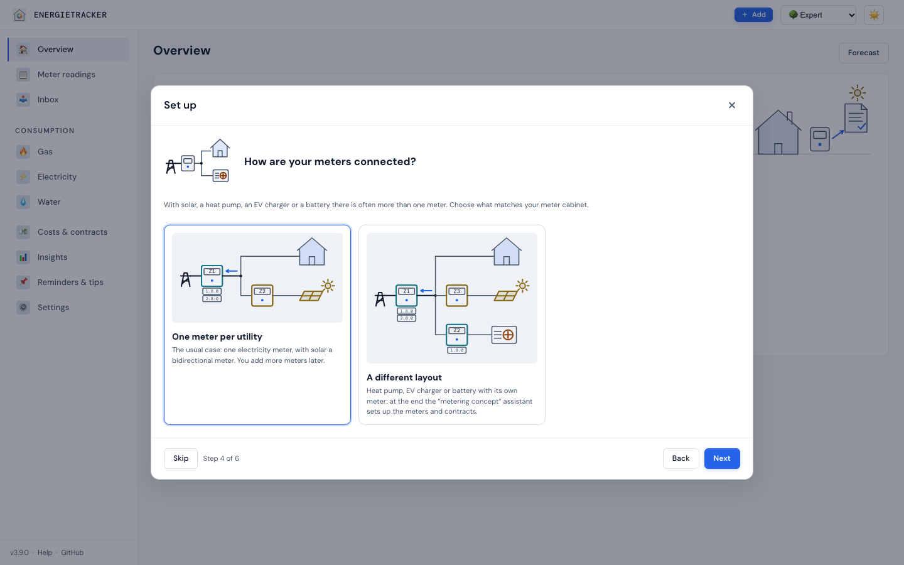

# Setup and experience levels

**English** · [Deutsch](../../einstieg/einrichtung.md)

[← Compendium index](../README.md)

Since **v3.2.0** a new installation starts with a few questions instead of an
empty interface — since **v3.5.0** first about language and country. The setup
assistant then sets the utilities and the experience level and, if you like,
shows a sample household that suits you.
The experience level decides how much the interface shows — every level
calculates everything. Explainers illustrate the key figures with your own
data.

---

## 1. The setup assistant

### When it appears

- **On the very first start** of a new installation, i.e. with an empty data
  directory — such as a fresh Docker container. It comes back every time you
  open the app until you finish it or choose “Skip”.
- **Not after an update.** An existing installation keeps its interface and is
  set to the “Expert” level afterwards.
- **In the public demo**, as long as this browser has not picked a sample
  household yet ([§ 5](#5-the-public-demo)).

### The steps

The “Set up” dialog has five steps (“Step 1 of 5”), six with electricity and solar. Since **v3.9.0** each
question has a small drawing next to it (globe, houses, meters, levels, tray),
and each answer to “Who are you?” shows a small house picture instead of an
emoji. The pictures are only decoration; the question and the text of the
answer say everything.

1. **“Language and country”** *(since v3.5.0)* — two choices:
   - **Language:** one of the seven interface languages. Preselected is the
     language of this device, so on the very first start the browser’s. A
     different choice applies at once: the assistant then speaks the new
     language.
   - **Country:** preselected is the country the first start derived from the
     browser (`de-AT` → Austria, otherwise the country of the language).
     Below it you see what applies, or what the country profile sets when you
     switch: how numbers, amounts and dates are written, currency, time zone,
     weather location, heating limit, CO₂ electricity and the unit of the
     calorific value ([country profiles](../verstehen/14-laenderprofile.md)).
     The writing style follows language *and* country, but only if the
     language is spoken in that country — English with Germany writes the
     British way (“1,234.5”, “31/12/2026”). The currency is only symbol and
     labels; amounts are not converted.
2. **“Who are you?”** — one of five answers (table below). The answer
   suggests utilities and a level.
3. **“Which energy sources do you use?”** — the suggested utilities are
   ticked; combine freely, at least one has to stay. A note explains the
   difference between district heating and heat
   ([§ 2](#district-heating-or-heat)).
   *With electricity and solar* (or as “Modern house”) **“How are your meters
   connected?”** follows since **v3.9.0**: two cards with a diagram, **“One
   meter per utility”** (preselected, the usual case) or **“A different
   layout”** (heat pump, EV charger or battery with its own meter). The
   different layout preselects “Set up metering concept” at the end; afterwards
   the “metering concept” assistant opens
   ([views](../referenz/ansichten.md#assistant-set-up-metering-concept-v390-github-40)).
   The dialog then has six steps.

   

4. **“How much experience do you have?”** — Beginner, Experienced or Expert
   ([§ 3](#3-experience-levels)).
5. **“What comes next”** — the summary and one of three ways *(since
   v3.7.0)*, with electricity since v3.9.0 one of four:
   - **“From documents”** *(recommended)* takes you to the inbox: file supplier
     mail as PDF, have it read, and a draft of your household is built —
     [Household from documents](../anleitungen/haushalt-aus-dokumenten.md).
     Below it the assistant lists which documents help for your answer in
     step 2. If no service for reading is set up yet, **“Set up reading”**
     opens the “Reading documents” card as a dialog above the assistant
     (administrators only; members read that an administrator sets it up).
   - **“Enter by hand”** takes you to “Meter readings”: check the meters, add
     the first reading — continue with [Getting started](erste-schritte.md).
   - **“Set up metering concept”** *(since v3.9.0, only with electricity)*:
     “For solar, heat pump or EV charger with its own meter: first the layout,
     then the readings.” Opens the electricity meters page with the assistant
     that asks about the layout in the meter cabinet and creates meters,
     registers and contracts
     ([use case H](../anleitungen/anwendungsfaelle.md#h--cascade-with-heat-pump-htnt-and-solar-v390)).
   - **“Look at it with sample data”** *(administrators only)* loads the
     sample household for your answer in step 2
     ([§ 2](#2-the-sample-households)). The app saves the current state as a
     snapshot first.

Nothing is saved until **“Let’s go”**: the active utilities, the tenure
(Settings → Household & building → “I live”: “in a rented home” for “I rent my
home”, otherwise “in my own home”), your answer in step 2 and the level.
Language and country only if you changed them:

- The **language** becomes the installation’s default language (annual
  report, CSV, new devices). If this device — or, with sign-in, your person —
  has a language of its own, it follows.
- The **country** takes the same route as in the settings and applies the
  country profile. Only what differs from the defaults is stored — the same
  rule as on first start. Whoever picks Germany after an English first start
  has no frozen German defaults in the settings afterwards; a later correction
  of a default reaches this installation too.

“Back” goes back a step, “Skip” leaves everything as it is — a language
picked in the assistant no longer applies either.

| Answer in step 2 | Suggested utilities | Suggested level |
|---|---|---|
| “I rent my home” | Electricity, Heat, Water | Beginner |
| “Owner-occupied flat with district heating” | Electricity, District heating | Beginner |
| “Own house with gas, oil or pellets” | Gas, Electricity, Water | Experienced |
| “Own house with heat pump and solar” | Electricity, Heat, Water, PV generation, PV feed-in | Experienced |
| “Just look at everything first” | all | Expert |

If you heat with oil or pellets, change the ticks in step 3: Heating oil or
Wood pellets on, Gas off.

### Start it again

Settings → General → card “Experience level and setup” → **“Start the setup
assistant”**. When you start it again, the language of this device, your
country, your active utilities and your level are preselected; below the
country you see what applies now (“Current settings for …”). An answer in
step 2 resets the ticks in step 3 to its suggestion and leaves the level
alone. This is also how you load a different
sample household later.

---

## 2. The sample households

There is a sample household for every answer in step 2 — four new ones and
the **showcase**, the previous demo household with almost every utility. All
of them are invented: names, suppliers and meter numbers are examples. The
location is Leipzig, the data cover three years and are carried forward to
today when you load them — readings, monthly values and temperatures with the
values of the same period one year earlier, reminders relative to today.

| Sample household | Utilities | What’s in it | Good for seeing |
|---|---|---|---|
| **Rented flat** (“I rent my home”) | Electricity, Heat, Water | 62 m², one person, central gas heating in the basement. Electricity on its own supply contract (billing year from October), with a switch of supplier and its final bill and a renewal that has been running on since the end of September 2026; heat as monthly values from the metering service’s consumption information (with previous month, same month last year and average user); cold and hot water meters; a tenancy with prepayments for heating and operating costs and two service charge statements including the landlord’s share of the CO₂ costs | the overview for beginners with “Does the prepayment cover it?”, heat without a contract of its own, [As a tenant](../anleitungen/mieter.md) |
| **Owner-occupied flat with district heating** | Electricity, District heating | 85 m², two people; district heating provides heating and hot water. Heat meter with monthly readings from the customer portal; its own district heating contract with unit, standing, capacity (6.5 kW) and metering charges and several price changes; the 2024 and 2025 annual bills are recorded (2025 not booked yet); electricity with two switches of supplier and their final bills, now open-ended with a minimum term and a price guarantee | district heating as a supply contract with a bill, [Check the annual bill](../anleitungen/jahresabrechnung.md), calibration deadline as a reminder |
| **Classic house** (“Own house with gas, oil or pellets”) | Gas, Electricity, Water | Detached house, 140 m², four people, gas condensing boiler. Gas contract switched after a price comparison, with a price guarantee until June 2026, running on since; final bill and annual bill recorded as supplier bills and booked as special payments (electricity and water too); baseline date “Hydraulic balancing” in September 2024; water with a main meter and a garden meter as a sub-meter, drinking water, wastewater and rainwater, the water bill with a meter rental item; since v3.6.0 a granny flat with storage heaters: a dual-rate meter (HT/NT) as a meter group with one group contract and annual bills, the first one shorter (from the move-in); a garden house meter out of service with its history; a Home Assistant alias on the main electricity meter; reminders for servicing, chimney sweep and calibration | weather adjustment and baseline date, tariff switch, sub-meters, meter group with group contract |
| **Modern house** (“Own house with heat pump and solar”) | Electricity, PV feed-in, PV generation, Heat | Detached house, 150 m², four people. Household meter; heat pump with its own meter and a heat pump tariff with the reduced grid fee under § 14a EnWG (module 1), cancelled as of 30 Sep 2026, follow-up contract with a minimum term and a price guarantee; wallbox as a sub-meter of the household meter, with charging sessions from evcc; a dynamic tariff as an offer for comparison; 9.8 kWp PV on the east and west roof with feed-in remuneration; 10 kWh battery; heat meter of the heat pump | seasonal performance factor, energy flow and self-sufficiency, [Charging sessions from evcc](../anleitungen/evcc.md), [Charging record](../anleitungen/ladestrom-nachweis.md), dynamic tariff check |
| **Showcase** (“Just look at everything first”) | Gas, Electricity, Water, District heating, Heating oil, Wood pellets, PV feed-in, PV generation | the previous demo household: a detached house with eight utilities — all except heat. Meter swap, baseline date, offers for comparison, tank book; since v3.9.0 a metering concept: a heat pump with its own HT/NT meter and a group contract behind the main electricity meter, whose contract bills only the remainder; details in [demo-data/README.md](../../../demo-data/README.md) | everything at once, for the “Expert” level |

### New in v3.5.0: who, when, what is still missing

Since v3.5.0 all sample households and the showcase also show:

- **“Done” history** with made-up people: reminders done by hand (some with a
  note), things done automatically with a reason (follow-up contract added,
  supplier bill recorded, reading after a gap, service charge statement), a
  hidden recommendation and an entry that was undone. Entries about reminders
  move with the reminders when loading; all others keep the date of their
  data.
- **Someone in charge of reminders:** one to three reminders carry a name.
- **Supplier bills:** recorded, compared with the app’s own calculation under
  “Check bill” and mostly booked as special payments — plus a recently ended
  billing period without a bill, for which the app expects a bill.
- **Contracts:** follow-up contracts without a gap and a contract that runs on
  or is open-ended with a minimum term and a price guarantee on the timeline.

| Sample household | People in the history | In charge of reminders | Bill expected |
|---|---|---|---|
| Rented flat | Lena | Lena | Electricity: annual bill of the renewal (period up to 30 Sep 2026) |
| Owner-occupied flat with district heating | Katrin, Mehmet | Katrin, Mehmet | District heating, always for 30 days |
| Classic house | Thomas, Sabine, Jonas, Lukas (deleted) | Thomas, Sabine, Jonas | Gas, always for 56 days — overdue |
| Modern house | Julia, Ben | Julia, Ben | Electricity: final bill of the heat pump tariff (cancelled as of 30 Sep 2026) |
| Showcase | Anna, Paul | Anna, Paul | Electricity, always for 21 days |

Since v3.6.0 these people are **created** in every household — with a
running number and a role, at least one admin per household; everyone in
charge of a reminder is one of them. In the classic house Lukas has been
deleted: he took care of cancelling the old gas contract, and the history
shows it under “Lukas (deleted)”
([Household members](../anleitungen/benutzer.md#deleting-people)).

Where it says “always for … days”, the app sets the billing anchor of this
utility relative to today when loading — like the reminders, so that the note
can be seen at any time. The two other notes belong to fixed periods and
appear as long as their end is at most 120 days ago (until the end of January
2027). The app does not carry bills forward when loading — except for the
utilities marked “always for … days”: there the annual bills move with the
billing anchor (the latest ends the day before the previous year’s anchor,
final bills stay), and the app recalculates their amounts. So the billing year
shows no in-between period, and “Check bill” still matches.

**Day film:** the modern house has quarter hours for all of 2025 and gets the
last two to three months up to yesterday when loading — grid import,
generation, feed-in, battery and wholesale price, consistent in every quarter
hour. The showcase deliberately has no quarter hours: it is meant to stay
small, and the day film needs a household with a battery and consumers — the
modern house is there for that.

### District heating or heat?

The sample households show the difference that the note in step 3 explains:

- **District heating** has its own supply contract with a bill from the
  supplier — as in the owner-occupied flat
  ([District heating](../verstehen/04-fernwaerme.md)).
- **Heat** is only measured. It is paid through the rent (the rented flat), or
  it is the output of a heat pump (the modern house)
  ([Heat](../verstehen/15-waerme.md)).

### Loading and going back

- **In the assistant:** choose the answer in step 2, then “Look at it with
  sample data” at the end.
- **Settings → Data → “Load demo data”** and **“Try with sample data”** on the
  empty overview load the showcase.

A sample household **replaces the whole household**: meters, readings,
contracts, tenancy, reminders and the household settings. Utilities it does
not use are empty afterwards. **Your experience level stays**, and since
v3.5.0 so do **language, country, currency, time zone and the unit of the
calorific value** (up to v3.4 the language fell back to German). Location,
heating limit and CO₂ factors come with the sample household — it is in
Leipzig. The app saves a
snapshot first; if there is data already, it asks before. To go back: Settings
→ Data → “Stored snapshots” → “Restore…”. With
[users](../anleitungen/benutzer.md), only someone who manages the installation
can load one.

Via the API: `GET /api/demo/status` lists the available sample households
under `personas`, `POST /api/demo/import` with `{"persona": "mieterin",
"force": true}` loads one of them (`mieterin`, `etw-fernwaerme`,
`eigenheim-klassisch`, `eigenheim-modern`, `showcase`). An unknown name ends
with “There is no sample household “…”.”
([API reference](../referenz/api.md)).

---

## 3. Experience levels

Three levels: **🌱 Beginner**, **🌿 Experienced** and **🌳 Expert**. They decide
what you see — not what the app calculates. Since v3.7.0 three sentences
decide: beginners want to know what they use, what it costs and whether the
advance payment is enough, and let the app read the supplier’s mail.
Experienced users compare and check. Experts see and connect everything.
Anyone with PV, a battery, a heat pump or a wallbox sees their pages at every
level. Every feature on its own, with three households to choose from:
**[What can I do at each level?](../referenz/stufen.md)**

| Area | 🌱 Beginner | 🌿 Experienced | 🌳 Expert |
|---|---|---|---|
| Overview | three answers: Will I get money back? More or less than last year? What needs doing? — with one explainer | all key figures, since v3.7.0 with the “Explainers” section | as Experienced |
| Meter readings | record, photo as a receipt | plus CSV import | plus time series from portals |
| Consumption per utility | monthly trend, balance, explainers — for PV, wallbox and heat pump too | plus previous year, weather-adjusted, table; since v3.7.0 seasonal performance factor, battery and payback, charging record | plus hot water heat and CO₂ price in the fuel |
| Contracts | unit price, standing charge, advance; since v3.7.0 the notice period and, for district heating, capacity and metering charge | plus price changes, bonuses, how cancellation takes effect, minimum term, special payments | plus groups and peak/off-peak, § 14a, monthly prices, district heating key figures |
| Tariff switch, check a bill | hidden — the recommendations point to them | yes | plus dynamic tariff check and wholesale prices |
| Tenancy (when renting) | “Does the prepayment cover it?” on the overview | the whole page, since v3.7.0 with “Sharing CO₂ costs” | as Experienced |
| Insights | forecast workshop with three sliders, flexibility with its result, annual report | plus analysis, weather data, more levers (since v3.7.0 also electric car and seasonal performance factor) | plus baseline date, models, budget |
| Meter structure | hidden | sub-meters, roles, since v3.7.0 PV system and heat pump electricity meter | plus groups, baseline dates, time series |
| Settings | General, Household & building, Utilities & billing, Data | plus Weather data, Integrations | everything, including Access, Expert and System |

### Hiding is not switching off

- The app **calculates everything at every level**. API, CSV export, backup,
  Home Assistant and the calendar subscription deliver the same, whatever the
  level.
- **Hidden fields stay in the form.** A contract you save as a beginner keeps
  its price changes and bonuses.
- **Hidden pages stay reachable.** A link to one — from the recommendations,
  from “To do” or a bookmark — opens the page with the note “This page belongs
  to the “…” level. It is open anyway.” and the button “Switch to “…””.
- **After an update** every existing installation is set to “Expert” —
  nothing disappears.

### Switching

- **Top bar**, next to light/dark: the “Experience level” selector. The level
  applies at once; navigation and view rebuild themselves.
- **Settings → General → “Experience level and setup”**: the same selector,
  plus one line per level on what it shows.

**Who it applies to:** without sign-in the level applies to the whole
installation, on all devices. With [users in the
household](../anleitungen/benutzer.md) every person has their own, on all
their devices; anyone who has not chosen one sees the installation’s level. In
the public demo the browser remembers it. It is stored as the setting
`ui_level` or as a setting of the person
([Settings](../referenz/einstellungen.md)).

### The overview for beginners

Once there is consumption data, the overview at the “Beginner” level shows
three answers instead of all key figures:

- **“Will I get money back?”** — per contract with advance payments “about …
  back”, “about … additional payment” or “about even”, with the date of the
  bill. Without a contract: “No contract with advance payments yet.” and the
  link “Add contract”.
- **“More or less than last year?”** — per utility the last twelve months
  against the same months a year earlier, once at least six months can be
  compared; within 2 % “about the same as last year”.
- **“What needs doing?”** — up to four items from “To do”, such as due
  readings, reminders and notice deadlines.
- When renting, also **“Does the prepayment cover it?”**, with a suitable
  prepayment per month when it gets tight.

Below, the explainer “Where does my money go?” explains the contract with the
highest advance; at the top is the button “Add reading”. The figures are the
same as at the other levels.

### Suggestions to move up

If your household needs more than the level shows, the overview suggests the
next level: “Your household has more than this level shows — “…” shows it.”

| Level | Reason in the household | Suggestion |
|---|---|---|
| Beginner | since v3.7.0 a PV system or a meter with the role battery, heat pump or wallbox; sub-meters, values from Home Assistant (a meter with an alias), several meters for one utility | Experienced |
| Experienced | since v3.7.0 quarter-hour values (up to v3.6 heat pump, battery or wallbox) | Expert |

“Switch to “…”” moves up with one click. Since v3.7.0 each reason appears
**at most once** per device and level: once you have seen it, it does not come
back, even without **“Don’t ask again”**. If a new reason appears, only that one
shows. The suggestion never blocks anything.

---

## 4. Explainers

Four pictures, each answering one question — with your figures:

| Explainer | What it shows | Appears when … |
|---|---|---|
| **“Where does my money go?”** | advance payments against cost up to the bill, the cost split into consumption, standing charge and “still estimated”; the result as a credit or an additional payment | there is a running contract with advance payments (not for the feed-in) |
| **“Energy flow in the house”** | solar, grid, battery, house and the consumers heat pump, wallbox and other for a year or a month: produced, fed in, drawn, charged and discharged, self-sufficiency; buttons highlight the flows of a node (since v3.4.0) | PV generation is recorded; battery and consumers show with the meters of those roles |
| **“Colder, or used more?”** | consumption and heating degree days against the same months a year earlier, plus the weather-adjusted result: “you really used less”, “you really used more — not just the weather” or “about the same — the difference is the weather” (threshold ±2 %) | a heating energy (gas, district heating, heating oil, wood pellets, heat) has weather-adjusted months — only whole months with an adjusted value from the last twelve count, at least six with a previous year |
| **“Contract at a glance”** | start, today, “Cancel by” or “cancel any time”, end or earliest end, minimum term, price guarantee, price increase and next contract on a timeline around today | there is a running contract |

**Where they appear:**

- **Consumption view of a utility**, at every level: the card “Explainers”
  with all that fit this utility.
- **Overview, from the Experienced level** (since v3.7.0, up to v3.6 Expert): the “Explainers” section — money and timeline for
  the contract with the highest advance, the energy flow of the previous year
  and “Colder, or used more?” for the heating.
- **Overview, Beginner level:** one explainer, “Where does my money go?”.

**Motion:** bars grow and flows run as soon as a picture comes into view. If
“Reduce motion” is on for the device, the finished picture shows straight
away; the same when printing. Each picture’s statement is written below it as
text — the graphic itself is hidden from screen readers, the text is not.
Colours follow light/dark and the colour of the utility. The pictures are SVG
with CSS animation, without a library.

---

## 5. The public demo

Without installing anything: [bingerminger.github.io/energietracker](https://bingerminger.github.io/energietracker/).
On the first visit the assistant opens with four steps — “Language and
country”, “Who are you?”, “How much experience do you have?” and “What comes
next”. The demo then shows the chosen sample household; “Skip” shows the
showcase.

- **Language:** applies per device, like the language choice in the notice
  bar. The **country** in the demo is that of the sample household (Germany)
  and cannot be changed — the demo has no server that could store it.
- **The browser remembers** the language, the sample household and the level.
  Nothing else is saved in the demo.
- **Change it:** Settings → General → “Start the setup assistant”.
- **Link directly:** `?persona=` with the name of the sample household, for
  example
  [`…/energietracker/?persona=eigenheim-modern`](https://bingerminger.github.io/energietracker/?persona=eigenheim-modern).

---

[← Compendium index](../README.md)
