# UI reference — all views

**English** · [Deutsch](../../referenz/ansichten.md)

[← Compendium index](../README.md)

> **Real screenshots.** The following images are **actual screen captures** of the
> running app with the bundled [demo dataset](../../../demo-data/) (light theme; base
> set v1.9.2, sign-in, security card and the capture question v2.6.0, navigation
> v2.11.0, capture, settings and import preview v2.12.0, help and explanations
> v2.13.0, analysis v2.15.0, overview, gas, PV and temperatures v2.16.0; captured
> again with v3.9.0: overview, gas, settings, welcome and the new views). Since
> v2.14.0 the views show the
> English interface, since v3.7.0 with English dates (dd/mm/yyyy); a few older
> captures (sign-in, the capture question, the CSV import preview) are still
> German. How the images are made: [Screenshots](../entwicklung/screenshots.md).
> Older images predate the experience levels (v3.2.0): they show what the
> “Expert” level shows today, and they do not show the level switch yet. The
> v3.9.0 captures show the “Expert” level with the switch.

The app is a single-page application. Since **v2.11.0** its navigation follows
the users' questions: seven areas instead of 17 entries. Since v3.7.0 the
inbox is the eighth entry, below the meter readings.

| Area | Pages |
|---|---|
| Overview | "To do", key figures, tanks and recommendations at a glance |
| Meter readings | all meters in one go |
| Inbox *(v3.7.0)* | File, read and take over supplier mail; key message per document (“What does this mean for you?”), review list; a file below every contract and meter — [guide](../anleitungen/posteingang.md) |
| Consumption | one page per active utility |
| Costs & contracts | Contracts & payments · Tariff switch · Check a bill · Tenancy (v3.1.0, only “in a rented home”) |
| Insights | Analysis · Forecast · Flexibility (v3.3.0) · Annual report |
| Reminders & tips | Reminders & maintenance · Recommendations (one count in the sidebar) · Done (v3.4.0) |
| Settings | General · Household & building · Utilities & billing · Weather data · Data · Integrations · Access · Expert · System |

The pages of an area appear as **tabs** above the view. Menu name and page title
match, and the browser tab names the view. Earlier addresses (`#/tariffs`,
`#/temperatures` …) keep working. The sidebar shows only the *active* utilities
(Settings → Utilities & billing → Active utilities) and follows a change
immediately. Since v3.2.0 navigation and tabs leave out the pages that only a
higher experience level shows (below).

**Mac and iPad in landscape:** sidebar on the left once the window is at least
**900 px** wide (since v3.5.0; up to v3.4 from 801 px — the iPad in portrait got
it and left two thirds of the width to the content). The top bar holds **＋ Add**: meter readings,
delivery and tank reading for heating oil and pellets, reminder, since v3.7.0
filing supplier mail. Next to it the
appearance switch (system, light, dark), since v3.2.0 with the experience
level in front of it.

**Appearance (v3.4.0):** each click moves on — like the system → light → dark
→ like the system again. The icon shows what currently applies: ☀️ light, 🌙
dark. While the app follows the system, the button also carries a small
**“A”** (automatic); in the evening it then switches along with the system.
After each click a short message says what applies now (“Automatic – follows
the system”, “Light”, “Dark”) — the step to “like the system” often changes
nothing visible. Up to v3.3 the icon showed the mode (🖥️ for “like the
system”).

**Experience level (v3.2.0):** in front of the light/dark button sits the
choice **“Experience level”** with 🌱 **Beginner**, 🌿 **Experienced** and 🌳
**Expert** — a menu on the Mac, the system’s wheel on the iPhone, where the
top bar shows only the symbol. The level applies at once: sidebar, tabs and
the open view rebuild. It decides what the interface shows, not what the app
calculates — API, CSV export, backup and Home Assistant deliver the same at
every level. Hidden form fields stay in the form: a contract saved by a
beginner keeps its notice period. Without sign-in the level applies to the
installation (`ui_level`), with sign-in to the person signed in
([Users in the household](../anleitungen/benutzer.md)); the public demo keeps
it in the browser. An existing installation is on “Expert” after the update.

| From level | Pages | Parts of pages |
|---|---|---|
| 🌱 Beginner | Overview (a view of its own, §1), Meter readings, Inbox (v3.7.0), Consumption per utility, Contracts & payments, Forecast workshop (v3.6.0, three sliders), Flexibility (v3.6.0: result, action sentences, typical day), Annual report, Reminders & maintenance, Recommendations, Help; Settings → General, Household & building, Utilities & billing, Data | since v3.7.0 in the contract dialog the notice period and, for district heating, capacity charge, metering charge and connected load |
| 🌿 Experienced | Tariff switch, Check a bill, Tenancy, Analysis, meter management of a utility (`#/utility/…/meters`), Weather data, Reminders & tips → Done (v3.4.0), Settings → Integrations | the overview with every key figure and, since v3.7.0, the “Explainers” section; in Flexibility (v3.6.0) the week, the best time windows, “Using solar power at home” and “Your lever”; in the forecast workshop room temperature, base load, forecast model, measures, since v3.7.0 electric car and SPF, ranking, month-by-month curve, balance and CO₂; in the consumption view the CO₂ tile, “Measured”/“Weather-adjusted”, the monthly table, the PV energy flow, “Check a bill” and “Charging sessions from evcc” (§3), since v3.7.0 charging record, heat pump and the PV battery and payback; in the contract dialog price guarantee, how cancellation takes effect, minimum term, “Renews unless cancelled”, bonuses and special payments; in the meter dialog since v3.7.0 PV system and the heat pump’s electricity meter; in the tenancy since v3.7.0 “Sharing CO₂ costs”; in the settings Display, Reminders, Own reference values, Water reference values, Physical constants, Energy sources (delivery) and since v3.7.0 Photovoltaics |
| 🌳 Expert | Settings → Access, Expert, System | in Flexibility the check per meter, battery, module 3 and the quarter-hour series (up to v3.5.0 the whole page was reserved for experts); in the consumption view hot-water heat and CO₂ price in the fuel; in the analysis the baseline date and “Effect of the measure”; in the forecast the model and the CO₂ price scenario, in the workshop heating curve, budget with optimisation, model comparison, range and CSV; under Tariff switch the dynamic tariff and “Wholesale electricity prices”; in the contract list the counts per contract (v3.4.0); in the contract dialog the key figures of district heating, the reduced grid fee (§ 14a), the time-variable grid fee (§ 14a module 3, v3.3.0), the energy price per meter of a group, credit notes from the direct marketer and “Import monthly prices”; in the meter dialog group, baseline dates and “Import time series”; in the settings CO₂ emission factors |

Every feature on its own, ordered by task and checked against the code:
[What can I do at each level?](stufen.md)

An area shows as tabs only the pages of its level, none if just one is left;
“Insights” in the sidebar takes beginners to the forecast workshop since v3.6.0, next to the annual report. A link, a
bookmark or an old address still opens a hidden page. A notice then sits on
top: “This page belongs to the “Experienced” level. It is open anyway.” with
**“Switch to “Experienced””** and ✕ — for example when a beginner taps
“⚙️ Meters” in the consumption view. Details:
[Setup and experience levels](../einstieg/einrichtung.md#3-experience-levels).

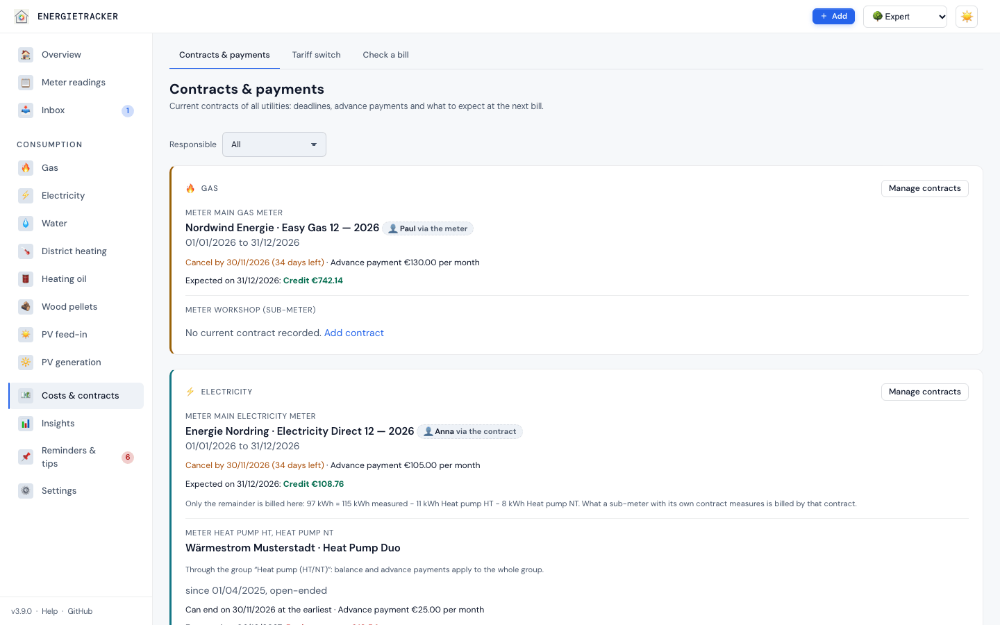

**iPhone and iPad in portrait (below 900 px):** a tab bar at the bottom, in thumb reach: Overview, Consumption,
**＋ Add**, Costs, More.

- "More" opens the sidebar as a menu.
- **Tablet (v3.5.0):** what counts is the width of the window, not the device.
  An iPad in portrait (744–834 px) shows the tab bar, in landscape (from
  1024 px) the sidebar; in Split View the width of the app decides. Rotating
  switches the navigation without a reload: an open menu closes, and focus in
  the sidebar stays there, or moves to “More” when the sidebar becomes a drawer.
- The utilities appear as tabs on their page.
- Dialogs slide up as a sheet; header and footer stay in place.
- The back gesture closes a dialog instead of leaving the page.
- Touch targets are at least 44 px, inputs 16 px, so Safari no longer zooms
  on every focus.
- As a home-screen app the page extends under the clock and home indicator.

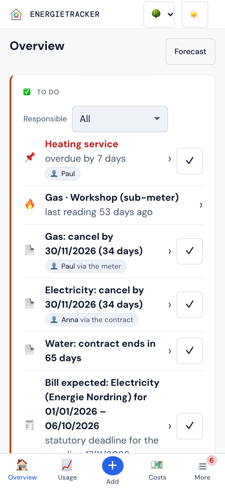 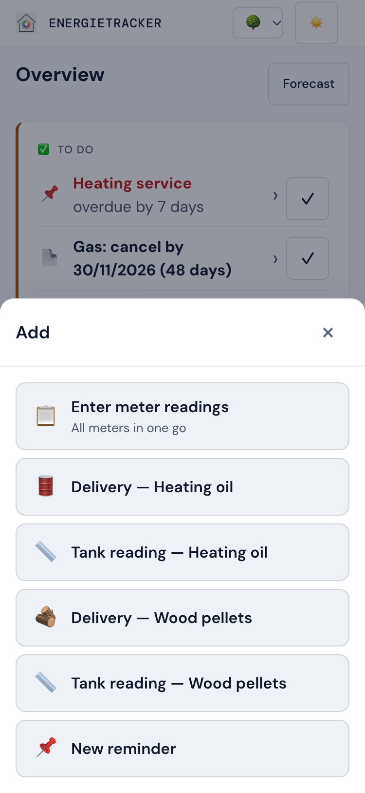

**Explanations on tap (v2.13.0):** technical terms carry an **ⓘ** — heating
degree days, R², moving average, balance, baseline date, break-even, notice deadline
and more. Tapping or clicking opens the explanation: on the Mac as a bubble
below the term, on the iPhone as a sheet above the tab bar. "All terms" leads
to the help (§15); Escape or a tap elsewhere closes it. Up to
v2.12 these explanations lived in tooltips, which the iPhone does not have.
Where an explanation belongs to a single row — why a reading carries "CHECK",
what "FULL" means on a delivery — the ⓘ next to it opens exactly that one.
Since v3.1.0 the explanation of a billing term also gives its wording on the
bill of the configured country, such as "On your bill (Austria):
“Teilbetrag”" for the advance payment
([country profiles §8](../verstehen/14-laenderprofile.md#8-what-your-bill-calls-it)).

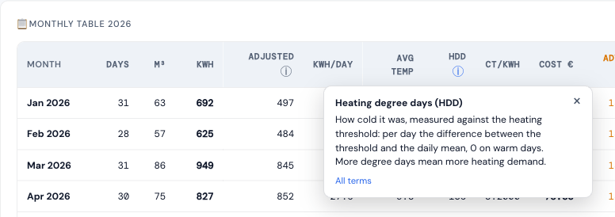 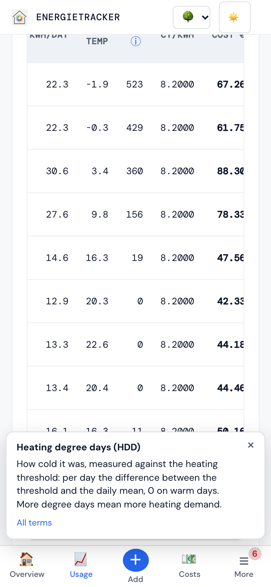

The **help** sits in the footer of the sidebar, on the iPhone under "More".

**Charts (v2.15.0)** follow the same rules everywhere:

- **Partial months** — the first month after installation, the current one, a
  month up to the last reading — appear pale (bars) or as a hollow point at the
  end of a dashed line. The tooltip names the recorded days ("Partial month: 14
  of 31 days recorded"), tables show "14 / 31". Trends and the seasonal profile
  leave them out.
- **Trends** compare the same full months a year earlier. The banner of a
  heating utility is weather-adjusted by the heating model when every month
  involved has a value; the cards on the overview compare measured values. Up to
  v2.14 the last three stood against the three before — heating season against
  summer.
- **Colours** are those of the utility, darkened in the light theme (at least
  3:1 on the card); open charts recolour at once when you switch.
- **Data as a table:** below every chart without a table of its own the numbers
  can be expanded. Screen readers hear a short description with period, total
  and the highest and lowest month.
- **Year and meter in the address:** `#/utility/gas?year=2025` (with several
  meters `&meter=…`) opens exactly that selection — to share, as a bookmark,
  after reloading. Each utility remembers its year.

---

## 1. Overview (dashboard)

The entry point. 12-month figures per utility (since v3.6.0 in **billing
years**: for each utility with bill check the current billing period with its
own settlement date, named and with the advance payments so far, without
sub-meters — switch above the cards, see the consumption view; a card’s
expandable **meter groups** then show the same period, or, if a group has bills
of its own, its latest one with its name), efficiency class **per heat
source**, tank levels (oil/pellets), **electricity balance & self-sufficiency** for
PV, the combined consumption history (as many months as set under *Months on
dashboard* in the settings, since v2.9.0) and due appointments. Since v2.10.0 the
**certificate-style figure** appears below the efficiency (with several heat
sources one for all of them together, ⓘ with the reference area and the
months); an incomplete year gets no class but a note instead. Since v3.5.0
the ⓘ also names the basis (net or gross calorific value) and the months the
procedure in force requires; up to 31 Dec 2026 a line below says what the new
procedure changes from 2027 and which figure it would give
([Fundamentals §7](../verstehen/00-overview.md#7-efficiency-class)). The PV card
additionally shows the **self-consumption savings** and, as long as fewer than
twelve months have data from all three meters, over how many months the rates
are calculated. Since
v2.7.0 the efficiency class appears only in countries with a scale (Germany);
elsewhere the card shows kWh/m²·yr and gives the reason ([country profiles](../verstehen/14-laenderprofile.md)).
Since v2.11.0 a due reminder reads "overdue by 65 days" instead of "now". The
header action "Temperatures" is gone; "Add" sits globally in the top bar or
the tab bar.

**"To do" (v2.12.0)** sits at the top: overdue and due reminders, meters whose
last reading is older than set under Settings → General → *Warn after*, notice
deadlines and tanks — each with a button that goes there. With up to two due
meters the entry jumps straight to that meter's card in the capture view; more
are combined into one line ("7 meters are waiting for a reading"). Each line
is tappable as a whole, on the iPhone with "›" instead of a button. The reminder card further
down and the "Active meters" tile per utility are gone; key-figure tiles no
longer lift on hover, because they are not clickable. Since v3.1.0 the entries
come from the agenda (`GET /api/agenda`, every event with `due_now`) — the same
source as the calendar subscription (§9) and the sensors for Home Assistant.
The rules are the same as before; up to v3.0 the browser assembled the list
itself.

**Ticking off (v3.4.0):** to the right of a row that can be done by hand
(reminder, cancellation deadline, contract end, price increase, plan a
delivery, objection and CO₂ deadlines) there is a tick **✓** — a button of its
own, not part of the link. It opens the dialog **“Mark as done”** with “Done
on” (today, can be backdated), note and receipt, for a cancellation deadline
also “Cancelled – the contract does not renew”. The row then disappears; the
message at the bottom offers “Undo”. “Read the meter” has no tick — a reading
clears it. New under “To do” are price increases and the objection and CO₂
deadlines as soon as they are due; a follow-on contract with a gap is named in
the second line. The beginner overview has the tick as well.
[Ticking off notices](../anleitungen/hinweise-erledigen.md).

**Adjust the heating limit (v3.9.0, GitHub #38):** If a meter’s heating model
fits much better with a different heating limit, “To do” shows “Adjust the
heating limit: with X °C the heating model fits much better”. Below it, before
and after: how far a month typically deviates from the expectation and which
summer base load the model assumes, plus the expected balance and the advance
payment suggestion of the current contract today and with the new limit.
**“Apply (this meter only)”** sets the limit on the meter (on the group for a
group contract); the message afterwards offers “Undo”. **“Not now”** hides the
entry until a new month is measured or the suggestion changes. The same note
with the same button appears on the balance card, in the forecast and in the
workshop when their estimate is uncertain because the heating model fits poorly.
Both buttons exist at every level; the analysis with the whole grid stays from
Experienced.

**Check a reading (v3.9.0):** If a reading between two correct ones is too low
or too high, “To do” shows “check the reading of …” (for several readings in a
row “check the readings from … to …”). Below it one line each for the interval
before and after (“Before (… to …): … measured, about … expected.”) and the
guess, such as “This reading is probably about 250 m³ too low.” Three buttons:
**“Reading is correct”**, **“Only for the bill”** and **“Correct it”** (opens the
edit dialog of the reading with the value that would fit). If consumption
before and after does not add up at all, the entry says “Consumption before and
after … does not add up”, with the same buttons and no suggested value. The
same reading on the same day twice gives “Reading of … entered twice” with
**“Delete one”**. If consumption stayed on a different level for a year or
more, the entry suggests a baseline date: **“Set baseline date here”** (a
dialog with the day filled in) or **“Not now”**. All with “Undo” and at every
level ([Ticking off notices §11](../anleitungen/hinweise-erledigen.md#11-check-a-reading-v390),
[basics](../verstehen/00-overview.md#check-a-reading-since-v390)).

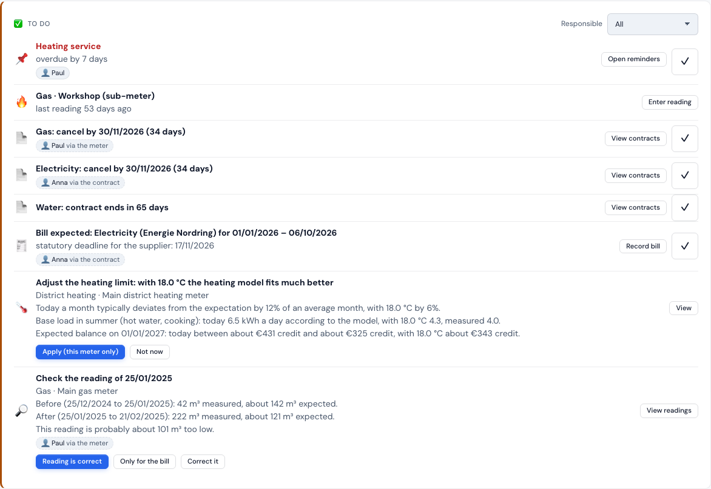

**Without data (v2.13.0)** a welcome replaces the empty tiles: what the
Energietracker does, the first steps with ticks taken from the data (location,
first and second reading, contract, optionally Home Assistant) and **"Try with
sample data"**. The app saves the current state first; the way
back is Settings → Data → Snapshots. Since v3.9.0 a small drawing (house,
meters, sheet) stands to the right of it, from a window width of 1200 px.

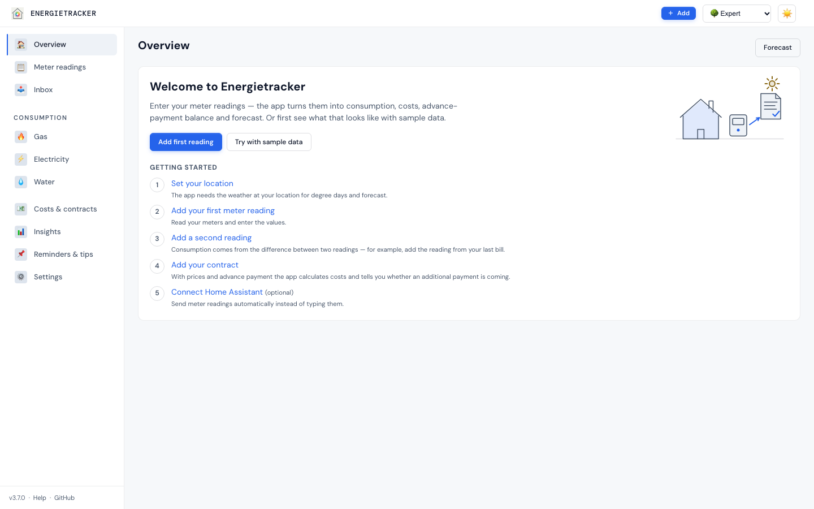

**Period per card (v2.15.0):** every card names its window ("Period:
Apr 2025 – Mar 2026 · Mar 2026: 14 of 31 days") — the utilities end in
different months. The arrow compares the same full months a year earlier; up to
v2.14 the twelve months before, with half a month against a whole one.

**Small multiples (v2.16.0):** every card shows its own history over the card's
window, the same months a year earlier as a dotted line. The shared history below
is called "Total energy" and only stacks what adds up: consumption in kWh; water
and PV are in their cards. Up to v2.15 heating utilities and electricity shared a
line axis on which electricity lay flat at the bottom. The values can be expanded
as a table below.

**PV on the overview (v2.13.0):** the feed-in shows "Feed-in" and
"Remuneration", the generation "Generation" without a cost tile. For both,
more is good: the upward arrow is green. The combined chart now shows only
what is drawn from the grid — up to v2.12 it also stacked the PV kilowatt-hours
as if they were consumption.

**Benchmark (v3.1.0, a traffic light since v3.6.0):** the card 📏
**“Benchmark {year}”** (previous year, calendar year) sets the annual
consumption against a comparison, each line with a traffic light, a word and
one sentence:

| Line | compared with | Traffic light |
|---|---|---|
| Household electricity | your reference value (Settings → Household & building → Own reference values) | **Good** at or below it · **Above** up to 10 % above · **Well above** more |
| per heating type, kWh/m² | your heating reference value | as for electricity |
| Water, litres per person per day | the benchmark under Water (default 122 L, BDEW) and the people in the household | by the bands of the water saving index (default: Good up to 100, yellow only from 5 points above, Well above from 150) |

For example “**Above** Household electricity: 3,650 kWh, 7% above your
reference value (3,400 kWh).” There is a traffic light only for full years;
before that the value stands without a colour, with the note that the year
does not yet have every month. Below, where it applies: that with PV, a heat
pump or a wall box the general electricity benchmark does not fit (heat pump
and wall box are already excluded), and the source of the reference values.

If something is missing, the card invites you with **exactly one link** that
leads straight to the field (the settings page opens with the field focused):
“Enter reference values”, “Enter living area” (no kWh/m² without an area) or
“Enter number of people”. **Default values do not count** (since v3.6.0):
the living area (default 100 m²) and the people in the household (default 2)
only benchmark once someone has entered them — even the same value as the
default. Until then heating or water get no traffic light but the invitation.
Anyone who has already saved the values (or loaded a sample household or a
backup with them) keeps their traffic light. Efficiency class, CO₂ stage and
water saving index keep calculating with the default until then; the efficiency
card then says **“Assumed living area 100 m² – please enter it”** with the link
“Enter living area”, and the efficiency page of the annual report (PDF and print
view) adds a sentence. With neither a line nor a missing detail — for
example without consumption in the previous year — the card is left out. The
links to the start pages of Stromspiegel and Heizspiegel (up to v3.5) are
gone: they led out of the app without leading back to where the value goes.

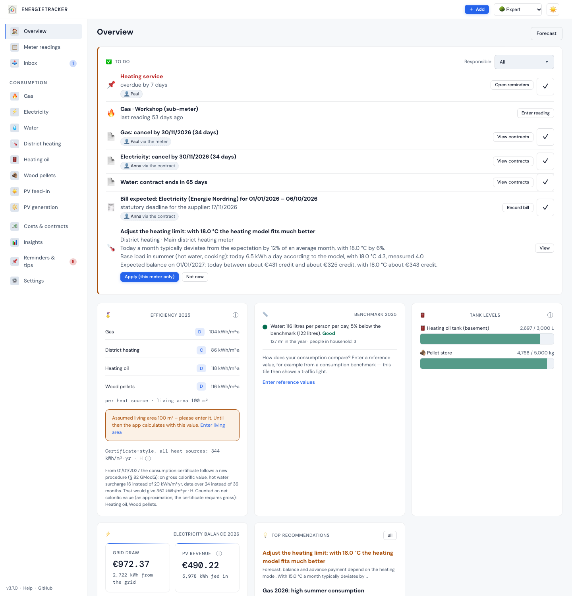

**Your lever (v3.6.0):** if there are measured quarter hours for the previous
year (electricity, or generation and feed-in) and a lever of €1 or more, the
tile ⏱️ **“Your lever {year}”** sits among the others: in large the same number
as the result card of the [Flexibility](#valuing-flexibility-v330-under-insights)
page — what you can save a year on your tariff, incl. VAT (if there is no lever
there, what a dynamic tariff would bring, and it says so) —, small below it
“With a dynamic tariff up to …”, plus one action sentence for the current
season (on your tariff first) and the button **“Flexibility”**. The server
calculates the number with a lean request (`GET /api/flexibility?summary=1`);
the overview does not wait for it, the tile appears as soon as it arrives. No
data, no tile. The beginners’ overview shows it as well.

**Overview for beginners (v3.2.0):** at the “Beginner” level, as soon as there
is consumption data, the overview shows three answers instead of every key
figure; the **“Add reading”** button sits at the top. Without data, every level
shows the welcome.

- 💶 **“Will I get money back?”** — per meter with a running contract (without
  sub-meters and PV) “about … back” in green, “about … additional payment” in
  red or “about even” (below €1), plus “bill on …”. Without a contract: “No
  contract with advance payments yet.” with the link “Add contract”.
- 📈 **“More or less than last year?”** — per utility the last twelve months
  against the same months a year earlier, from six comparable months on: “…
  more than last year”, “… less than last year” or, below 2 %, “about the
  same as last year” — green when it is good (for PV, more), otherwise red.
  Without a previous year: “No previous year to compare yet.”
- 🏢 **“Does the prepayment cover it?”** — only “in a rented home” with a
  running tenancy: “Yes — probably about … back.” or “Tight — probably about …
  additional payment.”, then with “Suitable prepayment: … a month.”
- ✅ **“What needs doing?”** — the first four entries from “To do”, each with
  “›”; otherwise “Nothing right now — good.”

Below, the explainer “Where does my money go?” explains the contract with the
highest advance payment. The figures are the same as at the other levels
(`GET /api/summary`, contract status).

**Suggestion to move up (v3.2.0):** if the household needs more than the
level shows, the top of the overview reads “Your household has more than this
level shows — “…” shows it.” with the reason in small print. For beginners
that is, since v3.7.0, a PV system or a meter with the role battery, heat pump
or wallbox, plus sub-meters, values from Home Assistant (a meter with an
alias) and several meters for one utility — suggestion “Experienced”; for the
experienced level, since v3.7.0, quarter-hour values — suggestion “Expert”.
**“Switch to “…””** moves up with one click. Since v3.7.0 each reason appears
at most once per device and level, **“Don’t ask again”** closes it at once.
The suggestion blocks nothing
([What can I do at each level?](stufen.md#3-the-app-suggests)).

**Explainers (v3.2.0, since v3.7.0 from the Experienced level, up to v3.6 Expert):** between “To do” with the efficiency,
tank, electricity-balance and recommendation cards and the cards of the
utilities sits the section 🎞️ **“Explainers”**: “Where
does my money go?” and “Contract at a glance” for the contract with the
highest advance payment, “Energy flow in the house” for the previous year
(otherwise the last year with PV data) and “Colder, or used more?” for the
first heating meter. Each picture appears only with its data; if all of them
lack it, the section is left out.

The four explainers are explanatory graphics with your own figures — each
answers one question instead of showing a series:

| Explainer | What it shows | Empty when … |
|---|---|---|
| **“Where does my money go?”** | two bars up to the end of the billing period: “Advance payments” against “Cost”, the cost split into “Consumption”, “Standing charge” (less bonuses) and “still estimated”; the gap as credit or additional payment. Text: “By the bill on … you pay … in advance payments; consumption and standing charge will probably cost …. That makes about … credit.” | there is no running contract with a balance path |
| **“Energy flow in the house”** | Solar, Grid, Battery, House and up to three consumers (Heat pump, Wallbox, Other) with the flows between them, for a year or a month — details below. Text: “{period}: the solar system delivered …, of which … went to the grid. The house needed …; … of it came from the grid. Self-sufficiency: ….”, with a battery also “The battery took in … and gave back ….” | the year has no generation |
| **“Colder, or used more?”** | “Consumption” and “Heating degree days”, each “the same months a year earlier” against “recently” with the change in %, below it the badge “weather-adjusted …”. The text says “you really used less”, “you really used more — not just the weather” or “about the same — the difference is the weather” (threshold ±2 %) | fewer than six whole months with a weather-adjusted value (`heat_adjusted`) from the last twelve have a previous year |
| **“Contract at a glance”** | a timeline with “Start”, “today” and, depending on the contract, “Cancel by” or “Deadline missed”, “End” or “Earliest end”, “Term ended”, “Minimum term ends”, “Price guaranteed until” (as a band on the axis), “Price increase” and “Next contract” — details below | the contract has no start |

For money and weather, labels and amounts sit above the bars; the bars leave
room on the right for the percentage, and the legend wraps instead of running
into the next item (v3.4.0).

**Energy flow in the house (v3.4.0, F1026).** Solar sits at the top, the grid
on the left, the battery on the right, the house at the bottom in the middle;
below it the consumers “Heat pump” and “Wallbox” (electricity meters with that
role) and “Other” as the remainder. No flow crosses another and no number sits
on a line: the amounts are inside the nodes — generation in Solar, consumption
in House, ↓ drawn and ↑ fed in at the grid, ↓ charged and ↑ discharged at the
battery. All nodes use the same unit (kWh, from 100,000 kWh in MWh). The width
of a flow follows the amount; the dots on it move at the same speed and their
density follows the amount — so a longer line does not suggest a larger
amount. The rings around the nodes show shares: at Solar, where the generation
went; at House, where the power came from (the grid share is exactly
1 − self-sufficiency); at Battery, what came back and what was lost; at Grid,
drawn against fed in.

- **Year or month.** Above the picture, **“Year”** and **“Month”** switch the
  period, the arrows ‹ › step back or forward. Within a year, values, bands and
  rings glide to the new period in place. A year with fewer than twelve months
  with all three meters is called, for example, “2023 (7 months)” — only those
  months count, as for the key figure.
- **Day (v3.5.0, F1027).** If there are values per quarter hour (imported from
  a portal or from Home Assistant with a timestamp,
  [Valuing flexibility](../anleitungen/flexibilitaet.md)), **“Day”** appears as
  a third level — otherwise it does not. Below it you choose **“One day”**
  (month and day; only days with data are offered, days with gaps read “… (with
  gaps)”; the default is the last complete day) or **“Typical day”** (ⓘ: per
  quarter hour the average over all days of the month with data — the pattern,
  say when the midday sun charges the battery; the default is the latest month).
  The picture plays the day in about 15 seconds: the nodes show the **power** of
  the quarter hour in kW (kWh × 4), the buttons below what has **built up**
  since midnight (“Running total up to 13:15:”), calculated like a month. The
  bands are measured against the strongest flow of the day — thin at night,
  wide at noon. **▶/❚❚** plays and pauses, the **slider** picks the time (screen
  readers hear “13:15”); Space plays or pauses, the arrow keys move one quarter
  hour, Page Up/Down one hour, Home/End to the start and end. Below the slider
  the **wholesale price** of the quarter hour runs along as a small line with a
  cursor (if loaded), and red marks show missing quarter hours — a gap shows as
  “–” in the picture, never as 0. On the day the clocks change the film has 92
  or 100 quarter hours; the repeated hour in October reads “02:15 (after the
  clocks go back)”. Nodes without data are left out; which meters count and how
  gaps arise: [API](api.md#day-film-energy-flow-per-quarter-hour-v350). With
  “Reduce motion” there is no playback and no moving dots, only the slider
  (starting at 12:00).
- **Highlight.** The buttons below the picture (“Solar: …, … used yourself”,
  “House: …, … self-sufficient”, “Battery: … charged, … discharged”, “Grid: …
  drawn, … fed in”) highlight the flows of their node; the line below names
  them. Tapping the node in the picture does the same, tapping again clears it.
- **Calculated.** The meters do not measure whether the battery was charged
  from solar or from the grid. Solar → Battery and Grid → Battery are therefore
  calculated from the monthly totals and drawn dashed; the note “Dashed:
  calculated from monthly totals, not measured.” says so.
- **Grid charging.** If the battery took in more than the solar surplus, a flat
  arc Grid → Battery appears; where it crosses the solar line it passes over it
  as a bridge. The text explains it: this power counts as grid power.
- **Motion.** The nodes pop up one after another, the flows draw themselves,
  the rings turn in and the numbers count up; then the dots start moving. With
  “Reduce motion” the final picture appears at once, arrows show the direction
  and nothing moves.

The calculation is the same as for the key figure “self-sufficiency”
([Photovoltaics](../verstehen/12-pv.md#4-self-consumption--self-sufficiency-rate)).

**Contract at a glance (v3.4.0, F1026).** The axis shows a window around
today: a good year back and a good two years ahead. Whatever lies before or
after sits dashed at the edge, with its date. Labels are spread over levels
above and below the axis by proximity and are left- or right-aligned at the
edges. “today” is the local date.

| Contract | Marks | Text |
|---|---|---|
| fixed term with notice period | “Cancel by”, “End” | “To switch, cancel by …; it then ends on ….” |
| deadline missed | “Deadline missed”, “End” | “The deadline to cancel passed on …; without cancellation it runs on after ….” |
| does not renew | “End” | “… it ends on … without you having to cancel.” |
| renewed (term over) | “Term ended”, “Earliest end”, at “today” “cancel any time” | “Its term ended on …; since then it has been running on and can be cancelled at any time — cancelled today, it ends on … at the earliest.” |
| open-ended with notice | “Earliest end”, “cancel any time” | “… You can cancel at any time — cancelled today, it ends on … at the earliest.” |
| open-ended with minimum term | “Earliest end” (end of the minimum term) | “… with a minimum term: cancelled today, it ends on … at the earliest.” |
| open-ended without notice | — | “… No notice period has been entered.” |

“Earliest end” is the day before the earliest switch (`switch_date − 1`). In
addition, where entered: “Minimum term ends”, the price guarantee as a green
band up to “Price guaranteed until”, the next “Price increase” and — as soon as
`contract-status` reports it — the “Next contract” with its own stretch; a gap
before it starts is dashed red and stated in the text (“In between there are
… days without a contract.”).

Bars grow and flows run as soon as a picture comes into view. With “Reduce
motion” on the device the finished picture appears at once, and so it does
when printing. The graphic is hidden from screen readers; its message is the
text below it, for the energy flow also the list of flows. The pictures are
SVG with CSS animation (dots: SMIL), without a library, with vector symbols
instead of emoji, and follow light/dark; the colours come from the utilities.
Where else they appear: in every consumption view (§3) and on the overview for
beginners ([Explainers](../einstieg/einrichtung.md#4-explainers)).

---

## 2. Meter-reading capture (F1004)

The central, mobile-friendly input mask: all active cumulative meters
(gas/electricity/water/district heating/PV, since v3.1.0 heat) each with the last reading for
orientation — ideal for the monthly reading on the phone.

**Since v2.6.0 with plausibility checks:** while typing, a note appears when the
new reading would mean an unusual daily consumption (more than three times the
usual one), is lower than the last one, lies in the future or when there is
already a reading for that day. On save the app asks per conspicuous card (title:
utility · meter); "Replace" updates the existing reading instead of creating a
second one. Whoever declines keeps the input; the card shows "Not saved – please
check". Details: [Meter readings → plausibility](../verstehen/11-zaehlerstaende.md).

**Since v2.12.0:**

- The date at the top applies to all cards; per card it is collapsed ("Other
  date"). A card with a date of its own keeps it when the top date changes.
- No example value in the field any more — "e.g. 1,395" looked like a
  pre-filled reading. The last reading sits above it.
- The keyboard shows "Next": Enter jumps to the next meter field, from the last
  one to "Save all". On the iPhone the reading can also come from the camera:
  tap the field → "Scan Text" (Live Text; the field is a text field with a
  decimal keyboard for this).
- An error appears below the field instead of only in the title of the ✗.
- After saving, the message names what changed ("Gas +5.4 m³") and offers
  **"Undo"** for ten seconds — it deletes the readings just created.
- **Direct link per meter:** `#/zaehlerstaende?meter=<id>` opens the capture
  view with that meter's card in focus — for a home-screen bookmark, a shortcut
  or "To do".

**Since v3.1.0:**

- **“📷 Photo”** on every card takes a picture of the register along as a
  receipt; on a phone the camera opens. The card shows a thumbnail with
  “Remove photo”. The picture is scaled down in the browser to at most 1600
  pixels and re-encoded as JPEG (without EXIF and GPS data) and saved with the
  reading.
- **Text recognition:** if a service is set up under Settings → Expert,
  “📷 Photo” uploads the picture right away and first shows “Recognising
  text…”, then “Recognised: 12,345.6” with **“Use”** — that puts the value into
  the field; saving works as usual with “Save all”. If the service recognises
  nothing, it says “No meter reading recognised – please enter it by hand.”
  ([Text recognition in the home network](../anleitungen/texterkennung.md)).
- **Without a connection:** a card whose saving fails for lack of a connection
  shows ⏳ “Waiting for a connection”; the reading sits in the browser's queue.
  At the top the card **“Not saved yet”** appears with every waiting reading
  (meter · value · date, 📷 with a photo), “Discard” and **“Send now”**. The
  number of waiting readings also shows on the “Meter readings” menu item and
  on the ＋ in the tab bar.
- **Conflict:** if, when sending later, there is already a different reading on
  the same day, the entry asks “There is already a reading on … (…) – replace
  it or keep the existing one?” with **“Replace”** and **“Keep existing”**. If
  the server rejects a reading, “Not saved: reason” appears with **“Edit”**
  (values and photo back into the card) and **“Discard”**. Details:
  [Use on your phone](../einstieg/handy.md#the-not-saved-yet-queue).
- **Meters with “consumption per period”:** instead of date and reading the
  card shows “Month” and “Consumption (kWh)” or the utility's unit, above it
  “Last period:” with the period and its value. The month after the last
  period is pre-filled, without a period the previous month. Expandable
  **“Comparison values from the consumption information”** with previous month,
  same month last year and average user — as the monthly consumption
  information from the metering service states them. “estimated” and the note
  work as for readings; “Save all” creates a period covering the whole month,
  and the offline queue applies here too. For gas the card enters kWh; m³ go
  through the consumption view. Background: [Heat](../verstehen/15-waerme.md).

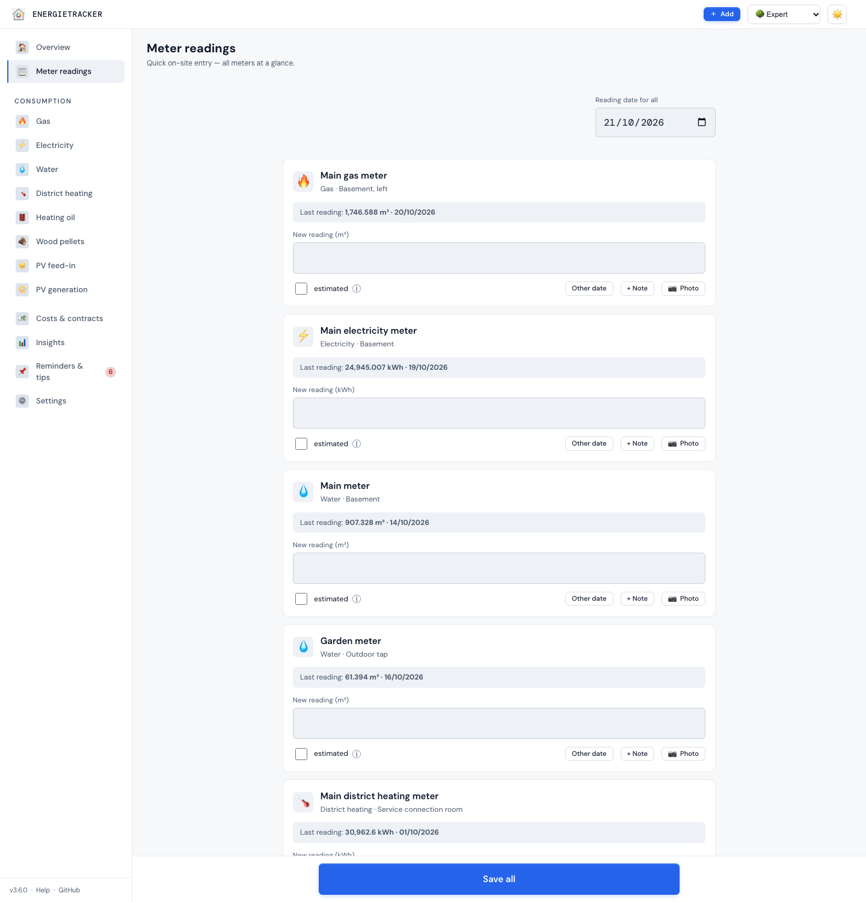

---

## 3. Consumption view — cumulative utilities (gas/electricity/water/district heating)

Identical structure per utility: year selection, meter selection, KPI bar
(consumption, costs, advances with the balance of the months read, daily average,
CO₂), contract/balance card, a consumption chart with a temperature overlay, and a
monthly table with moving averages (MA-3/MA-6) and weather adjustment.

**Costs without the bonus (v3.7.0, GitHub #33):** the “Costs” tile — here as
on the overview, in calendar and billing years — shows the costs without the
bonus; the bonus is a line of its own below (“Bonus −€50.00 on 15/03/2025”, an
other credit with its note). The balance includes it, like the bill; the
monthly average excludes it, because a one-off credit is not a monthly price.
The monthly table still shows each month’s cost net of the bonus (in the month
it is credited).

**Calendar year or billing year (v3.6.0, GitHub #33):** above the year
selection sits the switch *Calendar year · Billing year*. The device remembers
the choice; it also applies in the overview and the analysis. In billing years
the selection lists the **billing periods** instead of years: first the
periods of the recorded supplier bills, exactly as on the bill (also 15 Apr to
30 Mar), before, between and after them the periods by the utility’s
settlement date ([Settings](einstellungen.md)). A whole period is called
“2025/26”, a broken one shows its dates. Below, the view says where the period
comes from (bill or settlement date) and up to which reading it is
calculated. Figures, monthly chart and monthly table follow the period; the
first and last month are partial months when the settlement date falls within
a month. The server calculates quantity and cost like *Check bill* (pro rata
per day), the advance payments pro rata per day; the balance deducts extra
advance payments. The chart compares with the **previous period**. The address
carries the period (`?period=2025-09-01`). Only gas, electricity, water and
district heating with meter readings have billing years; the other utilities
stay with the calendar year and say so when the device shows billing years.
If the settlement date does not match the last bill, the view suggests the day
after its end as the settlement date. A **change of supplier** without a
recorded final bill ends the period on the last day with the old supplier
(“ends with the change of supplier”), and the next one starts with the new
contract; a renewal or a follow-up contract of the same supplier without a gap
does not split ([Annual bill](../anleitungen/jahresabrechnung.md#8-afterwards)).
In the **current year** the calendar year counts the standing charge and
advance payment of the month of the last reading in full, the billing year
only the days up to the reading; the ⓘ next to “Advances up to …” explains
it. Whole years are the same in both views.

**Balance over time (v2.16.0):** below the figures of the balance card stand the
cumulative costs and what was paid (advances, special payments) across the billing
period — dashed where estimated, hollow points after today. The gap between the
lines is the balance, the last point the expected bill; the numbers can be
expanded as a table. The backend calculates it with the same function as the
expected balance (`balance_path`).

**Monthly chart (v2.16.0):** next to every month stands the same month of the
previous year as an outline. Heating utilities switch between *Measured* and
*Weather-adjusted*: adjusted by the heating model to a normal year at your
location, so the comparison shows whether you saved — not whether the winter was
mild. The monthly table has an "adjusted" column for it, the tooltip names a
meter replacement in the month.

**Balance card (v2.8.0):** computes by calendar up to today — "Consumed (as of
today)" breaks down into working price and base price (minus bonuses); below it,
the card states up to when consumption is measured and from when it is
estimated. "Advance paid" counts the advances as they were debited. If the
expected balance deviates noticeably, the card suggests an advance (since
v3.9.0 not shortly before the bill, see below). The KPI
tiles, by contrast, sum up the months that have been read; if the last reading in
the current year is some time back, the tile is labelled "Advances up to
‹date›". The **Contracts & advances** table lists per contract tariff, advance,
consumed, paid, bonus, **special payments** (since v2.5.1: net from the
customer's perspective; since v2.13.0 the items expand instead of sitting in
the tooltip; gas/electricity/district heating, since v3.5.0 water too), balance today and
expected balance. The standing charge is spelled out ("standing charge
12.95 €/month" instead of "13 € base").

**Balance after the last booked bill (v3.6.0):** if the contract runs on beyond
a recorded supplier bill whose result is booked, the balance card, the balance
history and the row in **Contracts & advances** count from the day after; the
card says so (“Counted from ‹date›: the bill before is booked in the contract
…”). The booked refund or additional payment then no longer counts. A recorded
bill that is not booked yet keeps its result in the balance until it is booked.
Up to v3.5 the balance always counted from the contract start — on a contract
over several years every year without a booked settlement stayed in it.

**One calculation for card, workshop and report (v3.9.0):** the balance card
counts the current contract over the running billing period, even without a
recorded bill; Costs & contracts, the annual report, “Where does my money go?”
and the forecast workshop show the same balance on the same day. The date is
the **last day** of the period (“next settlement: 31/12/2026”, not 1 January).
If fewer than three advance payments are left before the bill, the card no
longer suggests a higher advance but says: “Only 2 advance payments are left
before the bill on …. The bill settles the rest, so there is no need to raise
the advance now.” If the ongoing amount differs, it adds “After that, about …
instead of … a month would be right.” Up to v3.8 the card counted from the
contract start without a bill and named the day after
([basics §10](../verstehen/00-overview.md#one-projection-for-balance-and-workshop-since-v390)).

**Advance payments with a rhythm (v3.9.0):** if the supplier collects the
advance every two or three months or on fixed dates, the card names the amount
per due date (“current: €165.00 every 2 months”) and the “next due date: …”;
the suggestion is then per due date too. For water the waste water standing
charge appears in the breakdown when the contract has one
([water](../verstehen/03-wasser.md#advance-payments-every-two-or-three-months-v390)).

**Remainder billing (v3.9.0):** if a sub-meter has its own contract, the parent
meter’s contract only bills the remainder. The parent meter’s balance card, the
row in Contracts & advances and “Check the bill” say so: “Only the remainder is
billed here: 300 kWh = 500 kWh measured − 200 kWh heat pump. …”. If sub-meter
readings are missing, a sentence names the estimated amount or the days without
a reading; if the sub-meter measures more than its parent in a month, the card
asks you to check the readings
([meter topology](../verstehen/13-meter-topologie.md#remainder-billing-v390)).

**Order and status of the contracts (v3.4.0):** the table runs backwards
through time, grouped under header rows: **Upcoming**, **Current** (a renewed
contract too) and **Ended (n)** — in Upcoming and Current the latest start on
top, in Ended the latest end. From three ended contracts the group is
collapsed; a click on “Ended (n)” expands it. A group contract is sorted in
instead of hanging at the end, and the special payments of a cell list the
newest first. The status (ACTIVE · RENEWED · FUTURE · ENDED) comes from the
server (`phase`) and reads the same in **Costs → Contracts**. Up to v3.3 the
oldest row was on top, and an expired contract running on was called “PAST”
there and “RENEWED” here. A contract replaced by one that started later is
listed under Ended.

**Balance from the customer's side (v2.13.0):** card and tile name the balance
with a word and without a sign — "Credit €120.00" in green, "Additional
payment €60.00" in red, with the period it covers. In tables **+ means credit** and
**− means additional payment**, explained in a line below. Up to v2.12 the app showed
the accounting view (cost − advances, minus = credit) — the opposite of what
the bill says. The API and the CSV export keep their sign.

**No monthly values yet (v2.13.0):** if a meter has no reading or only one,
the page explains that monthly values come from the difference between two
readings and leads to the capture of exactly this meter.

**Since v2.9.0** the card calculates to the day: a switch or a price change in
mid-month applies from its own day. Below the figures, notes appear when they
apply — the contract has expired and runs on without cancellation (status
**RENEWED**, end date = next billing date), the cancellation deadline has been
missed, or an entered price increase is coming up (in Germany with the special
right to cancel under § 41 Abs. 5 EnWG). The "reading overdue" banner follows
the setting *Warn after* (days without a reading; warning from ⅔, alert from
the value itself). Since v2.15.0 it names the trend of the last three full
months against the same months a year earlier ("Dec 2025 – Feb 2026 vs.
previous year, weather-adjusted"), for PV too, where more is good.

**Implausible readings (v2.6.0):** if there are outliers, a falling reading
without a meter swap or an unconfirmed suspect value from Home Assistant, a
notice above the year selection lists the affected readings with a link to the
meter swap. In the readings table they carry "CHECK" or "IMPLAUSIBLE" (since
v2.13.0 with an ⓘ and the reason, before in the tooltip); ✅ confirms a suspect reading — only then does it count. The
reading dialog asks the same questions as the meter-reading capture.

**Readings and paging (v3.4.0):** the **“Readings”** card names the number in
the selected year and in total (“10 in 2026 · 43 in total”; up to v3.3 only the
total stood above a list of the year). On the right of its header sits a small
year selection, newest years first, plus **“All years”**: a year switches the
whole page like the year selection at the top, “All years” only the list. If
the list has more than 50 rows — daily values from Home Assistant or evcc,
“All years” —, the paging bar **“‹ Previous · 1–25 of 365 · Next ›”** appears
below it with **“Rows per page”** (25, 50, 100). The device remembers the page
size per list; not the page: every visit starts on page 1 with the newest
readings, so does another year or another meter, and after editing you stay on
the page. If a long list holds readings with CHECK or IMPLAUSIBLE, the tick box
**“Only flagged (n)”** shows exactly those. Paging happens in the browser; the
interface still delivers all readings.

**Checking readings in the list (v3.9.0):** readings that “To do” asks about
carry **UNUSUAL** (with ⓘ: interval before, after and the guess), duplicates
**DUPLICATE**, readings marked as correct **VERIFIED** and readings that only
count for the bill **BILL ONLY**. “Only flagged (n)” counts UNUSUAL and
DUPLICATE too. The row of an unusual reading has ✅ for “Reading is correct”.
If there are readings only for the bill, a sentence above the list says that
monthly values skip them. The **edit dialog** of every reading has the ticks
“Only for the bill” (also when creating) and “Reading is correct (do not check
again)”; with a finding it names the value that would fit, with “Insert”. In a
month that a bill-only reading bridges, amount and cost in the monthly table do
not match: the amount is spread by the weather, the cost uses the reading
([Ticking off notices §11](../anleitungen/hinweise-erledigen.md#11-check-a-reading-v390)).

**Photo with the reading (v3.1.0):** if a reading carries a photo, the readings
table shows a small thumbnail. A click opens the large view with “Open in new
tab” and “Remove photo” — removing detaches the photo from the reading; the
file is cleaned up after 24 hours.

**Periods instead of readings (v3.1.0):** for a meter with “consumption per
period” the readings table gives way to the card **“Periods”** (since v3.4.0
with the number in the year and in total, year selection and paging as for
readings) with
period, consumption and the comparison values (previous month · same month
last year · average user), ✏️ and 🗑️ per row. **“+ Period”** opens the dialog
with “From”, “To (inclusive)” — pre-filled with the month after the last
period, otherwise the previous month —, “Consumption”, “Unit”, the comparison
values, “estimated” and a note. The unit can only be chosen for gas: kWh
(consumption) or m³ (meter unit, converted with the gas factors). An
overlapping period is rejected. When empty, it says “No period this year yet”
with the hint to enter month by month from the consumption information or to
import a CSV file under Meters. The “reading overdue” banner counts from the
end of the last period here (“Last period ended … days ago”). Chart, monthly
table, contracts and weather adjustment work as with readings.

**Hot-water heat (v3.1.0):** for a water meter with the role “Hot water”, a
line below the tables says “Heat for this hot water in {year}: about … kWh at
… °C – calculated under HeizkostenV § 9, not measured.” with an ⓘ. The
temperature comes from Settings → Household & building → Home and hot water.

**Check a bill (v3.1.0):** gas, electricity, water and district heating carry
the card **“Check a bill”** below the tables with the button “Check the {year}
bill”. It opens the page with utility, meter and the last completed billing
period after the utility’s settlement date
(`#/bill-check?utility=…&meter=…&from=…&until=…`) and recalculates straight away.
If the settlement date is not 1 January, the button reads “Check the bill
{from} – {to}”. Up to v3.3 it took the year on display, mostly the current one
— with a gap up to 31 Dec and “no reading”. Up to v3.0 the link existed for gas
only. Since v3.6.0 the button takes the latest completed billing period like the
page itself (from the recorded bills, otherwise by the settlement date), in
**billing years** the selected one if it is completed.

**CO₂ price in the fuel (v3.1.0):** for gas, heating oil, district heating and
heat — in Germany — the card **“CO₂ price in the fuel {year}”** follows, with an
ⓘ: “Included” (the amount including VAT), “Per kWh”, “Emissions (BEHG)” and
“CO₂ price” in €/t. Below it “Already part of the unit price – not a surcharge.
Net …, shown above including VAT.”, the source (standard factor, supplier bill
or the heat network’s emission factor) and, where they apply, the notes on the
approximation for heat and on an assumed price. Without consumption in the year
or without a factor — district heating without a network factor in the contract
— the card is left out ([CO₂ price in fuel](../verstehen/16-co2-preis.md)).

**Group contract (v3.1.0):** if the meter is a member of a group with a group
contract, the balance card shows the group contract with the note “This meter
is billed through the group contract “…”. Balance and advance payments apply to
the whole group.” ([Meter topology](../verstehen/13-meter-topologie.md#group-contract-v310)).

**Charging record (v3.1.0):** for an electricity meter with the role “Wallbox
(EV charger)” the card **“Charging record (company car)”** follows, with “Year”
(current and three previous years, the previous year preselected), “Price”
(“Contract price with pro-rata standing charge” or “Flat electricity rate”),
for the flat rate “Flat rate per kWh (cents)”, the line “Charged: … kWh · to
reimburse: …”, the buttons “Download CSV” and “Download PDF” and the note “not
tax advice”. Without a paying contract or without a flat rate the message
appears there ([Charging record](../anleitungen/ladestrom-nachweis.md)).

**Heat pump (v3.1.0):** for the electricity meter with the role “Heat pump
(heating electricity)” and for the heat meter with the role “Heat pump output”
the card **“Heat pump {year}”** follows with an ⓘ: “Seasonal performance
factor” (“from … months with both meters”), “Heating season (Oct–Apr)”, “Heat
/ electricity” in kWh and a table per month with heat, electricity and
performance factor; below it the field-test values for context. If the heat
meter, the link or a common month is missing, the card says so
([Heat §7](../verstehen/15-waerme.md#7-seasonal-performance-factor-of-the-heat-pump-v310)).

**Explainers (v3.2.0):** below the balance card, every level shows the card
**“Explainers”** with those that fit the utility (§1): with a running contract
“Where does my money go?” and “Contract at a glance” (not for feed-in), for
heating utilities — heating oil and pellets too (§4) — “Colder, or used more?”
over the last twelve months, for both PV utilities “Energy flow in the house”,
first for the selected year, switchable to the months (§1). If none fits, the
card is left out. Since v3.9.0 the energy flow names the period it covers when
that is not a whole year, puts “≈” in front of amounts from interpolated months
and says in the sentence below which series is interpolated or which month
contradicts itself; it no longer caps the measured feed-in
([PV](../verstehen/12-pv.md)).

**Charging sessions from evcc (v3.2.0):** for an electricity meter with the
role “Wallbox”, from the “Experienced” level on, the card **“Charging sessions
from evcc {year}”** follows for the selected year. A sentence explains that
evcc controls the wallbox and the app checks the result. With sessions it reads
“… charging sessions, … kWh, … of it from the sun”, with “· … according to
evcc” when evcc supplies prices, and a table with Month, Sessions, kWh, Solar
and “Price (evcc)”; without them “No charging sessions from evcc for {year}
yet.” Below it the choice **“Meter readings”** — “from the wallbox meter
(otherwise added up)”, “add up from the energy charged” or “none – only the
sessions” — and the buttons **“Choose CSV from evcc …”** and, when an address
is set under Settings → Expert, **“Fetch from evcc”**. Both show the preview
“Take over the charging sessions?” first: number and period of the sessions
with kWh, how many meter readings come along and how many existing ones on the
same day are replaced, a session still running, several charging points in the
file. “Take over” writes, the message names the number of sessions. Without an
address the card says where evcc offers the CSV file; “Guide” leads to
[Charging sessions from evcc](../anleitungen/evcc.md).

**What the levels show (v3.2.0):** beginners see year and meter, the tiles
consumption, cost, advances and daily average, balance card, explainers,
contracts, the monthly chart and the readings, periods or deliveries. From
“Experienced” on the CO₂ tile, the “Measured”/“Weather-adjusted” switch, the
monthly table, for PV the energy flow and the cards “Check a bill” and
“Charging sessions from evcc” are added, since v3.7.0 also the charging record,
the heat pump and, for PV generation, battery, payback and notes (up to v3.6
Expert). Only “Expert” shows hot-water heat and CO₂ price in the fuel.
“⚙️ Meters” in the header of the view
leads to the meter management; it belongs to the “Experienced” level, and
beginners see it with the notice described above.

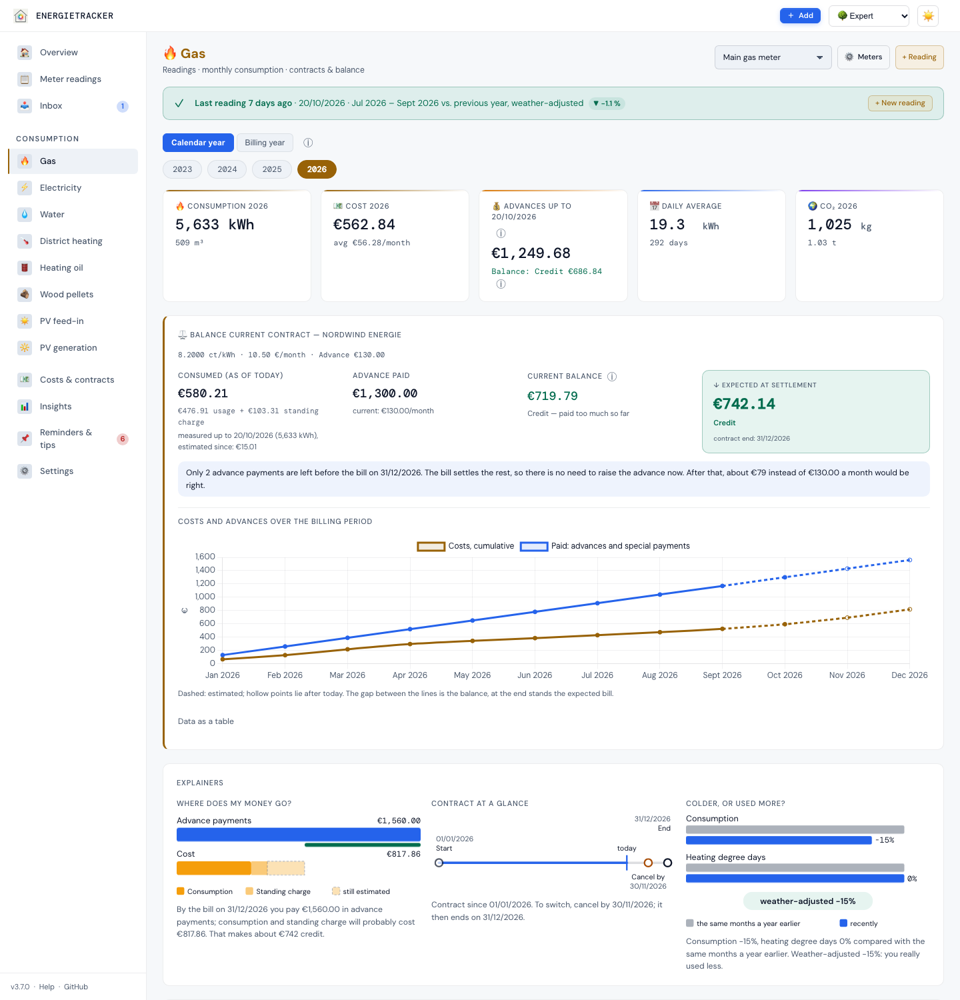

---

## 4. Consumption view — delivery-based utilities (heating oil/pellets)

Instead of meter readings: a tank card and a delivery table (date, quantity,
price, total, supplier). No contract area — the tank invoice is the cost basis.

**Tank log (v2.10.0):** the tank card shows the fill level and the **stock
history** of the selected year — calculated as a solid line, estimated dashed,
known stocks as points — and states below it up to when the calculation is based
on known stocks. Notes appear when levels do not add up, the tank is empty by
calculation or no calculation is possible yet. Below that, the **tank readings**
with "Record tank reading" (date, level, note) and delete. In the delivery
dialog, **"Filled to full"** marks a delivery as an anchor; the table shows it
with "FULL". Months with estimated days carry "≈" in the monthly table; the
ct/kWh column shows the effective price. For heating oil, since v3.1.0 the card
“CO₂ price in the fuel” follows below, as in §3.

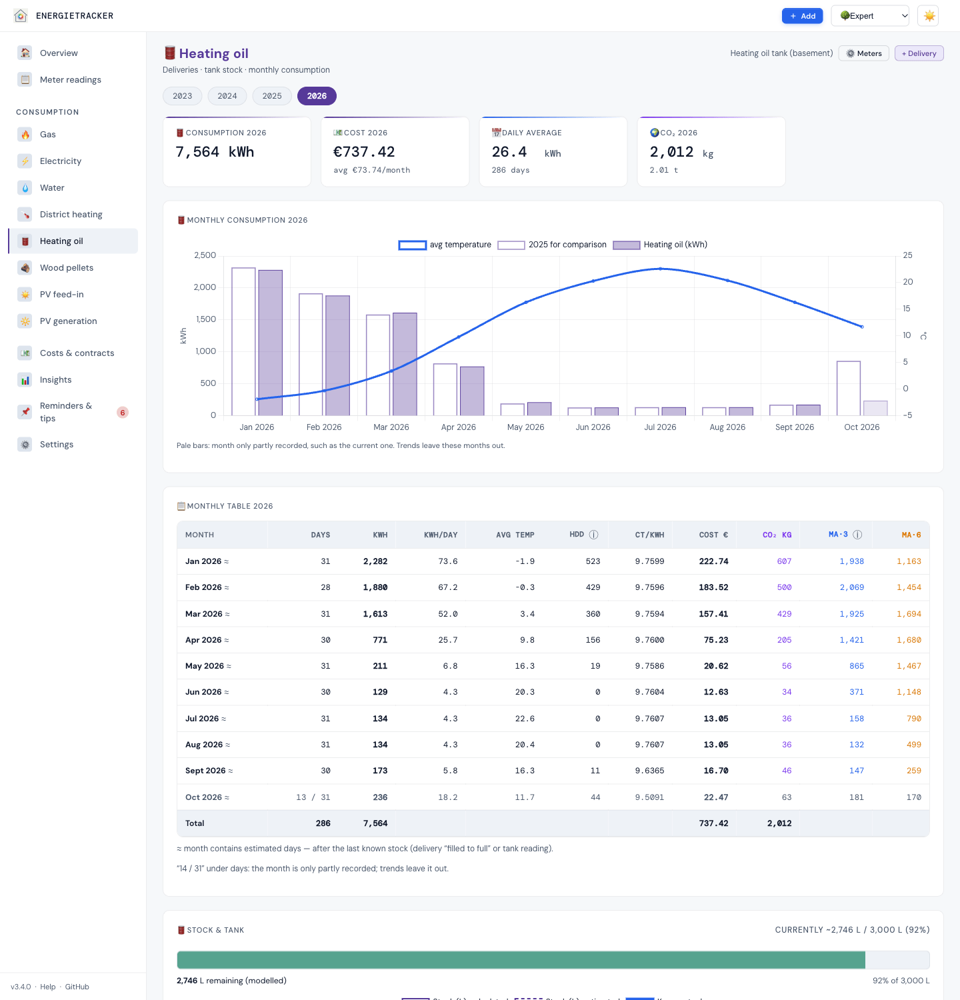

---

## 5. Analysis (heating signature)

An HDD correlation scatter plot with the curves of **all five** models (linear,
polynomial, robust, segmented, sigmoid) and their R² comparison, a year
comparison (since v3.6.0 in billing years by period: months from the first
month of the billing year, the last two periods compared) and anomalies.
Above this, the contract reminders appear in three
levels; since v2.9.0, when a notice period is maintained, they name the **cancellation
deadline** ("Cancel … by …, otherwise the contract runs on beyond …"),
otherwise the contract end.

Since v2.8.0: filled points feed the curves, **hollow** ones are your own months
outside the fit (partial month, too few heating degree days or temperatures),
**grey** ones lie before the baseline date. Below the table, a note says that R²
measures the fit to the months shown, not predictive quality. The "Effect of the
measure" card says whether the difference before/after the baseline date is
statistically supported, with a 95 % range. Anomalies measure each month against
its own expectation (heating model or the same month in other years). For
heating oil and pellets a note appears instead of the curves: their monthly
values are distributed by degree days.

Since v3.1.0 “Effect of the measure” also exists for **electricity, water and
PV**: “before”, “after” (each scaled to “… per year”) and the “change” in % and
per year, with the sentence that without a heating curve the same calendar
months before and after the baseline date are compared, scaled up to a year,
and that the weather is not adjusted.

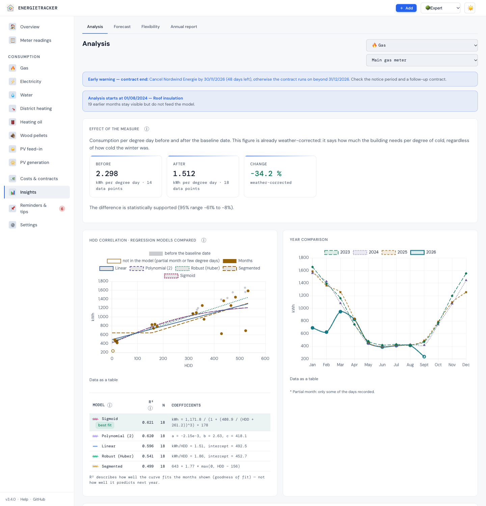

---

## 6. Forecast

### Forecast workshop (v3.6.0)

Since v3.6.0 the page opens with the **forecast workshop** — “What if? Try
it”. Sliders on the left (on top on a phone), on the right the **result
card** with one big number (“A cold winter costs you €214 more a year.”),
then key figures, the **Cumulative cost** curve (baseline dashed, scenario in
the utility’s colour) and — from Experienced — **Month by month** and the
ranking **“What makes the biggest difference?”**. Every change recalculates
at once (debounced); the server calculates, the page recalculates nothing.
Above the sliders sit **example scenarios** to click: Cold winter, Roof
insulated, Cheapest offer, Save 10% (whichever fit the meter).

| Level | Sliders | Result |
|---|---|---|
| 🌱 Beginner | Winter (heating degree days ± %), Save (%), Tariff (current contract, offer, cheapest offer) | result card; cost per year, consumption per year, recommended advance payment; cumulative cost |
| 🌿 Experienced | plus room temperature (± °C), base load (± %), forecast model (weather-adjusted, same as last year, trend), measures with % heating, % base load and cost, own price; since v3.7.0 electric car (km, kWh/100 km) and heat pump (SPF today → scenario), when the household has them | plus balance at the next bill, CO₂, month by month, ranking with payback |
| 🌳 Expert | plus heating curve (regression model), budget | plus forecast models compared, range, best combination within the budget, CSV |

Scenarios can be named, **saved per device** (in the browser) and compared.
**Save result as image** stores the card as a PNG, **Print or save as PDF**
opens the print view `#/forecast/print` with assumptions, baseline against
scenario, curves, monthly table and ranking on A4. None of this leaves the
device without a click. The overview invites into the workshop with the
**“What if?”** card. How it calculates and its limits:
[What if? The forecast workshop](../anleitungen/was-waere-wenn.md). In the
public demo the baseline and the example scenarios are precomputed; your own
installation calculates any slider value.

### Detailed forecast

Below the workshop, collapsible (“Detailed forecast”, the state is kept per
device): the previous view.

Model selection (all five), a 12-month forecast as an R²-weighted blend of
regression and seasonal profile, a cost forecast with the balance of open contracts.

Since v2.8.0 with an **uncertainty band** (the range within which consumption
lies in 80 % of years) and a line for the year ("in 80 % of years between … and
…"). Below it, the source of the heating degree days (climate normal at the
location or your own history) and notices when the history is short. The
"Method" column says per month how it was computed; months after the end of the
contract in which the last contract continues as an assumption carry an
asterisk.

Since v2.13.0 the model name is in the interface language and the balance
column is from the customer's side (+ credit, − additional payment) with an ⓘ. Model
and horizon are pre-set from the settings.

**CO₂ price scenario (v3.1.0):** next to the what-if fields sits **“CO₂ price
from 2028 (€/t)”** with an ⓘ — empty = off, pre-filled from Settings → Expert →
“CO₂ price”. With a value the page writes below the forecast something like
“With 150 €/t CO₂ from 2028: +1.94 ct/kWh, … more over the next 12 months (incl.
VAT).” The forecast itself does not change. The start year comes from “Scenario
from year” in the same settings; if the forecast does not reach it, the line is
missing. For gas, heating oil and heat with gas or heating oil as the energy
source ([CO₂ price in fuel](../verstehen/16-co2-preis.md#6-where-you-see-it)).

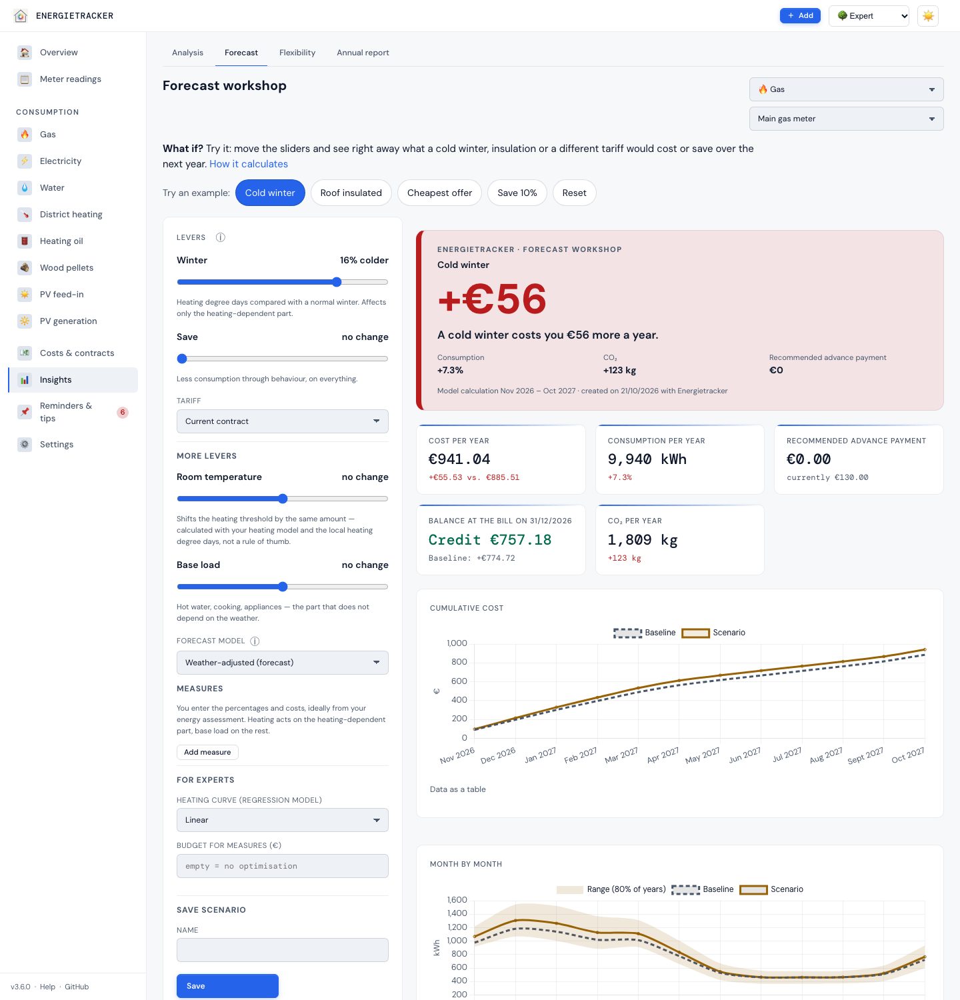

### Valuing flexibility (v3.3.0, under Insights)

The page **“Valuing flexibility”** (`#/flexibility?year=…`, since v3.6.0 for
every level, up to v3.5.0 Expert only) answers: when is it worth using power,
what can shifting bring — and what did it achieve? It calculates with
consumption, generation and wholesale price per quarter hour, every number on
the server — control happens elsewhere (evcc, Home Assistant, the battery
itself). The introduction says so and links the **Guide**
([Valuing flexibility](../anleitungen/flexibilitaet.md)); the data comes from
`GET /api/flexibility` including `insights` ([API](api.md#valuing-flexibility-v330)).

- **Header:** the choice **“Year”** (the current one and the three before it,
  pre-set to the previous year; a year in the address counts from 2018 to
  today) and the button **“Load wholesale prices {year} from SMARD”**. It
  fetches the prices per quarter hour — only on request —, reports “Wholesale
  prices {year} loaded: … quarter hours.” and rebuilds the page.
- **Invitation “What this page can show as well”** (v3.6.0) instead of notes:
  one sentence per missing building block, saying what it brings — wholesale
  prices per quarter hour (with the button to load them), consumption per
  quarter hour, wall box or heat pump with its own meter, generation and
  feed-in per quarter hour (only with PV meters), dynamic tariff or module 3;
  below it the link “Step by step in the guide”.
- **Result card “Your lever {year}”** (v3.6.0, all levels): big number, “This
  much you can save a year on your tariff by shifting use into cheap and sunny
  hours.” (without a lever on your own contract the sentence about the dynamic
  tariff), up to three facts (biggest lever, “With a dynamic tariff: up to …”,
  “Solar power used at home”, “Module 3 already saved”), source, “amounts incl.
  VAT” and date; button **“Save as image”** (PNG, 1200 × 630, drawn in the
  browser). Since v3.6.0 the “Your lever” tile of the
  [overview](#1-overview-dashboard) shows the same number.
- **“What you can do”** (all levels): one action sentence per appliance with
  the time window of the current half-year and the amount, for example “Run
  the heat pump more in the low grid tariff, 00:00–06:00: up to €40 a year.”,
  with the tags “on your tariff” or “with a dynamic tariff” and “sample value”,
  for the car “plug-in times from evcc” or “whole charging day (sample value)”,
  below it, small, the window of the other half-year.
- **“When power is cheap”** (traffic light): choice “Winter half-year · Summer
  half-year · Whole year”; **“A typical day”** (all levels) as a band of 24
  hours — green ✔ cheap, yellow ▲ medium, red ✖ expensive, ☀ for strong sun,
  one sentence per hour for screen readers —, the sentence “Cheapest: …
  Most expensive: …” and the range; **“The week”** (from Experienced) as a
  7 × 24 table. The sentence above and the range call the ct values “wholesale
  share, net, excl. VAT”. Without wholesale prices the module 3 time windows
  colour the traffic light.
- **“Best time windows of the week”** (from Experienced, tag **“net, excl.
  VAT”**): time window, “Avg. wholesale price (net)”, “vs. average”, sun.
- **“Using solar power at home”** (from Experienced, with generation and
  feed-in per quarter hour): used at home, fed in, how much more would be
  possible, with a bar.
- **“Your lever”** (from Experienced): table appliance, price signal, shifted,
  per year — biggest first, sample values marked, for the car the basis of its
  charging windows; below it the sum (biggest lever per appliance, of it on
  your tariff, incl. VAT), the sample values, a sentence about the car (“Car:
  shifted only while it is plugged in — plug-in times from … charging sessions
  in evcc.” or the assumption “whole charging day”) and “Upper limit: …” with
  the VAT rate.
- **“Checked: what shifting achieved”** (from Expert) with the following
  cards; since v3.6.0 the sentence below says that amounts and ct values at
  the wholesale price are the wholesale share, net, excl. VAT (module 3 with
  the amounts on the contract).
- **One card per electricity meter** (only with prices), heat pump and wall
  box first with the tag **“controllable”**, each with the tag **“net, excl.
  VAT”**. Key figures: “Consumption with
  price”, “In cheap quarter hours” (share), “At negative prices”, “Own avg. /
  market avg. (net)”, **“Profile factor”** with an ⓘ and “Advantage (wholesale
  share, net)”. Below it a sentence such as “Cheaper than average: €18.78 saved on
  the wholesale share excl. VAT (profile factor 0.95).” or “More expensive than average:
  … — consumption tends to fall in expensive times.” Expandable **“Per
  month”**: month, kWh, cheap, negative, own avg., market avg., advantage,
  coverage. Without a common quarter hour it says “No quarter hour with both
  consumption and wholesale price.”
- **“Battery by wholesale price”** (tag **“net, excl. VAT”**) — with series for
  charging and discharging the battery (PV generation): “Charged · avg.
  price”, “Discharged · avg. price” and “Value of shifting (net)” with an
  explanation.
- **“§ 14a module 3 — {meter}”** with an ⓘ — for every meter whose contract
  carries time windows (§12), also without wholesale prices: “In the low
  tariff”, “In the high tariff”, “In the standard tariff” (kWh) and “Saving
  vs. standard”, below it the note that time-variable grid fees only exist on
  top of module 1 and with a smart metering system.
- **“Quarter-hour series”** — the list of all series: series (“Wholesale
  prices DE-LU” or utility · meter ID), year, coverage, source (“File”, “Home
  Assistant”, “SMARD”) and 🗑️ “Delete series” with the question “Delete this
  series? Meter readings and daily values stay.”

With prices the source “Wholesale prices: Bundesnetzagentur | SMARD.de (CC BY
4.0)” appears at the bottom. The ⓘ on the profile factor explains: “Your
wholesale price per kWh (weighted by consumption) divided by the market
average. Below 1: you use more when electricity is cheap; above 1: more when it
is expensive.” The term is also in the glossary of the help. To try it out: the
example household “Own house with heat pump and solar” with the year 2025. The
annual report has the same figures as the page “Flexibility” (option in the
dialog, `flex=1`).

### Annual report (under Insights since v2.11.0)

One year at a glance. Since v3.6.0 the dialog offers the appendix **“Billing
years”**: for each utility with bill check, the periods ending in the report
year (period, basis, quantity, cost, advance payments, balance), in the PDF
and the print view (`billing=1`). The other pages stay with the calendar year;
otherwise the totals across utilities would not add up.
Up to v2.10 the report lived in the settings. Since
v3.4.0 (“Annual report for everyone”) it is built for readers without a
technical background: at a glance with status lights and the three most
important tasks, what paid off, what needs doing, deadlines, money, one page per
utility, topic pages only with data, a short glossary — structure, lights and
rules in [Reading the annual report](../anleitungen/jahresbericht-lesen.md).

**Print view (v3.1.0)** is the main button: **Open print view** shows the report
of the chosen year as a page inside the app (`#/report/print?year=…`) — in the
language of this device, with numbers, dates and amounts written as in the rest
of the interface, the charts as vector graphics. **Print / save as PDF** opens
the browser's print dialog; when printing, the page hides sidebar, header, tabs
and buttons and sets A4. On the iPhone this works via Share → Print, where the
report can also be saved as a PDF. The data comes from
`GET /api/reports/yearly`. Since v3.4.0 the print view shows the same model as
the PDF (`model`): all sentences, the app’s explainer graphics (money, energy
flow, “Colder, or more used?”, contract timeline) and simple bars; the
checkbox **“With appendix ‘Figures in detail’”** adds the monthly tables
(`#/report/print?year=…&detail=1`). It is the accessible version: real
headings, tables with header rows, every chart with its message as text.

Below it the **PDF file** stays as before: **Open in browser** shows the PDF in
a new tab (`yearly.pdf?inline=1`) — in the home-screen app on the iPhone a
download often never arrived —, **Download annual report** saves it. Since
v3.4.0 the link carries this device’s language (`lang`); the note says: "The
PDF is created in the language of this device (…), as is the print view." The
built-in PDF fonts only know
Western European characters (CP1252); since v3.1.0 "CO₂" becomes "CO2" there
instead of "CO". For a language the PDF cannot set, the block disappears and
the print view remains.

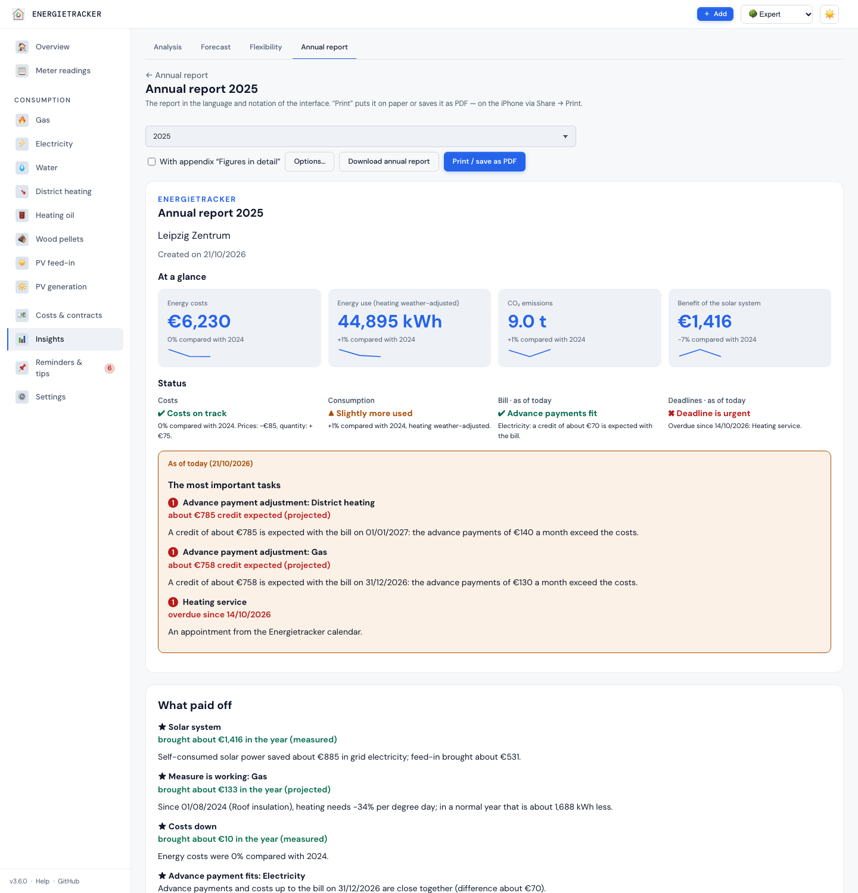

---

## 7. Costs & contracts

### Contracts & payments (v2.11.0)

Per utility and meter, the current contract:

- provider, tariff and term, or "renews automatically"
- **Cancel by** with the days left, highlighted from six weeks before; a
  missed deadline in red. Since v3.4.0 a follow-on contract without a gap shows
  **“Follow-on contract … from …”** (green) instead, with a gap “Follow-on
  contract only from … – a gap of n days” next to it
- *(v3.4.0)* **“History (n)”** as soon as the contract has entries: what was
  done (cancellation, follow-on contract …), when and by whom
- the advance payment per month
- what to expect at the next bill: credit (green) or back-payment (red)

"Manage contracts" leads to the utility's contract list. The figures come from
the same calculation as the utility's balance card. Heating oil and pellets
are no longer listed since v2.13.0 — their costs sit on the deliveries, and the
"Add contract" link led to a page without contracts.

### Check a bill

Up to v2.10 the bill check sat at the end of the gas page, since v2.11.0 it is a
page of its own (`#/bill-check`), since **v3.1.0** for **gas, electricity, water
and district heating**. At the top the selection **“Utility”** (with several)
and **“Meter”** (with several), below it “From”, **“To (inclusive)”** and
**“Recalculate”**.

**Calculated at once, on both routes (v3.4.0):** the page calculates as soon
as it opens — via **Costs → Check a bill** just as via the button on the
utility’s page. Since v3.6.0 it is pre-filled with the latest completed billing
period as in billing years — from the recorded bills, otherwise by the
utility’s settlement date; if there is none, as before with the last completed
billing period after the settlement date (Settings → Utilities & billing,
default 1 January = last year). If the supplier bills in a different rhythm than
the settlement date, the suggestion no longer cuts across the bills. A note
below says so. With
wastewater by a meter of its own or minus a garden meter the table now also
recalculates the wastewater (before, it was missing — and with it in the costs
of the billing years). Switching utility or meter
keeps the period and recalculates; utility, meter and period are in the
address (`?utility=…&meter=…&from=…&until=…`, `until` inclusive), without a
new history entry. Older links with `to` (exclusive) still work. Up to v3.3 the
page only calculated with a period in the address: via Costs the result stayed
empty, and right below the selection stood the “According to the bill” form
with a second period meant differently (“To (exclusive)” at the top, “To
(inclusive)” there).

The table cuts the period like the supplier bill: for gas at every reading and
every calorific-value change (m³ × correction factor × calorific value = kWh),
for the other utilities at every reading and every price or contract date
(boundary “Price change”). Per section period, old and new reading with reading
type, days, boundary, quantity and since v3.1.0 **Price**, **Consumption cost**
and **Fixed costs**; below it “Recalculated: …” (less any bonus) and the legend
of the reading types.

**According to the bill (v3.1.0):** since v3.4.0 it sits collapsed below the
result as **“Record the supplier’s bill (optional)”**, with the number of
bills recorded (“· 2 recorded”). It takes the period from above (“Period as
above: … to … (inclusive).”) and the figures of the
supplier bill — bill date, consumption on the bill (kWh
or m³), bill amount (incl. VAT), advance payments made, additional
payment/credit (positive = additional payment; empty = amount − advances),
**“Other items”** (levies, fees, credits with “Add item”), for gas “Emissions (kg
CO₂)” and “CO₂ cost on the bill” and “Attach bill (PDF or photo)”. **“Save
bill”** creates it and compares at once. The list below shows per bill period,
quantity, amount and additional payment/credit with 📄, **“Compare”**, **“Book
as special payment”** (afterwards the tag “booked”) and 🗑️. The comparison sets
recalculated, on the bill and difference side by side for quantity, amount and
advances, with the verdict **“matches”** or **“check”** and the possible
reasons ([Annual bill](../anleitungen/jahresabrechnung.md#7-on-the-bill-enter-compare-book)).

**Editing a bill (v3.2.0):** every row of the list carries a ✏️ (“Edit”)
before the 🗑️. It fills the “According to the bill” card with the values of
that bill — bill date, quantity, amount, advances, additional
payment/credit, other items, for gas the CO₂ figures and the attached
receipts; since v3.4.0 it puts the bill’s period into the fields at the top and
recalculates it — and says above the buttons “You are editing the bill from … to ….”
If it is already booked, “It is already booked as a special payment – the
booking in the contract does not change with it.” follows. The button then
reads **“Save changes”** (message “Bill updated”, then the comparison), next
to it **“Cancel”**. Up to v3.1 a bill could only be deleted and entered again;
the interface (`PATCH /api/utility/{utility}/bills/{id}`) already existed. The
page belongs to the “Experienced” level.

### Tariff switch (tariff comparison)

Answers the question the Energietracker exists for: **should I switch?** The
view is split into two blocks, and the order is deliberate.

#### Switching decision

At the top sits the **expected annual consumption** from the forecast — exactly
the figure comparison sites ask for as input. One click copies it. The workflow
is therefore: take the number, search elsewhere, enter the offer you found with
**"+ Add offer"** (technically a shadow contract).

There is deliberately no integration with comparison sites. The application
fetches no tariffs from outside; the user enters what they found. Where the
configured country has an official tariff comparison (Austria, France, Italy,
Spain, Portugal), the view links it below the annual consumption since v3.1.0:
"Official tariff comparison (Austria) ↗" — a link, not a fetch
([country profiles §8](../verstehen/14-laenderprofile.md#8-what-your-bill-calls-it)).

Next to it sits the **switch date**, derived from the contract end and the
notice period. The deadline is shown with the days remaining and highlighted
once it gets tight — it is the thing people miss in everyday life. To model a
different scenario, set the date by hand.

**Groups (v3.1.0):** the meter choice also lists “Group: …” for every meter
group with a group contract. Forecast and ranking then calculate with the
consumption of the whole group, with unit prices per register using a blended
price; an offer created here applies to the group. The card “Have ready for
switching” is left out for groups — it applies per meter.

What counts here is not the currently running contract alone but the **binding
chain**: if the follow-on contract has already been signed, the switch for the
next period is done, and the date follows that contract's end. The view states
such a follow-on explicitly. The baseline follows the chain too — each month is
billed with the tariff that applies then, not with the expiring one. A gap of
more than a day ends the chain; after that you are free.

Notice period, minimum term and price guarantee are maintained **on the
contract** (contract management of the respective utility). Without them the
comparison cannot derive a date or warn before a deadline passes.

**Have ready for switching (v3.1.0):** a card with the details the new supplier
asks for — **Market location ID**, **Meter number** (serial number of the
installed device) and **“Last meter reading ({date})”** — and the button **“Copy
details”**. Whatever is missing is left out; without any detail the card is left
out. You enter the market location ID in the meter dialog (§12).

**Price increase (v3.1.0):** if the running or following contract has a future
price increase entered, the app reports, in Germany, the recommendation “{label}:
price increase from {date}” with the note on the special right to terminate as
of that day (§ 41(5) EnWG). While the recommendation stands, the price increase
also appears under “To do”; once hidden it is only in the calendar.

The ranking shows, per offer:

| Column | Meaning |
|---|---|
| **Year 1** | cost of the first twelve months, sign-up bonus already deducted |
| **Year 2 on** | the ongoing cost, without one-off bonuses |
| **Difference** | against the current contract carried forward |
| **Pays off from** | the annual consumption above which the offer beats the current contract |

Since v2.13.0 this explanation sits below the ranking instead of only in the
tooltip of the column headers; "Pays off from" carries an ⓘ.

**Ranking follows "Year 2 on".** An offer that is only cheap in the first year
does not win the ranking — the year-1 figure still sits beside it so it can be
checked against what the portal displayed.

The **Pays off from** column is the honest answer to an uncertain forecast.
Instead of claiming a saving to the euro, it names the volume at which the
ranking flips: if that is far from the expected consumption, the decision holds
even when the forecast is off. A ±10 % consumption range sits below the annual
figures.

The chart overlays the offers **on top of** the current contract as a cost
curve. Monthly rather than as an annual total, because only then can you see
where the difference comes from — with gas it arises almost entirely in winter.
Months beyond the **price guarantee** are drawn dashed: there the price is an
assumption, not a commitment.

The calculation covers twelve months from the switch date, seasonally weighted.
A switch on 1 July therefore still covers a full winter; a one-twelfth
calculation would get this wrong.

#### Looking back at real months

Below, collapsed: the same tariffs applied to **actually measured** consumption
— "what would tariff X have cost?". This is the proof. Anyone who sees the
maths hold up on real data will also trust the forecast.

Real contracts refer to **exactly the days they cover** — what the bill booked;
contracts with a shorter term carry their month count as a marker, plus an
extrapolation to the full period. **Shadow contracts count as a price sheet for
the whole period** (since v2.9.0): an offer entered only from April to September
used to look cheaper than the same offer for the whole year, because it was
missing the winter.

The **ct/unit** column holds the total cost per kWh or m³ — unit price,
standing charge and bonuses combined. It is the only figure independent of the
term length, and therefore the basis for the ranking. Only pure tariff costs
are compared; advance payments and one-off settlements are cash flows against
the balance and stay out of it (they live in the consumption view). Both
stand below the table since v2.13.0.

Since v2.12.0 the year picker offers only years with consumption data (up to
v2.11 always the last seven years); months follow the language's notation
("Jan 2027"). A year without tariff rows shows a note instead of hiding the
whole retrospective including the picker.

#### Maintaining offers

An offer is captured with the fields a portal result actually carries: unit
price, standing charge, **sign-up bonus as an amount** (not as a credit date —
nobody knows that when entering it), price guarantee and notice period. The
calculated switch date is pre-filled as the start.

**Dynamic tariff (v3.1.0, electricity):** the offer form has the tick
**“Dynamic tariff (wholesale price per month)”**. With it the unit price field
disappears; instead there are “Mark-up per kWh” (with a hint on what belongs to
it) and “VAT on the wholesale price (%)”, pre-filled with 19. In the ranking and
the look-back, such an offer carries “Wholesale price as a monthly average — as
if your consumption were spread evenly across the day; evening use usually
costs more.” and, if needed, for how many months the previous year’s month was
assumed. If wholesale prices are missing, a note to load them under “Wholesale
electricity prices” appears instead of the offer. Since v3.3.0 the look-back
uses your own load profile where consumption and wholesale price per quarter
hour exist for the meter (months with at least 90 % coverage); the offer then
carries “Wholesale price with your quarter-hour load profile in {N} months,
otherwise the monthly average.” instead of the sentence about the monthly
average. The ranking of the switching decision stays with the monthly average
([Flexibility](#valuing-flexibility-v330-under-insights)).

**Wholesale electricity prices (v3.1.0, electricity):** the card **“Wholesale
electricity prices”** with an ⓘ names the range of available monthly averages
(“Monthly averages available: … to …” or “No wholesale prices loaded yet.”),
explains the dynamic tariff check and has the buttons **“Load from SMARD”**
(fetches the monthly values, only on request) and **“Import file”** (SMARD
download or `YYYY-MM;€/MWh`). Below it the source “Wholesale prices
Germany/Luxembourg: Bundesnetzagentur | SMARD.de (CC BY 4.0)”
([Electricity → Dynamic tariffs](../verstehen/02-strom.md#dynamic-tariffs-v310)).

Offers can be created, edited and deleted; the delete question names the offer
(v2.12.0). In the contract list they carry
their own marker so they are not mistaken for a running contract. They affect
**neither the balance nor the forecast nor the contract status** — they exist
for this comparison only.

> **Water** stays out: the three-component model (drinking, waste and rainwater)
> needs a calculation of its own. Heating oil and pellets are delivery-based —
> there the delivery invoice is the cost basis.

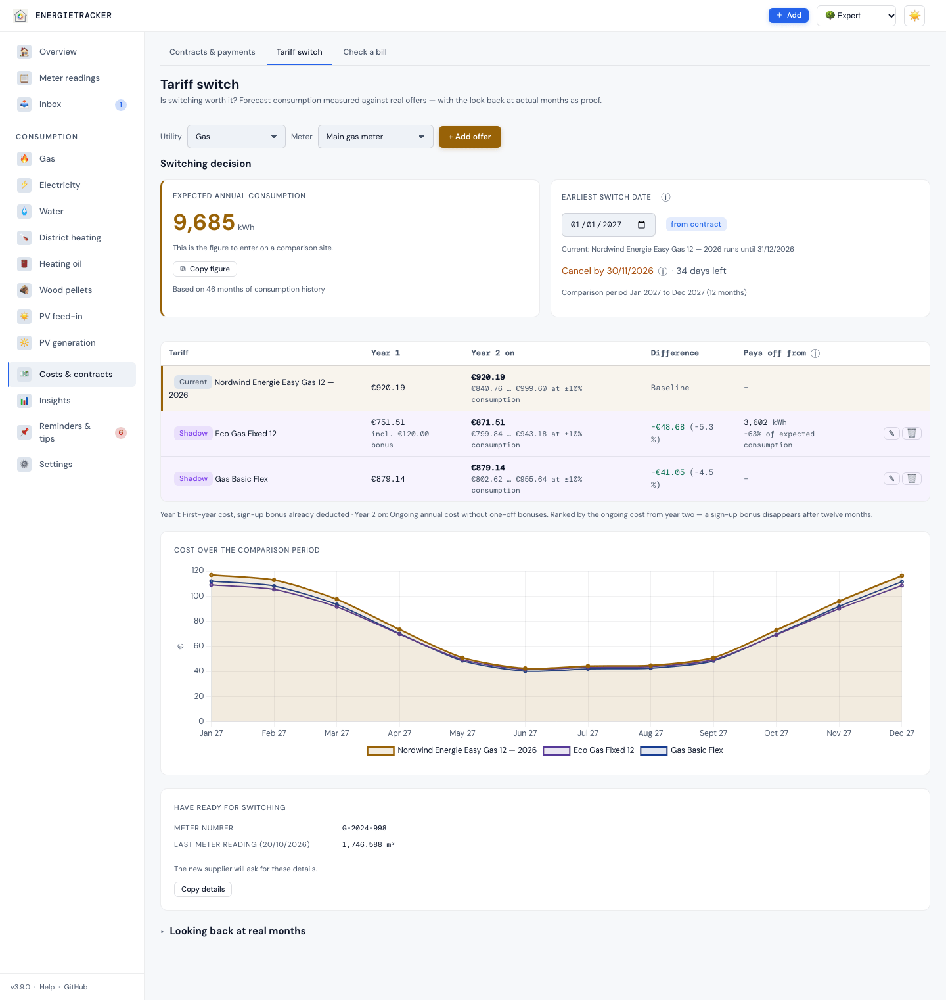

### Tenancy *(v3.1.0)*

For tenants who pay heating and water through the service charges. The page
(`#/tenancy`) appears under **Costs & contracts** as soon as “I live: in a
rented home” is chosen under Settings → Household & building → Home and hot
water; in your own home it does not exist. At the top “+ Tenancy”, with several
a selection. Without a tenancy it says “No tenancy yet” and asks you to set up
prepayment, billing date and the meters from the consumption information. Step
by step: [As a tenant](../anleitungen/mieter.md).

Three cards, in Germany since v3.1.0 a fourth (“Sharing CO₂ costs”):

**Prepayment and costs** ⓘ — the estimate for the current billing period
(“Billing period … – …”):

- Key figures **Expected costs**, **Prepaid**, **Likely outcome** (“…
  additional payment”, “… credit” or “about even”) with a note on the risk —
  “Little additional payment expected”, “Small additional payment possible”
  (up to 10 % of the prepayment) or “Additional payment likely” — and
  **Suitable prepayment per month**.
- Always below: “An estimate from your meters and the prices of the last
  statement – not a service charge statement. What the landlord bills may
  differ.”
- The **assumptions**, where they apply: a missing price for heat, hot water or
  cold water, a missing prepayment, no meters assigned, how many months are
  estimated.
- Expandable **“Month by month”**: month, heating (kWh), water (m³, hot and
  cold together), expected costs, prepaid and running total. Estimated months
  are pale with “estimated”.

**Sharing CO₂ costs {year}** ⓘ *(v3.1.0)* — for the previous year, the
landlord’s share of the CO₂ costs under the CO2KostAufG. One sentence names the
case (own heating with your own contract, or central heating), below it **CO₂
per m² and year**, **Stage** (… / 10), **Landlord’s share** and **Refund**,
differences in the heating cost statement as a warning, the reductions and “An
estimate under the CO2KostAufG, not legal advice.” **“Letter (PDF)”** opens the
letter to the landlord or the check result in a new tab. Without an area or data
the card says what is missing; in your own home or outside Germany it is left
out. If the tenancy’s area is empty and the living area was never entered, the
card (since v3.6.0) keeps calculating with 100 m² but says **“Assumed living
area 100 m² – please enter it”** with the link “Enter the area in the tenancy”
(opens the tenancy with the field focused); the annual report names the
assumption in the tenancy topic
([Share CO₂ costs with the landlord](../anleitungen/co2-aufteilung.md)).

**Master data** — titled with the name of the tenancy, next to it **“Edit”**.
Start (and end), landlord or managing agent, start of the billing period
(DD.MM.), the prepayment valid today (“Heating … + operating costs … per
month”), the prices for heat (per kWh in the minor unit), hot water and “Cold
water and sewage” (per m³) and the number of assigned meters. A sentence with
an ⓘ points to the utility: “You enter the monthly consumption information
under the utility: Heat” — only if Heat is active.

The dialog **“Set up tenancy”/“Edit tenancy”** has name, landlord or managing
agent, since v3.1.0 **“Floor area per tenancy agreement (m²)”** (empty = from
settings), start, “End (empty = ongoing)”, “Billing period starts on (DD.MM.)”
and three lists with “+ Row” and ✕, each row with a “From” date:

- **Prepayments** — heating and operating costs per month,
- **Prices** — heat per kWh, hot water per m³, cold water per m³; hint: from
  the last statement, cost of the category divided by consumption, standing
  charges included,
- **Flat charges** — name and amount per year (waste, cleaning, insurance,
  cable …).

Under **Assigned meters** there are checkboxes for “Heating:” (meters of the
Heat utility), “Hot water:” and “Cold water:” (water meters). Since v3.1.0 the
field group **“CO₂ costs (CO2KostAufG)”** follows: the checkbox “Gas also for
own appliances (e.g. gas cooker) – refund −5%” and the selection “Public-law
restrictions (§ 9)” — none, “against renovation or replacing the heating (share
halved)” or “against both (no sharing)”; plus a note. “Delete tenancy” asks
first — it takes its statements with it.

**Service charge statements** ⓘ — a list with period, received, costs,
prepaid and result (“… additional payment” or “… credit”), a 📄 per receipt
(“Open statement”), ✏️ and 🗑️. **“+ Statement”** opens “Record statement”:

- period from, to, “Received on” (this starts the objection period),
- total costs and prepaid,
- heat consumption on the statement (kWh) and heating costs,
- **Items** with name, kind (heating, hot water, cold water, sewage, operating
  costs, other), amount and consumption — “For the prices, hot and cold water
  with cost and consumption (m³) are enough; sewage counts towards cold
  water.”,
- *(v3.1.0)* **CO₂ information on the heating cost statement**: emissions (kg
  CO₂), CO₂ costs, stage on the statement, landlord’s share on the statement
  (%), landlord’s amount on the statement — basis of the check with central
  heating,
- **New prepayment as per the statement** (from, heating, operating costs),
- “📄 Attach PDF or photo” (several possible),
- two checkboxes, ticked by default: **“Take over prices from it (from the day
  after the period)”** and **“Take over the new prepayment”**, plus a note.

With “in a rented home”, agenda and calendar know two deadlines: by when the
statement must arrive at the latest and until when objections are possible
([Calendar](../anleitungen/kalender.md)). With your own gas boiler, since v3.1.0
the deadline for the refund of the CO₂ costs is added.

---

## 8. Recommendations

Seven statistical rule families (over-consumption trend, summer base, anomaly, tank
level, contract end, efficiency, …), sorted by urgency, individually hideable.
Purely data-driven, no advertising. Since v2.11.0 under **Reminders & tips**;
the button reads "Hide for 30 days" instead of "✕". Since v2.12.0 the message
names the recommendation and offers **"Undo"** for ten seconds. Since v2.13.0
the page says when there is too little data (no meter with three readings)
that it is too early for recommendations — before, it read "all clear". Since
v3.4.0 a recommendation with a deadline more than 30 days away (cancellation,
contract end, price increase) has the button **“Hide until …”** — it does not
come back before the deadline; every hide is recorded in the history
(Reminders & tips → Done).

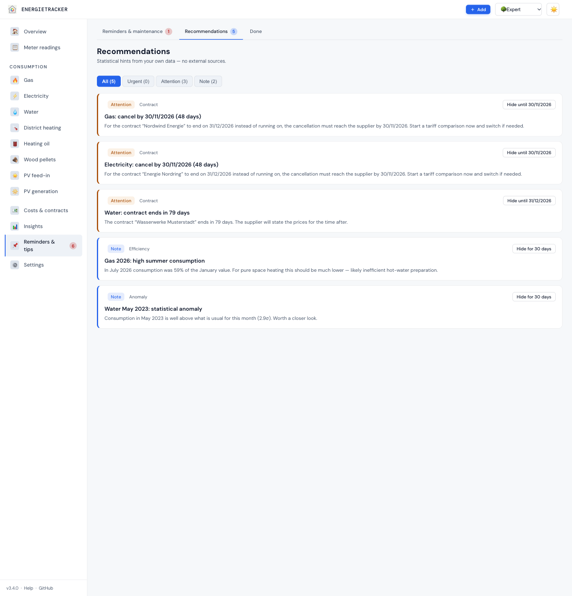

---

## 9. Appointments & maintenance

Recurring appointments (heating service, chimney sweep, calibration deadlines —
since v2.9.0 with a category of its own for heat meter calibration). Due/overdue
ones appear on the dashboard; on completion the next appointment is
rolled forward according to the recurrence. Since v2.11.0 the first tab under
**Reminders & tips**; the count in the sidebar adds due reminders and open
recommendations.

Since v2.12.0 **"Done"** reports the reminder with its next due date and offers
**"Undo"** for ten seconds (date and status as before). A missing title or date
appears at the field instead of in a message at the bottom right; the delete
question names the reminder. An interval in months reads "Every 48 months"
instead of "Every N months (48)".

Since v3.4.0 **✓** opens the dialog “Mark as done” (date, note, receipt);
every completion is recorded in the history, “Undo” restores date and status
and strikes the entry through. Below the title it says **“Last done on … by
…”** (the person only with sign-in).

**Subscribe in your calendar (v3.1.0):** the button above the list opens a
dialog with two addresses to copy — `webcal://…` (opens the calendar app
directly) and `https://…`. The subscription holds reminders, cancellation
deadlines, contract ends, ends of price guarantees, price increases and due
readings; the calendar fetches it again every 12 hours. With sign-in switched
on, the app creates a dedicated **calendar key** for it and appends it to the
link; it only works for this subscription and can be revoked under Settings →
Access. Notes on Apple Calendar and Google Calendar are in the dialog. Setup
per calendar app: [Deadlines in your calendar](../anleitungen/kalender.md).

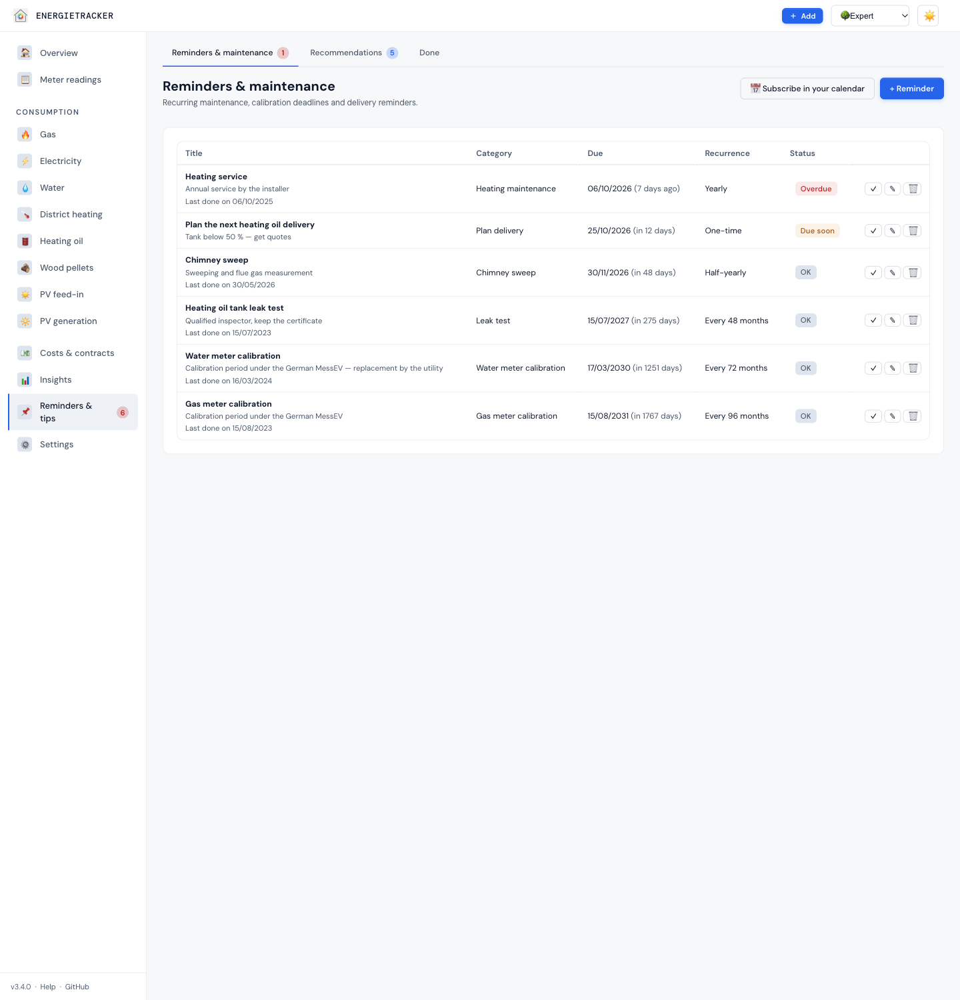

### Done (v3.4.0, under Reminders & tips)

The third tab under **Reminders & tips**, from the “Experienced” level: the
history of done notices, grouped by month, newest first, with the number of
entries per month.

- **Filters:** “Person” (only if people appear in the history), “Period”
  (entire history, last 3 or 12 months, this and last year) and “Area”
  (reminders, contracts, meter readings, tank and store, tenancy,
  recommendations).
- **Entry:** title in the interface language, “on … by …” (without sign-in
  only the day), for automatic entries the badge “automatic” and “Reason:
  Follow-on contract … from …”, “hidden” for a recommendation, note and
  receipt (📎).
- **✎** changes the note, **“Undo”** strikes the entry through (“Undone on …
  by …”) and restores what it changed. Automatic entries have no “Undo” —
  they follow the data.
- **“Manage history”** (admins only): retention in months
  (`activity_keep_months`, default 60, 0 = unlimited) and “Clear history” —
  all entries before a day, or all of them.

Guide: [Ticking off notices](../anleitungen/hinweise-erledigen.md).

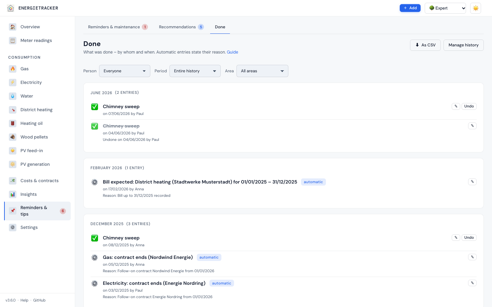

---

## 10. Weather data (settings)

Since v2.11.0 under Settings → Weather data; the address `#/temperatures`
remains. CSV import (drag & drop), Open-Meteo sync for the stored location, a monthly chart
min/avg/max. The basis of every HDD evaluation.

**Since v2.12.0** this is the only place for location and weather:

- **Place search:** enter a name or postcode and pick a hit — coordinates and
  place name are taken over and saved. Only the search text goes to Open-Meteo.
- Latitude, longitude and place name save on change; *Fill weather
  automatically* is a switch on this page.
- The sync saves a changed location first.
- CSV in the usual format `DD.MM.YYYY;avg;min;max` with a decimal comma; tab and
  the old double-quote format are read as well. Up to v2.11 the import also
  split at the decimal comma. Since v3.1.0 it also understands spreadsheets
  from other languages — dates as `D/M/YYYY` or `D-M-YYYY`, a header such as
  "Date;Moyenne;Min;Max" — and every export file of your own; the example CSV
  comes in the interface language.

Since v2.8.0 a line above the
chart states up to when measured values and from when forecasts are available;
the option "Also replace existing older values with archive values" cleans up
forecasts that earlier versions stored like measured values. With *Fill weather
automatically* (on by default) the app syncs by itself once a day when
it is opened and loads the climate normal the first time. If the location is
still the country default, a note says so (v2.7.0) — the degree days then use the
weather of another place.

Below the chart, since v2.13.0, the source and licence: "Weather data by
Open-Meteo.com (CC BY 4.0)"; the PDF annual report names it too as soon as it
shows temperatures. Since v2.16.0 the range from minimum to maximum is a filled
area, the average the line inside it.

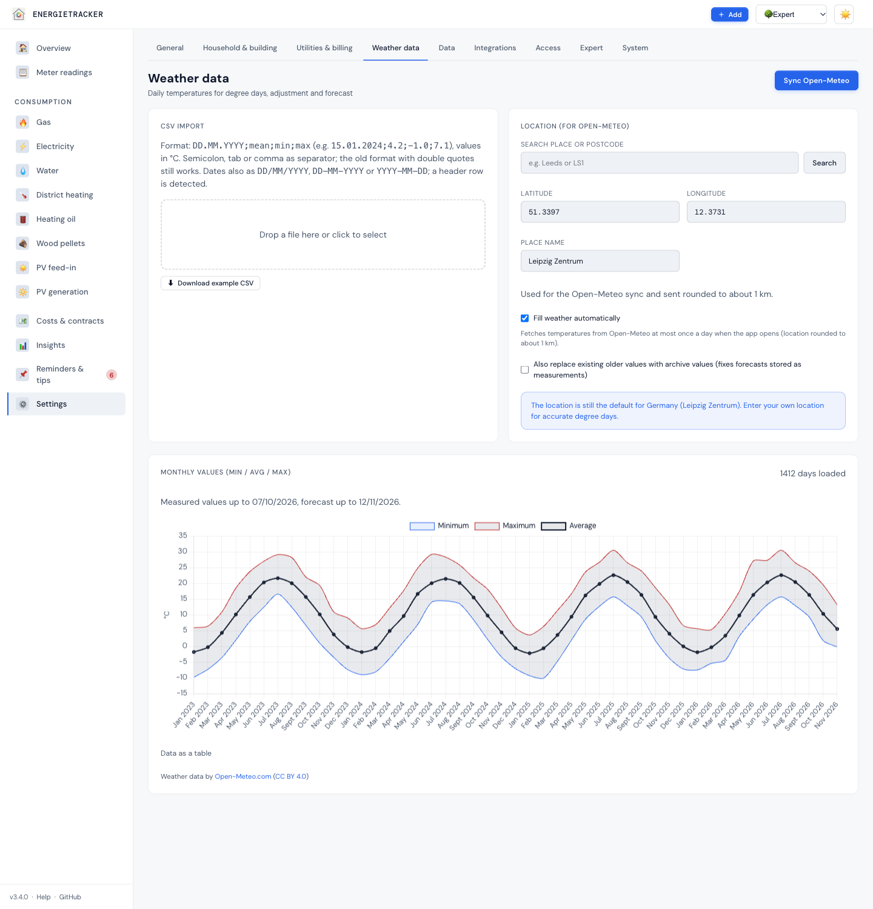

---

## 11. Settings

Since v2.12.0 **nine sub-pages** instead of one long page:

| Page | Contents | From level (v3.2.0) |
|---|---|---|
| General | since v3.2.0 at the top “Experience level and setup” and, with sign-in, “My account”; Language & country, overview (months, forecast horizon, warn after days without a reading), contract reminders | Beginner; the groups “Display” and “Reminders” from Experienced |
| Household & building | living area, building type, heated basement, hot water; since v3.1.0 “Home and hot water” and “Own reference values” (for the benchmark); water reference values with the number of people in the household; since v3.9.0 “People in the household”: add, rename and delete names for “Responsible”, also without sign-in ([Users in the household](../anleitungen/benutzer.md#people-in-the-household-v390)) | Beginner; “Own reference values” and “Water reference values” from Experienced |
| Utilities & billing | active utilities (since v3.1.0 including heat), all billing dates in one card, physical constants (gas factors, heating threshold), calorific values and tank warning, CO₂ factors (since v3.1.0 with “CO₂ avoided by PV”), since v3.1.0 “Photovoltaics” (assumed self-consumption of plug-in solar), since v3.9.0 “Metering concept” (assistant, below) | Beginner; physical constants, calorific values and since v3.7.0 Photovoltaics from Experienced, CO₂ factors from Expert |
| Weather data | §10 | Experienced |
| Data | CSV export (spreadsheet in the default language or format 1), backup & restore with snapshots, demo data; link to the annual report | Beginner |
| Integrations | Home Assistant integration; since v3.9.0 “Notifications to Home Assistant” | Experienced |
| Access | since v3.4.0 “Security check” (does the web server serve `data/`?, proxy header, open operation without a host list), sign-in & access with “Sign out everywhere”, since v3.2.0 “Users and roles”, embedding, since v3.4.0 “Host names” | Expert |
| Expert | since v3.7.0 at the top the “Reading documents” card (Local \| Cloud), since v3.1.0 receipts (storage limit) and text recognition in the home network, since v3.2.0 “evcc in your home network”; below, collapsed (“Show calculation parameters”) and with a warning: regression, forecast model, anomaly and recommendation thresholds, since v3.1.0 CO₂ price | Expert |
| System | version, licence, since v3.4.0 “Support Energietracker”, security check (v3.4.0), system diagnostics | Expert |

Each page saves through a bar at the bottom ("Discard" · "Save") that appears
only after a change. Leaving the page with unsaved changes asks first.

**Cards in a grid (v3.4.0):** every sub-page lays all its cards out in one
grid — three columns on the Mac, two or one on the iPad, one on the iPhone.
Narrow cards (such as “Active utilities” with the checkboxes in two columns,
“Language & country”, “Sign-in & access”) sit side by side and aligned at the
top; wide cards with tables (physical constants, data export, backup, API
keys, users and roles, system diagnostics, “Meters and templates for Home
Assistant”) span the full width at the end of the page. The Home Assistant
integration is split for this: status and token in a narrow card, meter
aliases and YAML templates in a wide one; likewise “Sign-in & access”
(narrow) and “API keys for scripts” (wide). Number fields in wide cards are at
most 12 rem wide.

**Support Energietracker (v3.4.0, GitHub #28):** under System, next to “About
Energietracker”, a small card links to Buy Me a Coffee
(`buymeacoffee.com/bingerminger`, opens a new tab). Support is voluntary; the
app stays the same and nothing depends on it.

**Since v2.13.0:** 18 more fields carry a hint on what they do. The card of
billing dates lists the **PV feed-in** (its remuneration is calculated up to
the billing date); heating oil and pellets are gone there — they have no
advances and therefore no billing date, the fields had no effect. Under Expert
the forecast models carry names instead of keys, and the **forecast band
width** can be set (effective since v2.8.0, until now only via the API). The
Home Assistant card links the guide in the matching language.

The PDF annual report sits under Insights since v2.11.0. After demo data, backup import
or a restore the app restarts, so that sidebar, language and cache match the
new state.

**Experience level and setup (v3.2.0, General page):** the 🌱 card sits at
the very top. Its hint reads “Decides what the interface shows — every level
calculates everything.” and says who the level applies to: “Applies to all
devices of this installation.” or, with sign-in, “Applies to you (…) on all
devices.” Below it the choice “Experience level” — the same as in the top bar;
it saves at once (“Level saved.”) — and one line per level on what you can do
there (since v3.7.0): Beginner “See what you use, what it costs and whether
the advance payment is enough. Enter readings, let the app read supplier mail,
deal with reminders.”, Experienced “Plus compare and check: tariffs and
switching, bills, analyses with weather, meter structure, tenancy, Home
Assistant.”, Expert “See and connect everything: quarter hours and
recalculation per meter, calculation parameters, access, API keys, system.” The
buttons **“Start the setup assistant”** (§16), **“Guide”**
([Setup and experience levels](../einstieg/einrichtung.md)) and since v3.7.0
**“What can I do at each level?”** ([feature table](stufen.md)) close the card.

**My account (v3.2.0, General page):** only with sign-in and a person signed
in — 👤 **“My account: {name}”** with the role (“Admin” or “Member”). Whoever
signs in with a password changes it here with “Current password”, “New
password” (at least 8 characters) and **“Change password”**; in proxy mode it
says “Signed in through the service in front of the app; change the password
there.” instead ([Users in the household](../anleitungen/benutzer.md)).

Below that the card **Language & country** (v2.7.0): language, country, currency
and time zone, all taking effect immediately. Since v3.1.0 there are two
language fields:

- **Language on this device** — applies to this browser only and is stored
  there, not on the server. The first choice, "Same as the installation (…)",
  follows the default language. So one phone in a household can show English
  and another German.
- **Default language of the installation** — the setting `language`. It
  applies to devices without a choice of their own and to everything produced
  without a device: PDF annual report, CSV files, messages to Home Assistant
  and scripts.

With sign-in and a person signed in (v3.2.0), the choice under “Language on
this device” also saves that person’s language; it then applies on all of
their devices and takes precedence over the choice in the browser.

Up to v3.0 one person switched the language for every device. When the country
changes, a dialog
shows the values the country profile would change — current and new side by
side, with the source of the CO₂ factor — and offers "Apply all", "Change
country only" or "Cancel". Since v2.7.0 the gas conversion factors accept the
calorific value in kWh/m³, MJ/m³ or GJ/Smc, with a hint for British, Italian
and Dutch bills.

Since v2.10.0: **CO₂ factors** of the energy sources with their source, all per
kWh (heating oil and pellets were labelled g/L and g/kg respectively, but
calculated per kWh; water stays per m³ and without a source), electricity **per year** as a table; **Building & efficiency** with *Heated
basement* and *Decentralised hot water*. If an installation still carries the old
default values, **"Newer default values available"** appears at the top with the
old and the new value and the button "Use the new values". If only the default
gas factor 11.5 is active, the gas factor table points this out.

**Embedding** (since v2.6.0, Access page): addresses allowed to embed the app,
such as a Home Assistant dashboard. The **🏠 Home Assistant integration
(F1009)** on the Integrations page — manage the API token, maintain meter aliases and copy three
ready-made templates: the REST command, the `secrets.yaml` entry and (since v2.5.3)
an automation built from the aliases that checks `has_value` before every push.
Since v3.3.0 the REST command also sends
`"timestamp": "{{ now().isoformat() }}"`. The automation still sends once a day
(23:55); for consumption per quarter hour, switch its trigger to every 15
minutes (`time_pattern`, `minutes: "/15"`).
Since v3.1.0 **“Step 5 · Values back into Home Assistant”** follows: REST
sensors for `configuration.yaml` that query `GET /api/summary` once an hour —
per meter the balance (for utilities with a contract), the forecast for the
next 12 months and the days since the last reading. With sign-in switched on,
the `secrets.yaml` entry `energietracker_read` for an API key with scope
“Read” appears below. When the app runs under Home Assistant ingress, the
templates name `http://<container host name>` as the address instead of the
ingress address from the address bar
([Home Assistant, step 5](../anleitungen/home-assistant.md)).
Number fields and billing anchors are validated before saving; errors appear in
red at the field.

**Data export (CSV, v3.1.0):** above the buttons sits the choice of format:
"Spreadsheet in the default language (…) — recommended" opens directly in
Excel or LibreOffice with the column names, decimal separator and dates of the
default language; "CSV format 1 — stable, for scripts" stays as it has been
since version 1.1. The browser remembers the choice; both can be imported
again. Exported are the monthly overview, readings or deliveries per utility
and the temperature series ([CSV formats](api.md#csv-formats-v310)).

**Backup & restore (v2.6.0):** an import is first checked completely and shown as
a preview (what is restored, what stays unchanged for lack of content); a faulty
backup changes nothing and names the findings. Below, the **stored snapshots**
with time, occasion and size — download (⬇️), restore (↩️, the app saves the
current state first) or delete. If the safety snapshot fails, the app asks
whether to restore anyway. Since v3.1.0, as soon as there are receipts, a line
above the buttons reads “Receipts: 12 files, 3.4 MB of 500 MB – included in
the backup.”; from 80 % of the limit in the warning colour with “The storage
for receipts is almost full.”

**Home and hot water (v3.1.0, Household & building page):** the 🔑 card
between “Building & efficiency” and the water reference values. “I live” — “in
my own home” or “in a rented home”; renting adds the [Tenancy](#tenancy-v310)
page under Costs & contracts. “Heat comes from” and “Hot water is heated by” —
a choice of energy sources, first option “not specified”; “Hot water
temperature” in °C ([Settings](einstellungen.md#home-and-hot-water-v310)).

**Receipts and text recognition (v3.1.0, Expert page):** two groups at the top
of the page, before the collapsed part “Show calculation parameters” — they are
not calculation parameters. **📎 Receipts** with “Storage for receipts, at
most” (`attachments_max_mb`). **🔎 Text recognition in the home network** with
“Model” and “Time limit”; “Service address” and “Interface” (Ollama or
“OpenAI-compatible (LM Studio, LocalAI)”) have been in the **📥 Reading
documents** card under “Local” since v3.7.0, because the inbox uses them too.
Left empty, text recognition stays off
([Settings](einstellungen.md#text-recognition-in-the-home-network-v310),
[guide](../anleitungen/texterkennung.md)).

**Reading documents (v3.7.0, Expert page):** the 📥 card comes first, before the
collapsed part. The switch **Local | Cloud (experimental)** is the choice of who
reads the post in the inbox (`inbox_provider`). “Local”: address and interface
of your own service (with the sentence that they also apply to meter photos),
“Check connection”, text model and time limit per step. “Cloud”: the
“Experimental” note, provider (Claude, OpenAI, Mistral, OpenRouter, Google
Gemini, own address), key (never shown, only “Stored”), model from the service’s
list or by hand, time limit and “Switched on”. A **Save** button of its own; only
admins change the switch and the cloud fields
([Inbox](../anleitungen/posteingang.md#setting-up-reading)).

**evcc in your home network (v3.2.0, Expert page):** the 🚗 group sits next to
receipts and text recognition, before the collapsed part. Its field **“evcc
address”** (`evcc_endpoint`) takes the address you open evcc at in the
browser, such as `http://192.168.178.30:7070` or `http://evcc.local:7070`;
only addresses in your own network. Left empty, fetching stays off — the CSV
file from evcc always works. With an address, the card “Charging sessions from
evcc” shows the button “Fetch from evcc” (§3,
[Charging sessions from evcc](../anleitungen/evcc.md)).

**CO₂ price (v3.1.0, Expert page, under “Show calculation parameters”):** the
group 🏷️ with “CO₂ price per year” — a table year → €/t with delete per row and
the fields year and €/t for adding; your own values take precedence over the
country profile —, “Scenario: CO₂ price” (default for the forecast, empty = off)
and “Scenario from year” ([Settings](einstellungen.md#co₂-price-v310)).

**Sign-in & access (v2.6.0):** shows the mode (no sign-in, password, proxy),
switches password sign-in on, changes the password or switches it off again
(with the current password) and manages **API keys** for scripts (read or
manage, plaintext once, last used). Since v3.1.0 it also lists the calendar
keys that “Subscribe in your calendar” creates after asking first (“Create
link”; scope “calendar subscription only”); revoking one ends the
subscription. Whatever is fixed by an
environment variable is only displayed here. Since v2.6.0 the Home Assistant card shows when a value
last arrived with the token and warns when sign-in is on but no token exists.
Once people have been added (v3.2.0), the fields for changing the password are
gone here; instead it says “Each person changes their password under Settings
→ General → My account.”

**People in the household (v3.9.0, Household & building page):** the card 👥
appears at every level and without sign-in too. It lists everyone with their
number; people without sign-in have **“Rename”** and **“Delete person”** (the
same dialog as under Access), people with sign-in the note “with sign-in” and no
buttons. Below it the field **“New person”** (placeholder “Name, e.g. Anna”)
with **“Add”**; Enter is enough, the focus then stays in the field, and the
message says “… can now be chosen under “Responsible”.” Members only see the
names. Without people it says “No people yet. Add the first one, then you can
assign reminders, meters and contracts to them.” The field for the water saving
index has since been called “Number of people”
([Users in the household](../anleitungen/benutzer.md#people-in-the-household-v390)).

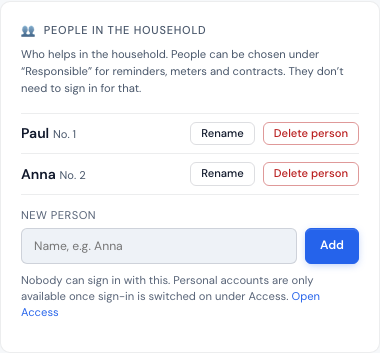

**Users and roles (v3.2.0, Access page):** with sign-in switched on,
the card 👥 **“Users and roles”** follows “Sign-in & access”, with the
hint “Each person signs in with name and password and has their own level and
language. Everyone shares the household’s data.” — in proxy mode “… the app
knows each person by name. The first one to arrive manages.” — and the link
“Guide”. The table lists per person the name (your own row with “(you)”) and
the role as a choice of “Admin” or “Member”, which saves at once; plus
**“Reset password”** (for people with a password, “New password” in a dialog;
the person is signed out on every device) and **“Delete person”** (not on your
own row; it asks “This person will no longer be able to sign in. The
household’s data stays.”). In password mode **“Add a person”** with name, “New
password” (at least 8 characters) and role (“Member” preselected) creates a
person — “{name} can now sign in.” Before the first new person, the list only
holds the admin “admin”; the installation’s previous password belongs to
them. The last person who manages can neither be deleted nor made a member
(“At least one person must manage the installation.”). Without sign-in the
card shows, since v3.9.0, only the note that own accounts only come with
sign-in and the button **“Go to people”**; there is no second list of people
there any more.

To a **member** the Access page shows only “Access is managed by whoever
manages the installation. Change your own password under Settings → General.”
What only admins may do — people, API keys and sign-in, restoring a backup or
snapshot, loading sample data, the addresses for embedding, text recognition
and evcc, since v3.9.0 the notifications to Home Assistant — the server refuses
for members with “Only someone who manages this
installation may do that.” ([Users in the household](../anleitungen/benutzer.md)).

**Notifications to Home Assistant (v3.9.0, Integrations page):** the card 🔔
sits next to the Home Assistant integration. At the top a sentence on what is
reported and “The messages only go to your Home Assistant. Nothing leaves your
home network unless you enter an address outside it yourself.” Below it the
switch **“Send notifications”**, **“Where to?”** (Through the Supervisor, only
selectable in the Home Assistant app · Webhook in Home Assistant · Address and
token), depending on the target “Home Assistant address”, “Webhook ID” with
**“Create a new ID”** and the ready-made automation to copy, or “Token
(long-lived)”, plus “Action in Home Assistant”, **“What to report?”**
(appointments, deadlines and other items from “To do”, warnings, new documents
in the inbox) and “Daily check from” (time). After saving, the card shows
webhook ID and token only as “stored”. **“Send a test message”** checks the
target; the line below names the last delivery or why it failed. Only admins
may change it
([Home Assistant, step 6](../anleitungen/home-assistant.md#step-6--notifications-to-home-assistant-v390)).

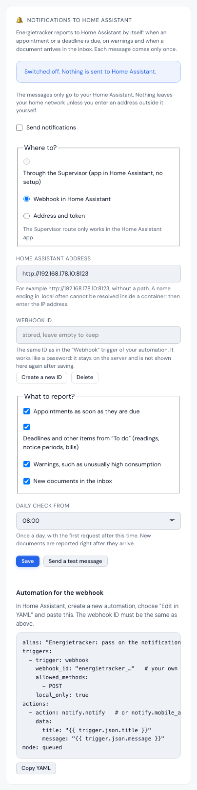

**Metering concept (v3.9.0, Utilities & billing page):** the card 🔌 asks
“Solar, heat pump or EV charger with its own tariff?” and opens the assistant
from §12 with **“Set up metering concept”**. It is not part of the public demo.

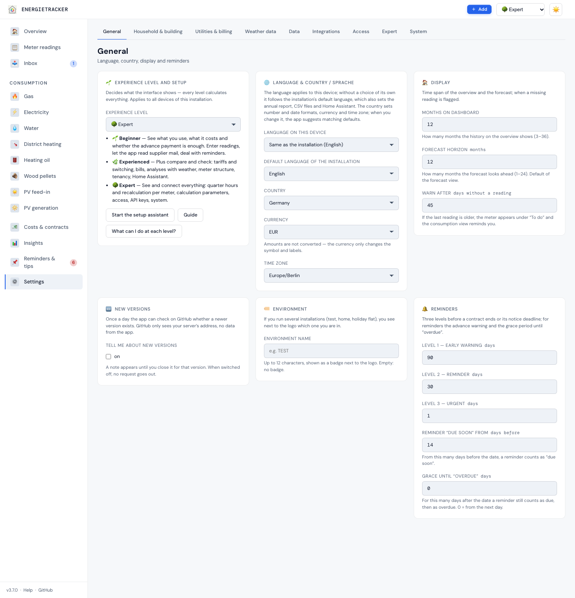

---

## 12. Meters & contracts — incl. topology (F1006)

Meter/device management incl. meter swap (the device chain) and contract maintenance
(working/base price history, advances, bonuses, special payments). Since v2.5.3 the
**meter swap** requires the final reading, shows the last known reading and
summarises the swap before performing it. A **contract** needs a provider or tariff
and at least one working price; the start is prefilled with the day after the
current commitment, and the app asks before a new contract supersedes a running one. Since v2.12.0 the first price rows apply from the contract start and follow it until someone changes their date; a pre-filled row without an amount stays empty. "From start" (up to v2.11 "⇧ Start") sets a row to the contract start. The contract card counts in the right plural ("1 working price"), delete is an outlined button, and the question names the contract. Since v2.9.0 the **Notice period** takes months, weeks or days, plus **Cancellation takes effect** ("automatic", "at the end of the term", "any time, at month end", "any time, to any day") and the **"Renews unless cancelled"** checkbox — clear it once you have cancelled. A meter with *Active* cleared still counts in every total, but no longer appears in the reading entry and raises no warnings. Below the unit prices of a gas contract, **"Convert a price per m³"** (v2.7.0) turns a price per m³ or Smc into ct/kWh and enters it. For oil/pellets only the tank/store
management is relevant here. When creating or editing a tank, **tank capacity** and **initial stock** are captured (instead of a cumulative meter reading), since v2.10.0 optionally the **price of the initial stock** (empty = price of the first delivery). For cumulative meters the **register digits** can be maintained since v2.6.0 — the evaluation then calculates a rollover (99,999 → 0) correctly; the device line shows them.

**Heating limit (v3.9.0):** For gas, district heating, heat, heating oil and pellets
the form has its own block with this meter’s heating limit (6 to 22 °C). Empty
means the default from the settings, shown as the placeholder. The explanation
says what the limit changes (expectation, adjustment, forecast, balance; for
tanks how deliveries are spread over the months). If the measured months give a
suggestion, it appears below with a button that enters it into the field; it is
only stored with “Save”.

**Contract list (v3.4.0):** the contracts of a utility (Costs → Contracts →
“Manage contracts”) stand in one view, backwards through time and grouped:
**Upcoming**, **Current** (renewed too), **Ended (n)** — collapsible from three
entries — and at the end **“Quotes for comparison – not counted”** with the
shadow contracts and a link to the tariff switch. In Upcoming and Current the
latest start is on top, in Ended the latest end; a contract replaced by one
that started later counts as ended. Every card carries the status tag from the
server’s phase (as in the “Contracts & advances” table), the years
(“2024–2025”, “since 2022”) and, instead of the counts, the values that apply
today: “Unit price … ct/kWh · Standing charge … €/month · Advance payment
… €/month” — for an ended contract those of its last day, for an upcoming one
those of its first, then with “(as of …)”. The counts (“1 unit price · 1
standing charge …”) appear at the “Expert” level. Up to v3.3 the list sorted
by start only: a quote for next year stood on top as the “newest contract”,
the open-ended heat pump contract among the ended ones. In the contract dialog
the price rows (unit price, standing charge, advance payment, for district
heating capacity and metering charge, for water all price lists) also list the
newest first, and **“+ Row”** adds on top; saving still stores them in
ascending order.

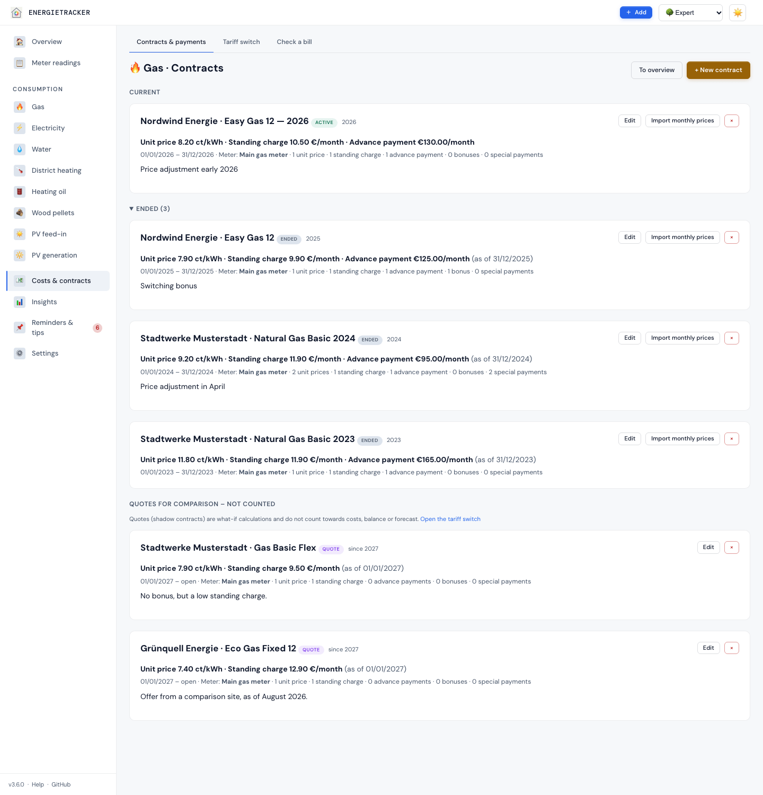

**One form grid (v3.4.0):** all dialogs — contract, meter, device replacement,
group, delivery, tank reading, period, reminder, offer, tenancy and statement —
and the “As billed” form lay out their fields in the same six-column grid:
dates and numbers narrow, text wide, notes across the full width, two columns
on the iPhone. Label, field and hint of one row line up, even when a label
wraps. Fields that belong together sit in a box with a heading; its fields have
their own surface, in dark mode too. Lists of rows (prices, bonuses, special
payments, time windows, prepayments, items) share one grid — date | amount |
extra | ✕ — with the labels only above the first row. The **contract dialog**
orders its boxes like a bill: contract → term and cancellation → unit price,
standing charge, advance payment → grid fee (§ 14a module 1 and module 3) →
bonuses → special payments → credit notes → notes at the end. The **water
contract** has the same box of special payments after its bonuses (since v3.5.0,
[#34](https://github.com/Bingerminger/energietracker/issues/34)). The module 3
time windows take “from” and “until” the same way (also “6” or “1530”, which
the app writes as 06:00 and 15:30). The **meter dialog** starts with name,
icon, role and recording, then device, structure, market location, system,
baseline dates, notes.

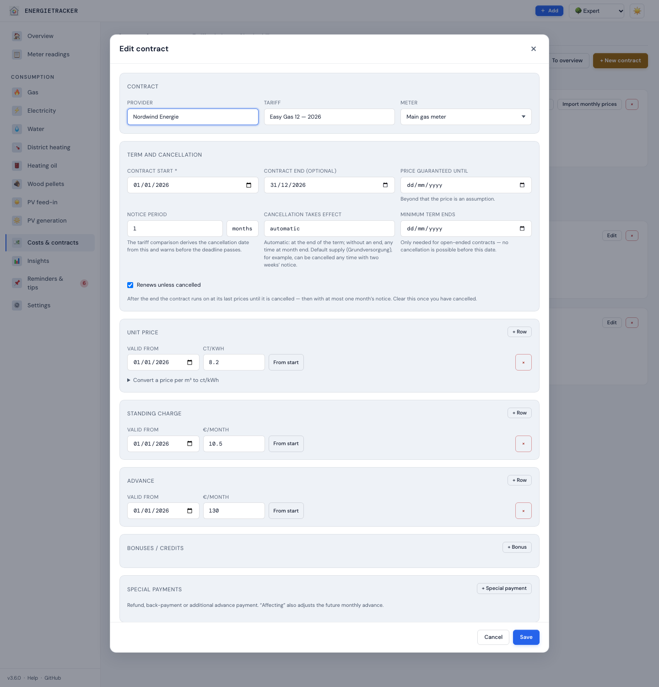

**Role and recording (v3.1.0):** for electricity, water, PV generation and
heat, the meter dialog has the choice **“Role”** with a hint below — it
replaces the former “Heating electricity (heat pump)” checkbox:

| Utility | Roles |
|---|---|
| Electricity | Household · Heat pump (heating electricity) — counts towards the efficiency figure · Wallbox (EV charger) |
| Water | Cold water · Hot water — the app also shows the heat needed for it · Garden |
| PV generation | Generation · Battery – charging · Battery – discharging |
| Heat | Home consumption · Heat pump output — does not count as heating energy, otherwise it would be counted twice next to the heating electricity |

All utilities with meter readings also get **“Recording”**: “Meter readings”
or “Consumption per period” — “for values that already come as consumption –
such as the monthly consumption information from the metering service.
Switching is possible while the meter has no data.” The meter card then
carries the tag “per period”, likewise any role other than the default. A
meter with consumption per period has no meter swap; “CSV import” opens the
import of periods for it: one line each with a month and the consumption, or
`from; to; consumption; note`, header optional, with a preview (“N periods can
be imported”); overlapping periods are skipped and reported
([Heat](../verstehen/15-waerme.md)).

**Market and metering location (v3.1.0):** except for heating oil and pellets,
the meter dialog has the fields **“Market location ID (MaLo)”** and **“Metering
location ID (MeLo)”** with the hint “For switching supplier; shown on the bill.
MaLo: 11 digits; MeLo: 33 characters starting with “DE”.” The app rejects a
wrong ID — such as a market location ID with a wrong check digit — with a
message. The market location ID appears in the switching decision under “Have
ready for switching” (§7).

**Register and parent meter (v3.9.0):** for electricity and solar feed-in the
meter dialog has the field **“Register (OBIS code)”** with suggestions (1.8.0
import, 1.8.1 import HT, 1.8.2 import NT, or 2.8.0 feed-in) and the hint to
create one meter per register with the same meter number. The meter card shows
“Register 1.8.1”. Below “Parent meter” it now says what it does: “If this meter
has its own contract, the parent meter’s contract only bills the remainder.
Without its own contract it is a breakdown.” When you create a contract on a
sub-meter, the contract dialog says in one sentence what changes on the parent
meter.

**Advance payments with a rhythm (v3.9.0):** every row of the advance payment
plan has the choice **“Rhythm”** (every month, every 2 months, every 3 months);
the amount is then “€ per due date”. If the plan came from a bill, it shows
“Due dates according to the bill: …, then yearly on the same days” below; a
different rhythm removes the dates. The water contract also has the field
**“Waste water standing charge (€/month)”**, and its advance payment plan counts
per due date too ([water](../verstehen/03-wasser.md#advance-payments-every-two-or-three-months-v390)).

**District heating (v3.1.0):** the district heating contract dialog has two
more price lists with an effective date — **“Capacity charge”** (€ per kW and
year) and **“Metering charge”** (€ per year) — and the field group **“District
heating: connection and key figures”** with “Connected load (kW)”, “Network CO₂
factor (g/kWh)” and “Primary energy factor” plus a hint where the values are
found ([District heating](../verstehen/04-fernwaerme.md#fixed-costs-capacity-and-metering-charge-v310)).

**Group contract (v3.1.0):** for gas, electricity and district heating the
“Meter” choice in the contract dialog also lists **“Meter groups (one contract
for all)”** — every group with members. With a group, **“Unit price per meter
(e.g. peak/off-peak)”** appears: one price list with effective dates per
member, empty means the unit price above. The contract card then names “Meter
group: …” instead of the meter
([Group contract](../verstehen/13-meter-topologie.md#group-contract-v310)).

**Reduced grid fee (v3.1.0):** the electricity contract has the price list
**“Reduced grid fee (§ 14a EnWG, module 1)”** in € per year, with an effective
date ([Electricity](../verstehen/02-strom.md#controllable-consumers-v310)).

**Time-variable grid fee (v3.3.0):** after the price lists, the electricity
contract has, at the Expert level, the section **Ҥ 14a module 3:
time-variable grid fee”** with the hint “Standard tariff and time windows from
your grid operator’s price sheet (grid fee per kWh). A window across midnight is
two windows. Evaluated under Insights → Flexibility.” Fields: “Standard tariff
(ct/kWh)” and per time window “Quarters” (Q1–Q4 to tick, all four for a new
one), “From”, “Until (HH:MM, also 24:00)” and “ct/kWh in the window”, plus ✕
“Remove time window” and **“+ Time window”**. If standard tariff and windows
stay empty, the contract has no module 3. The app rejects invalid entries with
“Module 3 time windows invalid (…): quarters 1–4, times HH:MM with from before
until, prices 0–100 ct and a standard tariff.”
([API](api.md#contracts-time-variable-grid-fee-module-3-v330-additive)). Balance
and forecast do not change because of it.

**Credit notes from the direct marketer (v3.1.0):** the feed-in contract
dialog has the section **“Credit notes from the direct marketer”** with “From”,
“To (inclusive)” and “Amount” per row and “Add credit note”
([PV §11](../verstehen/12-pv.md#11-credit-notes-from-the-direct-marketer-v310)).

**Import monthly prices (v3.1.0):** on the card of a real contract (not for
water and feed-in), **“Import monthly prices”** reads a file
`month;ct/kWh[;standing charge]`. The preview “Apply monthly prices” names the
months (“The file contains prices for … months …”) and skipped lines; “Apply”
enters a unit price (and standing charge) per month from the first
([Electricity](../verstehen/02-strom.md#dynamic-tariffs-v310)).

**PV system and heat pump in the meter dialog (v3.1.0):** for PV generation the
field group **“PV system”** with “Plug-in solar device (balcony system, no
feed-in meter)”, “Investment (incl. VAT)”, “In operation since” and “Storage
capacity (kWh)” with hints. For heat with the role “Heat pump output” the
choice **“Heat pump electricity meter”** — electricity meters with the heat
pump role to tick.

**Import time series (v3.1.0):** every meter card of a utility with meter
readings carries the button **“Import time series”**. The dialog “Time series
from a portal — …” shows the first lines after “Choose file” and asks for
“Header rows”, “Date (and time) column”, “Time column (if separate)”, “Value
column”, “The values are” (consumption per interval or meter readings), “Unit
of the values”, “Time stamp marks” (start or end of the interval) and “Start
value (meter reading)”. “Preview” names days, period and total; “Import”
writes and remembers the mapping per meter in the browser
([Time series from portals](../anleitungen/daten-aus-portalen.md)). Since
v3.3.0 “Import” also keeps values at 15, 30 or 60 minute intervals per quarter
hour — for Insights → Flexibility; the preview names them in a line “Plus
{count} quarter-hour values (every {N} minutes) — evaluated under Insights →
Flexibility.”

**Minimum term over 24 months (v3.1.0):** if a contract’s minimum term ends more
than 24 months after its start, the app shows after saving the note “The minimum
term is longer than 24 months. In Germany, an initial term this long is invalid
for consumers (§ 309 no. 9 BGB).” The contract is saved anyway.

**Meter topology:** submeters are shown indented under their parent meter, groups as
an expandable collective entry; **"Group meters"** (up to v2.11 "Merge meters")
combines several existing meters into a group — the meters stay separate, the
group shows the total. A missing selection or name appears at the field. Per
meter, the HA alias (`external_id`) can also be set here.

**CSV import with preview (v2.12.0):** choosing a file only reads it. The
preview shows each row with its effect — new, replaces the existing reading
(with the old value) or unchanged — and the checks of manual entry: decrease,
jump, order of magnitude, future, duplicate date. Conspicuous rows are always
listed, others up to 50. Only "Import N rows" writes; "Choose another file"
starts over.

Since v3.1.0 the import reads spreadsheets in every language of the app: column
names such as "Date", "Index" or "Lectura", dates as `DD.MM.YYYY`,
`DD/MM/YYYY`, `DD-MM-YYYY` or `YYYY-MM-DD`, "estimated" as the yes of the
language. A date with the month before the day (`01/15/2026`) is not
reinterpreted; the row is reported. The example below the file field and the
example CSV are in the interface language.

### Assistant “Set up metering concept” *(v3.9.0, GitHub #40)*

Reached through **“Set up metering concept”** on the meters page of
electricity and the solar utilities, through the card “Metering concept” under
Settings → Utilities & billing and as a way at the end of the setup assistant
(§16). It asks about the layout, not about the name of the metering concept,
because the names differ from one grid operator to the next. Five steps, “Step 2
of 5” in the footer:

1. **What is connected to your electricity supply?** Solar system, battery, a
   device with its own tariff (heat pump or EV charger) and “Two time-of-use
   rates (HT/NT)?” (no, on every import meter, only on the device’s meter).
2. **How are the meters connected?** Cards with a diagram: with a device on
   its own tariff “Two meters side by side”, “Sub-meter behind” and “Cascade”,
   without such a device only “One meter for everything”. Each card says in one
   sentence what each meter measures and which contract bills what.
3. **Which meters are there?** Name and meter number per position, the register
   codes filled in; you pick an existing meter instead of creating it twice.
4. **Which contracts are there?** Start, unit price (per register with HT/NT),
   standing charge and advance; leaving it empty is fine. A running contract on
   an existing meter stays as it is; with remainder billing it says “Bills only
   the remainder: … minus …”.
5. **What the assistant will create:** the diagram of your installation with a
   legend and the list of steps. “Create” saves the current state as a snapshot
   first.

The diagrams are line drawings in the colours of the utilities, light and dark;
a screen reader reads their name (“Diagram: Cascade”). Obstacles (such as a
meter with sub-meters of its own that is supposed to hang behind another)
appear in the summary; “Create” is then disabled. It is not part of the public
demo ([use case H](../anleitungen/anwendungsfaelle.md#h--cascade-with-heat-pump-htnt-and-solar-v390),
[meter topology](../verstehen/13-meter-topologie.md#3-interaction--data-model)).

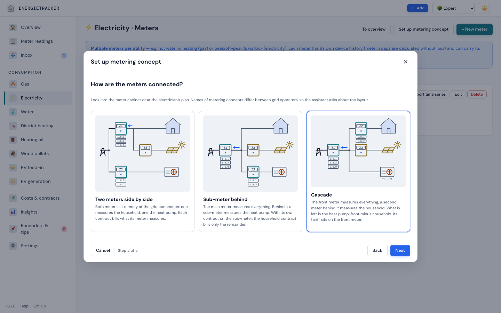

---

## 13. PV — feed-in & generation (F1005)

A dedicated view for photovoltaics: the feed-in meter (remuneration as revenue), the
generation meter, the **electricity balance** (grid import − feed-in) and the
**self-sufficiency rate/self-consumption**. Since v2.10.0 the generation shows
"Generation" and avoided CO₂ instead of "Consumption" and an emission, without a
cost tile; in the tariff switch of the feed-in, the higher remuneration comes
first. PV utilities have no default meter — anyone without a system sees no
phantom meters.

**Since v2.13.0** the feed-in speaks of remuneration throughout: the monthly
table has "Revenue" instead of "Cost" and no advance columns, the contract
table "Earned" and "Received" instead of "Consumed" and "Paid", and an open
claim is green instead of red (legend "+ credit, − reclaim"). Avoided CO₂ has
no minus in front — the word "avoided" carries the direction, as in the annual
report. Both PV utilities drop temperature and heating
degree days; anomalies and the year-on-year comparison rate less feed-in as a
decline, not as a saving.

**Energy flow (v2.16.0):** both PV pages show per month where the solar power
went — self-consumed and fed in, stacked to the generation — and as a line what
still came from the grid. The short description only adds up months with data
from all three meters.

**Battery, payback, notes (v3.1.0):** the PV generation view shows, where the
data allows:

- **“Battery {year}”** — “Charged”, “Discharged”, “Efficiency” with “Losses …
  kWh” and “Full cycles” (only with a storage capacity);
- **“Payback”** — “Investment”, “Benefit so far” with “recently … a year” and
  “Paid back since” or “Paid back probably” with “about … years”, below it what
  the benefit includes and what it does not;
- for plug-in solar without a feed-in meter “Plug-in solar: self-consumption
  assumed at …% of generation (settings).”;
- in Germany, for commissioning on or after 25 Feb 2025, the note on § 51 EEG
  (no feed-in tariff at negative wholesale prices, below 100 kW from the year
  after a smart metering system is installed).

More in [PV §7–10](../verstehen/12-pv.md#7-battery-v310).

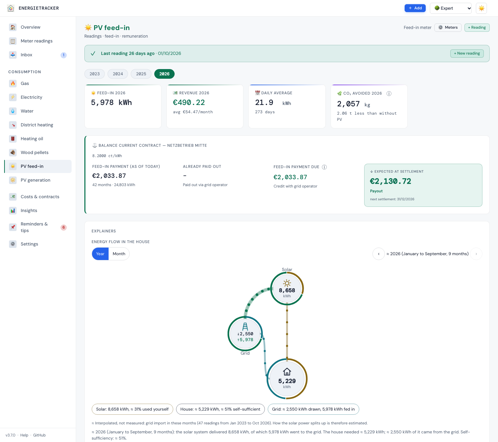

---

## 14. Sign-in (v2.6.0, opt-in)

Only with sign-in switched on: a plain sign-in screen with a password field and
the note how to get back in after forgetting the password. After signing in, the
browser stays signed in for 30 days; the top bar then carries a **Sign out**
button (it also discards this browser's offline data). When a session expires,
the screen appears instead of a series of error messages. Setup and background:
[Security & network operation](../betrieb/sicherheit.md).

**Name (v3.2.0):** once people have been added under Settings → Access
(`named_login` in `GET /api/session`), the field **“Name”** sits above the
password, and the cursor starts there. Upper and lower case do not matter in
the name. An empty name field signs in with the installation’s previous
password as long as the first admin “admin” still exists. The note below then
reads “Forgot your password? Someone who manages this installation can reset
it under Settings → Access.” In proxy mode the service in front of the app
signs you in; the app recognises the person by the name it reports
([Users in the household](../anleitungen/benutzer.md)).

**Offline notice:** when data comes from the offline storage of the installed
app, the top bar shows "Offline – data as of …". Changes without a connection
are reported as "No connection to Energietracker – nothing was saved."

---

## 15. Help (v2.13.0)

Reached from the footer of the sidebar, on the iPhone under "More"
(`#/help`). Four cards, since v3.2.0 the use cases, and the glossary:

- **First steps:** the same list as in the welcome, with ticks from the data;
  once everything is done, it says so.
- **Documentation:** since v3.4.0 **“Open the handbook”** at the top (the
  index of this handbook), below it getting started, frequently asked
  questions, glossary, “Setup, example households and levels”
  ([Setup and experience levels](../einstieg/einrichtung.md)), “Use cases”
  ([Use cases](../anleitungen/anwendungsfaelle.md)), the Home Assistant guide
  and troubleshooting. All of them open **in the app** (up to v3.3 on GitHub,
  as of `main`) — in German for a German interface, otherwise in English, with
  a note when your own language is missing. A sentence below says that the
  handbook lives on your own server, matches the version and opens without
  internet access.
- **Questions and bugs:** GitHub issues and the pointer to the diagnostics
  under Settings → System, whose details a bug report needs.
- **Your data:** everything stays on your own server — no accounts, no
  advertising, no telemetry. The app talks only to Open-Meteo: for the daily
  weather sync (location rounded to about 1 km) and the place search — and,
  only if set up, to your own text recognition service in the home network
  (v3.1.0) and to evcc in your home network (v3.2.0) — and, only on request
  (“Load from SMARD” under Tariff switch), to SMARD for wholesale electricity
  prices (v3.1.0).
- **Use cases (v3.2.0):** a card of its own between the cards above and the
  glossary, in every language of the app — the documentation exists only in
  German and English. Since v3.4.0 all seven cases of the
  [guide](../anleitungen/anwendungsfaelle.md) (A–G: shared flat with shared
  meters, smart home with Home Assistant, solar household with a heat pump,
  landlord with several units, wallbox and company car, **“District heating
  or heat?”**, **“Control with evcc or Home Assistant”**), since v3.9.0 as the
  eighth case **“Cascade with heat pump, HT/NT and solar”** (H), and **“Simple first,
  everything later”** (the experience levels), each with title, a short
  explanation and **“Read more in the handbook”** — the jump leads exactly to
  the section, in German or English. Below them **“Try an example
  household”** — it leads to Settings → General with “Start the setup
  assistant” — and “Use cases” to the whole guide.
- **Terms:** since v3.1.0 43 entries (33 in v2.13.0) in all seven languages with a search. The ⓘ in the app
  opens the same texts; `#/help?term=hdd` jumps to a term. Since v3.1.0
  billing terms also show what the bill of the configured country calls them
  ("On your bill (France): “Mensualité”").

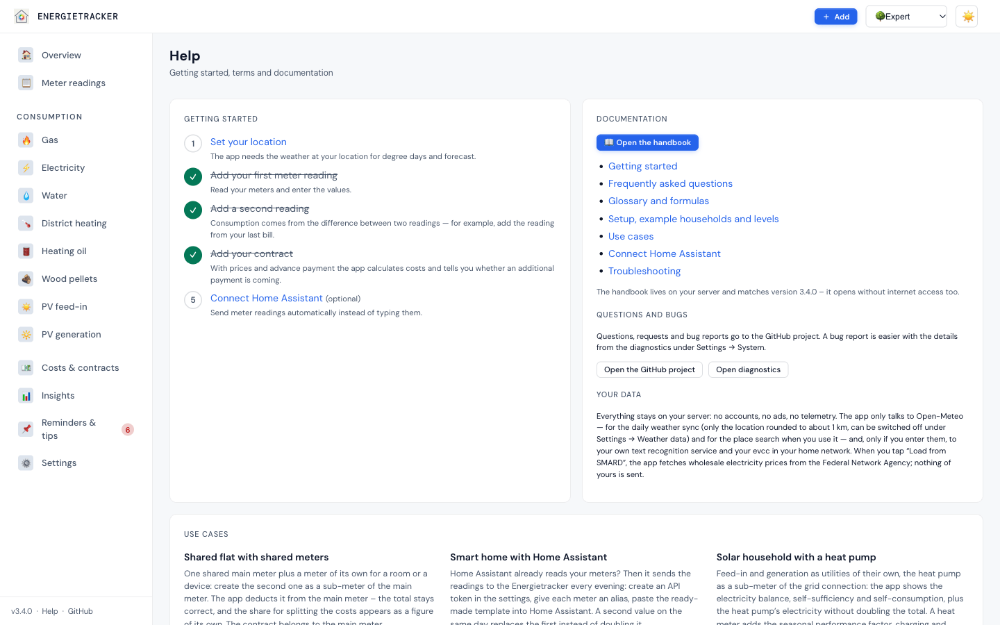

### Handbook in the app (v3.4.0)

`#/help/doc/<path>` shows a page of this handbook, loaded from your own server
in the version that is running — the same files as on GitHub for that tag. It
opens without internet access; pages that were open before also open without a
connection to the server (service worker).

- **Header:** “Help › Handbook” and the **Deutsch | English** switch when the
  page exists in both languages; a jump target is kept when switching.
- **Note** in French, Italian, Spanish, Portuguese and Dutch: the handbook
  exists in German and English, the app shows the English version.
- **Contents:** a collapsible table of contents of the headings (from three
  sections on); a tap jumps to the section without reloading the page.
- **Text:** headings, lists, tables, code, quotes and images as on GitHub. Wide
  tables and code blocks scroll within themselves, so the page stays as wide
  as the screen on the iPhone.
- **Links:** links within the docs, to the changes (CHANGELOG), the licence and
  the notes on security and contributing stay in the app. Other files of the
  project (roadmap, templates, sample data) open GitHub at the tag of this
  version, external pages a new tab.
- A page that does not exist says so, with the way back to the handbook; an old
  path (before v2.14.0) leads to the new page.

Every way there — Help, “Guide” at Home Assistant, setup, users, evcc and
flexibility — opens in the app. Only “Open the GitHub project”, the link in the
sidebar and the source code of the version under Settings → System still lead
to GitHub. Technical details: [Docs in the app](api.md#docs-in-the-app-get-apidocs-v340).

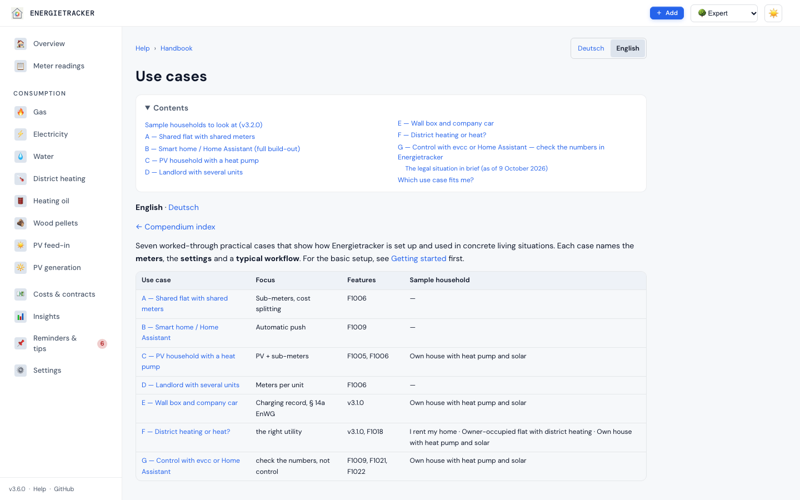

---

## 16. Setup assistant (v3.2.0)

The **“Set up”** dialog asks four questions (since v3.5.0 language and country
first) and then sets the utilities, the
tenure and the experience level; at the end it shows a matching sample
household or leads to your own data. Explained in
[Setup and experience levels](../einstieg/einrichtung.md).

**When it appears:**

- on the **very first start** of a new installation — only the first start
  sets `setup_pending`, never an update. It comes back every time the app
  opens until it is finished or skipped;
- on request under Settings → General → **“Start the setup assistant”** (§11)
  — then the active utilities and the level are preselected;
- in the **public demo**, as long as this browser has not picked a sample
  household.

**The steps** — the footer shows “Step 1 of 5”, “Back”, “Next” and “Skip”.
Since v3.9.0 each question has a small line drawing next to it (globe with a
speech bubble, houses, three meters, steps with a sprout, a sheet going into a
tray), decoration without a message of its own; on the phone the progress sits
above the buttons:

1. **“Language and country”** *(since v3.5.0)* — language and country with
   what the country profile sets ([Setup](../einstieg/einrichtung.md#the-steps)).
   Up to v3.8 this step was missing here, and the footer read “Step 1 of 4”.
2. **“Who are you?”** — five answers with a sentence, since v3.9.0 with a small
   house picture instead of the emoji. The answer
   ticks its utilities in the next step; on the first start it also suggests the
   level.
3. **“Which energy sources do you use?”** — every utility to tick, “Suggested
   from your answer — combine freely.”; without a tick you cannot go on. Below
   it the note “District heating or heat? …”.
4. **“How much experience do you have?”** — the three levels with the same
   lines as in the settings and “You can change the level at any time at the
   top, next to light/dark. If your household needs more, the app suggests it
   once.”; since v3.7.0 followed by the link **“What can I do at each
   level?”** ([feature table](stufen.md)), which opens in a new tab — the
   assistant stays open.
5. **“What comes next”** — “{answer} · level “…”” and the choice *(three ways
   since v3.7.0)* **“From documents”** (*recommended*; below it, which
   documents help, and without a reading service the button “Set up reading”
   with the “Reading documents” card as a dialog; afterwards you go to the
   inbox), **“Enter by hand”**
   (“Next: check the meters and add the first reading.”), with electricity
   since v3.9.0 **“Set up metering concept”** (opens the electricity meters page
   with the assistant from §12) or — administrators
   only — **“Look at it with sample data”** (“Loads the matching sample
   household. The app saves the current state first.”). The button here reads
   **“Let’s go”**.

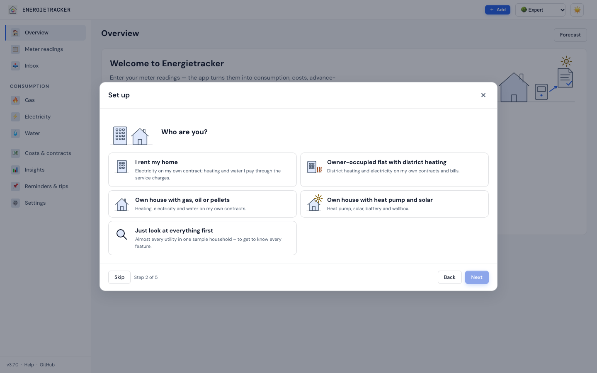

| Answer in step 2 | Sample household | Suggested utilities | Level |
|---|---|---|---|
| 🏢 “I rent my home” | `mieterin` | Electricity, Heat, Water | Beginner |
| 🏙️ “Owner-occupied flat with district heating” | `etw-fernwaerme` | Electricity, District heating | Beginner |
| 🏡 “Own house with gas, oil or pellets” | `eigenheim-klassisch` | Gas, Electricity, Water | Experienced |
| ☀️ “Own house with heat pump and solar” | `eigenheim-modern` | Electricity, Heat, Water, PV generation, PV feed-in | Experienced |
| 🔍 “Just look at everything first” | `showcase` | all | Expert |

Only “Let’s go” saves: the active utilities, “I live” (“in a rented home” for
“I rent my home”, otherwise “in my own home”), the answer (`setup_persona`)
and the level. Then the app loads the sample household — if there is data
already, it asks first, as with “Load demo data” — and restarts, or it opens
the meter-reading capture. A sample household replaces the whole household and
keeps the level; only someone who manages the installation may load one
(§11). “Skip” changes nothing and ends the first start.

**Public demo** ([bingerminger.github.io/energietracker](https://bingerminger.github.io/energietracker/)):
four steps, without “Which energy sources do you use?” (up to v3.8 this said
“three”; “Language and country” exists there too since v3.5.0). At the end it says
“The demo now shows the sample household “…”. Pick another under Settings →
General → Setup assistant.”; “Let’s go” reloads the page with that household.
The browser remembers sample household and level; “Skip” shows the showcase.

---

[← Compendium index](../README.md)
