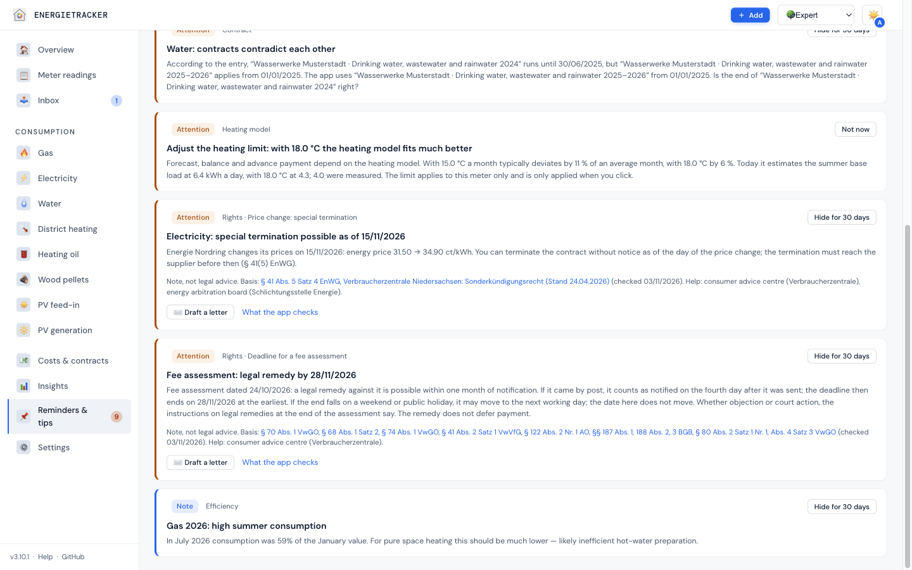
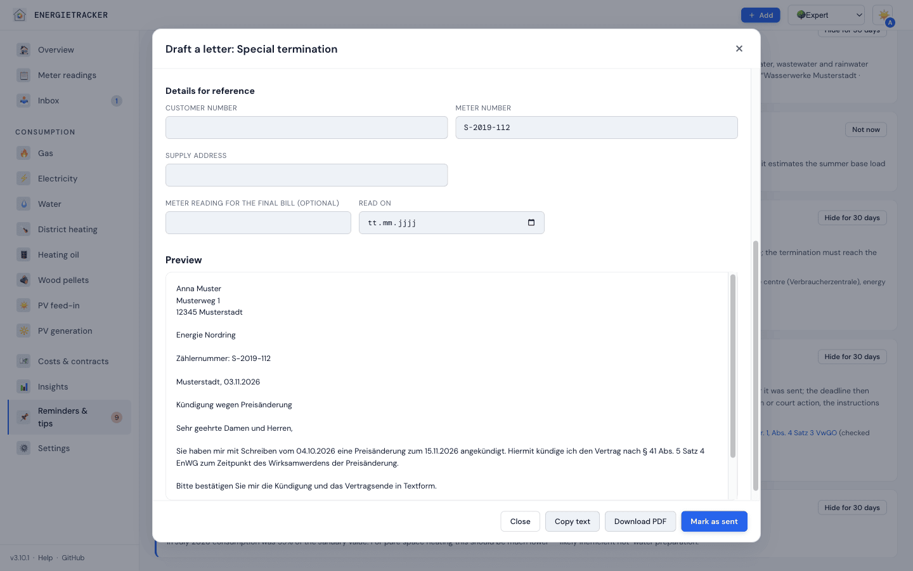

# Your rights as a customer

**English** · [Deutsch](../../verstehen/17-rechte.md)

[← CO₂ price in fuel](16-co2-preis.md) · [Compendium index](../README.md)

Since **v3.11.0** the Energietracker reads your contracts, bills and advance
payments with a second question in mind: are you entitled to something here as
a customer? A bill came too late. An advance payment is far above your
consumption. You can terminate because of a price increase. A bonus is missing.
When the app finds something like this, it tells you what the law provides,
names the provision with source and date, and offers a letter where it fits.

> **Note, not legal advice.** The app says what the law provides and what you
> can ask for. It never says that something is invalid or unlawful, that a
> deadline has been met, or that you should withhold payments or cut advance
> payments yourself. Help is available from the consumer advice centre
> (Verbraucherzentrale) and, for electricity and gas, the energy arbitration
> board (Schlichtungsstelle Energie). Every provision a note relies on is listed
> with source and date under [Legal basis](../referenz/rechtsgrundlagen.md).
> The rules are German law; norms keep their German citation.

---

## At a glance

| Check | What the app reports | Applies to | Date | Letter |
|---|---|---|---|---|
| [Bill came late](#1-bill-came-late) | Annual or final bill later than six weeks after the end of the period | Electricity, gas | – | Complaint |
| [Advance payment clearly too high](#2-advance-payment-clearly-too-high) | Advance payment far above what your last billed consumption and current prices give | Electricity, gas, district heating | – | Request to adjust the advance payment |
| [Price change: special termination](#3-price-change-special-termination) | Price increase that lets you terminate, with the day by which the termination must arrive | Electricity, gas | yes | Special termination |
| [Bonus not credited](#4-bonus-not-credited) | Bill without a credit for a bonus from the contract | Electricity, gas | – | Complaint |
| [Estimate despite your own reading](#5-estimate-despite-your-own-reading) | Bill estimates the closing reading although you read the meter yourself around that day | Electricity, gas, water, district heating | – | Question about the estimate |
| [Metering charge above the cap](#6-metering-charge-above-the-cap) | Charge for metering above the statutory price cap | Electricity | – | Complaint |
| [Deadline for a fee assessment](#7-deadline-for-a-fee-assessment) | Deadline for an objection or action against a municipal assessment | Water, sewage | yes | Objection |

## Principles

- **Germany only.** The checks run only if the country in the settings is
  Germany. In any other country the app shows no notes on rights and no letters.
- **A note, not a verdict.** The app describes the rule and your figures.
  Whether your case falls under it is your decision, with advice if in doubt.
- **Every statement has a source.** The rules sit in one place in the code, each
  with norm, link, date and a rating (W, S, G, U). The app never names uncertain
  rules (U). What this means is explained under
  [Legal basis](../referenz/rechtsgrundlagen.md#status).
- **Templates, not free text.** Letters are built from fixed text blocks and the
  figures of the note, never by a language model. The app sends nothing.
- **Only new things go to “To do”.** A note without a date goes to “To do” if
  its occasion (such as the bill date) is at most 120 days ago. The app still
  checks older bills; “Bill check” shows all notes.
- **Deadlines are dates.** Special termination and fee assessment have a fixed
  date. They appear under “To do” and in the calendar 14 days before.
- **Not checked:** shadow contracts (comparison offers) and feed-in.
- **Little to check without a bill.** Five of the seven checks work on a recorded
  bill. If none is recorded yet, “Check bill” and the recommendations page say
  so instead of showing an empty list *(v3.11.0)*.
- **Extended contracts count.** If a contract runs on after its end without
  cancellation, the app checks it like a current one: a price increase entered
  after the end gives the special-termination note, an advance payment that is
  too high gives the advance note *(v3.11.0)*.

## What a note looks like

Every note has a title, a short text with your figures and a footer:

> Note, not legal advice. Basis: § 40c Abs. 2 EnWG (checked 03.11.2026). Help:
> consumer advice centre (Verbraucherzentrale), energy arbitration board
> (Schlichtungsstelle Energie).

Each norm in the footer links to its source. The date is the day the source was
last read. The app names the energy arbitration board only for electricity and
gas.



You find a note here:

| Where | What you see |
|---|---|
| **Recommendations** | Card “Rights · …” with text, footer, where it fits the button “Draft a letter”, and the link “What the app checks” to this page |
| **To do** (dashboard) | a line ⚖️ with the title; with a date “Deadline: …”. Ticking it off means done |
| **Bill check** | under “Compare” the notes on this bill with footer and letter, in the list of bills “⚖️ 2 notes on your rights”; older notes too |
| **Inbox** | for a price change letter, the key statement with right to terminate, deadline and footer |
| **Calendar** | notes with a date on the day of the deadline, with an advance reminder |
| **Home Assistant** | as an item of the “To do” list, not as a warning |
| **Annual report** | only notes with a date, among the dates |
| **Activity** | what you have done, in the “Contracts” area |

If you hide a note with a date, the date stays in the calendar until the
deadline has passed. A note without a date disappears. How completing and hiding
work in general is explained under
[Ticking off notices and the history](../anleitungen/hinweise-erledigen.md).

## The checks

<a id="rights-bill-late"></a>

### 1. Bill came late

**What the law says.** For electricity and gas the bill must come no later than
six weeks after the end of the billing period, the final bill six weeks after
supply ends (§ 40c Abs. 2 EnWG). The law names no consequence for the amount of
the bill. You can complain to the supplier about the delay; it must answer
within four weeks (§ 111a EnWG).

**What the app checks.** Annual and final bills for electricity and gas. It
counts 42 days from the end of the period. If the bill was available later, it
reports the gap in days. “Available” is the day you received the bill if you
enter it, otherwise the bill date. Without either it checks nothing. So that a
weekend at the end of the period does not trigger a note, the app reports only
from the third day after the deadline. If a correction from the inbox replaces
the bill, the date of the first version stays.

**Limits.** Whether the deadline moves on a weekend or public holiday is not
settled; the app does not assume it does. Monthly bills (deadline three weeks)
and correction bills are not checked. For district heating and water the app
knows no statutory deadline and checks nothing. What is open is listed under
[Legal basis](../referenz/rechtsgrundlagen.md#what-is-open).

<a id="rights-advance-high"></a>

### 2. Advance payment clearly too high

**What the law says.** Advance payments are based on consumption in the last
billed period. If you credibly show that your consumption is considerably lower,
this must be taken into account appropriately. This is set out for basic supply
in § 13 StromGVV and § 13 GasGVV, for special contracts with household customers
in § 41b Abs. 3 EnWG, for district heating in § 25 AVBFernwärmeV and for water
supplied under private law in § 25 AVBWasserV. You can request an adjustment.
The consumer advice centre advises against cutting the advance payment on your
own.

**What the app checks.** For electricity, gas and district heating it calculates
which advance payment follows from the latest annual or final bill entered and
the prices on the next due date:

```text
assessment per instalment = (quantity ÷ days of the period × 365 × unit price
                             + 12 × fixed costs per month) ÷ instalments per year
```

Without a bill it uses the last completed billing period from your own readings
if no month in it is distributed. The instalments per year come from the payment
plan (monthly, every two or three months, named dates). It does not deduct
bonuses. There is a note only if everything comes together:

- your advance payment is more than 20 % above the assessment,
- and at least 10 € per instalment above it,
- (if other prices apply on the due date than today, the note and the letter say
  “with the prices from …” instead of “with the current prices”),
- it is also above the advance payment the app’s forecast suggests, and the
  forecast is not uncertain,
- and at least three instalments are left before the next bill.

Example: the last bill states 3,000 kWh in 365 days, the unit price is
30 ct/kWh, the fixed costs 12 € a month. Assessment: (3,000 × 0.30 + 12 × 12)
÷ 12 = 87 € a month. An advance payment of 110 € triggers a note. 100 € does
not: 13 € and 15 % above, below both thresholds.

**Limits.** If your consumption is set to rise (heat pump, electric car, more
people), the assessment underestimates it; if the forecast disagrees, the app
stays silent. For a first contract without a billed period the law refers to
comparable customers; the app does not know them and reports nothing. Water is
not checked: the app does not know whether it is billed under private law or by
a municipal assessment. Group contracts (price per register) are not checked
either. If you pay more on purpose, hide the note for this advance payment.

<a id="rights-special-termination"></a>

### 3. Price change: special termination

**What the law says.** If the electricity or gas supplier raises prices, you can
terminate with effect from the day the change takes effect:

| Contract | Notice of the change | Termination |
|---|---|---|
| **Special contract** | no later than one month before, simple and clear, with reason, conditions and extent (§ 41 Abs. 5 Satz 1 bis 3 EnWG) | without notice period with effect from the change, without a charge (§ 41 Abs. 5 Satz 4 EnWG); the supplier confirms within one week in text form (§ 41b Abs. 1 Satz 2 EnWG) |
| **Basic supply** | at the start of a month, publicly at least six weeks before, plus a letter (§ 5 Abs. 2 StromGVV, § 5 Abs. 2 GasGVV) | without notice with effect from the change (§ 5 Abs. 3 StromGVV, § 5 Abs. 3 GasGVV); also at any time with two weeks’ notice (§ 20 StromGVV; for the GasGVV to be checked) |

The termination must reach the supplier before the change takes effect; the
supplier may not set its own deadline for it, and a minimum term does not
exclude the right (Verbraucherzentrale Niedersachsen). Whether you are in basic
supply is stated on your bill (§ 40 Abs. 2 Satz 1 Nr. 13 EnWG). If, under a
special contract, the supplier only passes on a statutory change in VAT
unchanged, there is no right to terminate (§ 41 Abs. 6 EnWG).

**What the app checks.** A price increase on an electricity or gas contract
(unit or standing charge, gross). The note names the day by which your
termination must arrive: the day before the change. If the supplier’s letter
names an earlier date (“cancel by …” on the price), the earlier one is the date
and the text names both; once that day has passed, the day before the change
applies again, because the supplier may not set its own deadline. The date
appears under “To do” and in the calendar 14 days before, only once, even if the
letter came through the inbox. The text depends on whether basic supply or special contract is entered on the
contract; without that, it names both routes briefly. Additional sentences:

- **Notice too late:** if you enter the date of the letter and it was closer to
  the change than one month (special contract) or six weeks (basic supply), the
  app says so. It does not say whether the increase is therefore void.
- **Only the tax changes:** if the old and the new price carry a VAT rate, the
  net price stays the same and only the rate changes, the app reports no right
  to terminate and no note.
- **Price step or price change?** Without the date of a letter, a higher price
  can also be a step you agreed when signing the contract. The title then asks
  instead of asserting, and the text says that an agreed price step gives no
  right to terminate. The date still stays.
- **Price guarantee:** if an entered price guarantee is running, the app asks
  you to check whether the increase is excluded from it.

**District heating** gets no “Rights” note but a sentence of its own on the
balance card and in the annual report: prices change according to the price
adjustment clause of your contract, the calculation factors must be shown; there
is no general special right of termination as for electricity and gas (§ 24
Abs. 4 bis 7 AVBFernwärmeV). For **water** the app reports no special
termination.

The note replaces the former recommendation “Price increase, check special
termination”. The calendar entry “Price increase” on the day of the change
stays.

**Limits.** If the supplier terminates itself, this check does not apply. If an
entered follow-on contract already applies on the day of the change, the app
reports nothing. Dynamic tariffs and comparison offers are excluded.

<a id="rights-bonus-missing"></a>

### 4. Bonus not credited

**What the law says.** A bonus is a benefit under your contract; the contract
summary states bonus agreements (§ 41 Abs. 4 Satz 2 Nr. 6, Abs. 1 Satz 2 Nr. 5
EnWG). The consumer advice centre applies the rule for credits to bonuses as
well: pay out within two weeks or offset against the next advance payment
(§ 40c Abs. 3 EnWG).

**What the app checks.** Electricity and gas. For a new-customer bonus on the
contract, the first bill that ends at least twelve months after the contract
start, or a final bill before that; for a bonus with a date (switching, new
customer, other), the bill whose period contains the date, with 31 days of
leeway. If the bills up to then contain no credit of the bonus amount (up to
1 € less) as an item “credit” or as a booked refund, the app reports it. If the
credit does not say net or gross, the amount × 1.19 counts too. Each credit
covers only one bonus. The label on the bill does not matter, only kind and
amount. Bills are checked until the end of the third year after their year.

**Limits.** The app does not check an instant bonus; it usually comes by bank
transfer. If a bonus came another way (bank transfer, later bill), tick the note
off. A bonus of the kind “other”, for example from a comparison portal, is not
necessarily paid by the supplier; there is no letter for it. The app does not
know the bonus conditions (often twelve months of supply); the text asks you to
check them.

<a id="rights-estimate-despite-reading"></a>

### 5. Estimate despite your own reading

**What the law says.** For electricity and gas the supplier may estimate only if
no reading was submitted despite the obligation, or if it could not determine
consumption for reasons it is not responsible for (§ 40a Abs. 2 Satz 1, 2 EnWG).
An estimate must be recognisable, with reason and factors; on request the
supplier explains it free of charge in text form (§ 40a Abs. 2 Satz 3 EnWG). For
water and district heating an estimate is allowed as long as the agent cannot
enter the premises to read the meter (§ 20 Abs. 2 AVBWasserV, § 20 Abs. 2
AVBFernwärmeV).

**What the app checks.** A bill that carries the estimated closing reading
(“Estimated final reading” in the form; the inbox fills the field). It is **not a
reading** and does not count towards your consumption *(v3.11.0; until then it
had to be entered as an estimated reading, which distorted your own
consumption)*. Older bills with an estimated reading at the end of the period are
checked as before. It also needs
your own, non-estimated reading of the same meter at most 14 days before or after
the end. The app projects your reading in a straight line. If the estimated
reading differs from it by more than 2 % of the period’s quantity and this is
worth at least 10 €, it reports the difference in quantity and euros. The
period’s quantity is the consumption on the bill (for gas converted to m³ via the
calorific value), otherwise your consumption per day times the days of the
period. Below that, the supplier has usually just
projected your reading to the end of the period; then it stays silent. If the
estimated reading lies above a later or below an earlier reading of yours,
saving already warns: the meter would run backwards. If you
reported the reading before the bill (switch “reported to the supplier” when
capturing), the text becomes firmer; otherwise it asks: “Did you report the
reading?” In basic supply, with a reported reading, it names a correction with
your reading as a right (§ 18 StromGVV); without a report the estimate may have
been permitted, so there too it asks you to request a recalculation, as in a
special contract.

**Fee assessment.** If the water bill is an assessment notice of the
municipality, the AVBWasserV does not apply. The note then points to the legal
remedy and its deadline (check 7) and offers no query letter: an informal query
does not preserve the deadline.

**Limits.** With a smart metering system the values of the metering operator
take precedence (§ 40a Abs. 1 Satz 4, 5 EnWG). Only the closing reading triggers
the note; an estimated opening reading belongs to the previous bill. If the
estimate is in your favour, the text says which way it goes. For a group (peak
and off-peak) the app checks each register.

<a id="rights-metering-cap"></a>

### 6. Metering charge above the cap

**What the law says.** For operating your electricity meter the Metering Point
Operation Act (MsbG) sets price caps per year, gross per metering point, for the
default metering operator: 25 € for a modern metering device (§ 32 Abs. 1
MsbG), for a smart metering system 30 to 140 € depending on annual consumption,
system or an agreement under § 14a EnWG (§ 30 Abs. 1, 3 MsbG). If several groups
apply, the highest applies (§ 30 Abs. 4 bis 6 MsbG). The full table is under
[Legal basis](../referenz/rechtsgrundlagen.md#price-caps-for-metering). A
metering operator you chose freely is not bound by the caps.

**What the app checks.** An electricity bill with an item of the kind
“metering”, if the meter has a modern metering device or a smart metering system
entered and the metering operator is not marked as freely chosen. It converts
the amount to a year and to gross (net times VAT rate; net without a rate is not
checked) and compares it with the cap for your case. For a smart metering system
it finds the group from annual consumption (mean of up to the last three full
calendar years, otherwise projected from the bill, otherwise no check), from the
capacity of the feed-in meters and from an agreement under § 14a EnWG on the
contract. More than 1 € above the cap gives a note. Only the days from
2026-01-01 are checked; the amounts of older versions are not documented.

**Limits.** If the charge is hidden in the standing charge, the app cannot check
it. For a conventional meter and for gas it checks nothing. Additional services
(such as an installation you asked for) may cost extra: if the meter was swapped
during the period, the app does not report an excess of up to 100 €. If it is
open whether your metering operator is the default operator, it checks anyway;
the text names the condition.

<a id="rights-fee-notice-deadline"></a>

### 7. Deadline for a fee assessment

**What the law says.** If the municipality bills water or sewage by an
assessment notice, you can challenge it within one month of notification
(§ 70 Abs. 1 VwGO). Whether by objection or by action is stated bindingly in the
instructions on legal remedies at the end of the notice; state law can exclude
the objection (§ 68 Abs. 1 Satz 2, § 74 Abs. 1 VwGO, to be checked). A notice
sent by post is deemed notified on the fourth day after posting (§ 41 Abs. 2
Satz 1 VwVfG). Without or with incorrect instructions, one year applies (§ 58
Abs. 2 VwGO). The legal remedy does not defer payment (§ 80 Abs. 2 Satz 1 Nr. 1,
Abs. 4 Satz 3 VwGO).

**What the app checks.** A water bill where you ticked “fee assessment” and
entered the date of the notice. The date is the notice date plus four days plus
one month; if that day does not exist in the month, the last day of the month.
With a date of service (certificate of service) that one counts. The app counts
from the notice date on purpose: it is the earliest possible end of the period.
If that day is a Saturday, Sunday or a public holiday that applies throughout
Germany, the deadline ends on the next working day (§ 57 Abs. 2 VwGO with
§ 222 Abs. 2 ZPO, § 31 Abs. 3 VwVfG); date, “To do”, calendar and letter name
this day *(v3.11.0, follow-up review; before, a deadline ending on a Sunday
already counted as expired on the Monday)*.
After the date the note disappears from “To do”. In “Check bill” it then says
that the deadline has expired; one year applies only without or with incorrect
instructions on legal remedies (§ 58 Abs. 2 VwGO), and the app shows this
sentence as long as less than a year has passed since notification *(v3.11.0;
until then it still said “a legal remedy is possible” afterwards)*.

**Letter.** The app offers an objection only if “objection” (Widerspruch) is
entered as the legal remedy on the bill and the deadline is still running, and
the dialog asks you to confirm that the instructions on legal remedies name it.
After the deadline the server refuses the letter. If the instructions name an
action, there is no letter, only the advice to seek help.

**Limits.** The app does not know public holidays that apply only in some states
(such as Corpus Christi or Reformation Day); if one falls on the end of the
deadline, it runs until the next working day after it, and the text says so.
Which holidays apply everywhere is still “to be checked” in the report (no. 61).
If public utilities bill under private law,
there is no assessment and the app calculates no deadline.

## Letters

Five notes come with a letter. You start it with “Draft a letter”; the app fills
it with the figures of the note and your contract and meter details. You check
and complete everything, then download a PDF or copy the text for e-mail or a
customer portal.

| Letter | To | What for | Form |
|---|---|---|---|
| Special termination | Supplier | Termination with effect from the price change, asking for confirmation | Text form is enough in basic supply; in a special contract as the contract says |
| Request to adjust the advance payment | Supplier | New advance payment from consumption and prices, with reasons | Text form |
| Question about the estimate | Supplier | Explanation of the estimate and correction with your reading, photo attached; not for an assessment notice | Text form |
| Complaint about a bill | Supplier; for the metering charge the metering operator (reference: meter number, not the supplier’s customer number) | Late bill, missing bonus, metering charge above the cap | Text form; answer within four weeks (§ 111a EnWG, which covers metering operators too) |
| Objection to an assessment notice | Authority that issued the notice | Objection that keeps the deadline, reasons to follow; only while the deadline runs | **In writing with a signature**; a simple e-mail is not enough |

- The letter is always in German, because the recipient is in Germany; the
  dialog speaks the language of the interface.
- The app does not store sender and recipient. If you wish, the browser
  remembers the sender, on this device only.
- If a detail is missing (customer number, supplier’s address), a visible gap
  `[…]` remains; the app invents nothing. A long supplier name is wrapped at word
  boundaries onto up to three lines.
- The PDF file is named after the template, for example `brief-sonderkuendigung-2026-11-03.pdf`.
- The norm a letter names comes from the same rules as the note. The complaint
  about a missing bonus names none (the claim is in the contract), nor does the
  objection (it needs none).
- The letter never says that an increase is void or an assessment unlawful,
  never announces withholding payments, and never sets a deadline with
  threatened consequences.
- “Mark as sent” ticks the note off under “To do”, with date, note and, if you
  wish, the letter as a receipt.
- In the demo on GitHub Pages only the first draft is precomputed.



Step by step: [Writing a letter](../anleitungen/brief-schreiben.md).

## Price change letters in the inbox

When the [inbox](../anleitungen/posteingang.md) reads a letter about a price
change, it takes over the date of the letter, the VAT rate and a “cancel by …”
from the letter together with the new prices. For electricity and gas the check
above creates the date of the special termination, once (the day before the
change, or an earlier date from the letter, then with both), also when the
contract runs on after its end without cancellation. If the check gives no note
for this contract, the inbox creates the date itself *(v3.11.0)*. An estimated
final reading on a bill goes to the bill, not into a reading. The inbox checks
the notice period, recognises a pure tax change and shows, before you apply it,
what the change costs a year and which advance payment fits afterwards. If a new
advance payment in the letter rises by more than 5 percentage points more than
the costs, it points to the rule for advance payments. If a bill names basic
supply or a special contract, it proposes the type of supply on the contract
when there is none yet.

## What changes in older notes

| Before | Since v3.11.0 |
|---|---|
| Recommendation “Price increase, check special termination” on the day of the increase | a “Rights” note with the date on the day before and the letter; the calendar entry on the day of the increase stays, without “check special termination” |
| District heating also said “special right of termination (§ 41 Abs. 5 EnWG)” | District heating gets a sentence of its own on the balance card and in the annual report, without a right to terminate; “energy” within the meaning of the EnWG is electricity, gas and hydrogen (§ 3 Nr. 31, Nr. 57 EnWG) |
| The warning “term over 24 months” came for every utility | only for electricity and gas (§ 309 Nr. 9 BGB, to be checked); for district heating from ten years (§ 32 AVBFernwärmeV); none for water |
| Basic supply was justified with § 41 Abs. 5 EnWG | the text depends on basic supply or special contract |
| Every higher gross price counted as a price increase with a right to terminate | agreed price steps and pure tax changes no longer automatically |
| Bills from the inbox had no bill date | the date of the document becomes the bill date |

## Deadlines and thresholds

Statutory deadlines are listed under
[Legal basis](../referenz/rechtsgrundlagen.md#deadlines). The following
thresholds are **decisions of the app, not values from the law**. They are meant
to avoid false alarms. A test keeps them tied to the values in the code.

| Threshold | Value | What for |
|---|---|---|
| Leeway after the bill deadline <!-- doc-claim: rights-threshold BILL_LATE_GRACE_DAYS --> | 2 days | Bill came late: covers a weekend |
| Advance payment above the assessment <!-- doc-claim: rights-threshold ADVANCE_HIGH_PCT --> | 20 % | Advance payment clearly too high |
| … and per instalment at least <!-- doc-claim: rights-threshold ADVANCE_HIGH_MIN_EUR --> | 10 € | Advance payment clearly too high |
| Instalments left before the bill, at least <!-- doc-claim: rights-threshold SUGGEST_MIN_MONTHS --> | 3 | Advance payment clearly too high (like the advance suggestion) |
| Bonus counts as credited from <!-- doc-claim: rights-threshold BONUS_TOLERANCE_EUR --> | 1 € below the bonus | Bonus not credited |
| Leeway around the date of a bonus <!-- doc-claim: rights-threshold BONUS_WINDOW_DAYS --> | 31 days before or after | Bonus not credited |
| Credit without net or gross stated <!-- doc-claim: rights-threshold BONUS_NET_FACTOR --> | also counts times 1.19 | Bonus not credited |
| Own reading around the end of the period <!-- doc-claim: rights-threshold ESTIMATE_WINDOW_DAYS --> | 14 days before or after | Estimate despite your own reading |
| Deviation of the estimate <!-- doc-claim: rights-threshold ESTIMATE_DEVIATION_PCT --> | 2 % of the period’s quantity (from the bill, otherwise consumption per day × days) | Estimate despite your own reading |
| … and an effect of at least <!-- doc-claim: rights-threshold ESTIMATE_MIN_EUR --> | 10 € (as for the advance payment; without prices only the quantity) | Estimate despite your own reading |
| Rounding of the metering charge <!-- doc-claim: rights-threshold METERING_TOLERANCE_EUR --> | 1 € a year | Metering charge above the cap |
| Date under “To do” <!-- doc-claim: rights-threshold DEADLINE_REMIND_DAYS --> | 14 days before the deadline | Special termination, fee assessment |
| New notes without a date <!-- doc-claim: rights-threshold WINDOW_DAYS --> | 120 days after the occasion | all checks without a date |
| Advance payment in a price change letter rises more than the costs <!-- doc-claim: rights-threshold ADVANCE_EXCESS_PCT --> | 5 percentage points | Inbox: pointer to the rule for advance payments |

Examples, recalculated with the code by a test:

| Case | Input | Result |
|---|---|---|
| Bill came late <!-- doc-claim: rights-example bill_late --> | Period ends 2026-03-31 | Deadline ends 2026-05-12; a bill dated 2026-05-14 gets no note, from 2026-05-15 there is one |
| Special termination <!-- doc-claim: rights-example special_termination --> | Price change on 2026-12-01 | Termination must arrive by 2026-11-30, appears under “To do” from 2026-11-16; notice in a special contract by 2026-11-01 at the latest, in basic supply 2026-10-20 |
| Fee assessment <!-- doc-claim: rights-example fee_notice --> | Notice dated 2026-01-27 | notified 2026-01-31, by the calendar 2026-02-28 (a Saturday), deadline ends 2026-03-02 |
| Fee assessment <!-- doc-claim: rights-example fee_notice --> | Notice dated 2026-01-28 | notified 2026-02-01, by the calendar 2026-03-01 (a Sunday), deadline ends 2026-03-02 |

## What you can enter

All details are optional. The more you enter, the more precise the note; if
something is missing, the app words it more cautiously or stays silent.

| Where | Detail | What for |
|---|---|---|
| Bill (“According to the bill”) | Received on | Bill came late |
| Bill | Invoice number | Reference in the letter |
| Bill | Estimated according to the bill: opening or closing reading; estimated final reading and its day (not a reading) | Estimate despite your own reading |
| Bill | per item the kind (such as “metering”, “credit”), net or gross, VAT rate | Metering charge above the cap, bonus not credited |
| Bill (water) | Fee assessment: date, service, legal remedy as instructed, file number | Deadline for a fee assessment |
| Contract (electricity, gas) | Type of supply: basic supply or special contract | Price change, advance payment, estimate |
| Price on the contract (from “Experienced”) | Letter dated, VAT % | Price change: price step, notice, pure tax change |
| Electricity meter | Metering: metering device, metering operator (default or freely chosen) | Metering charge above the cap |
| Feed-in meter | Plant capacity (kW) | Metering charge above the cap |
| Capture | switch “reported to the supplier” | Estimate despite your own reading |

The [inbox](../anleitungen/posteingang.md) fills much of this from your
documents: bill date and number, estimated readings, credits, metering charge,
assessment, and for price changes letter date, VAT rate and “cancel by”. The
fields and their validation are described in the
[API reference](../referenz/api.md#customer-rights-v3110), where they appear in
the interface under [Views](../referenz/ansichten.md).

## Limits

- The app knows only German federal law, no state laws and no bylaws of your
  municipality. It does not say how the states regulate the objection procedure.
- Only the end of the deadline for a fee assessment moves to the next working
  day, with the public holidays that apply throughout Germany; it does not know
  holidays of individual states. It does not move other dates.
- It checks only what has been entered. A bill that is not recorded cannot be
  questioned.
- The sources were read on 2026-11-03. If a law changes, the note only applies
  again after the next review. What is still to be checked or open is listed
  under [Legal basis](../referenz/rechtsgrundlagen.md#what-is-open).
