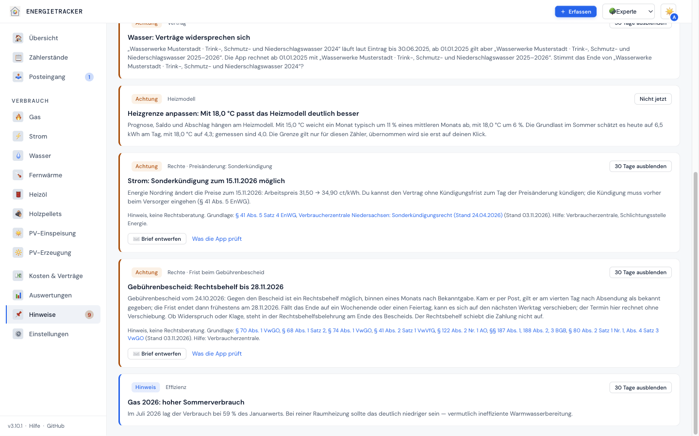
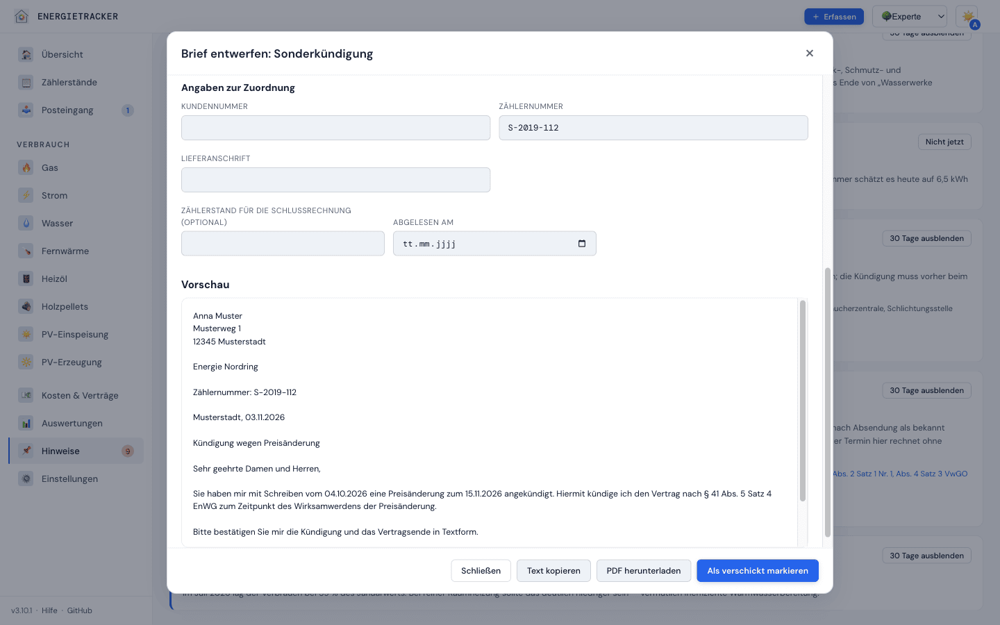

# Deine Rechte als Kunde

**Deutsch** · [English](../en/verstehen/17-rechte.md)

[← CO₂-Preis im Brennstoff](16-co2-preis.md) · [Kompendium-Index](../README.md)

Seit **v3.11.0** liest der Energietracker deine Verträge, Rechnungen und
Abschläge auch mit einer zweiten Frage: Steht dir hier als Kunde etwas zu? Eine
Rechnung kam zu spät. Ein Abschlag liegt weit über deinem Verbrauch. Zu einer
Preiserhöhung kannst du kündigen. Ein Bonus fehlt. Findet die App so etwas, sagt
sie dir, was das Gesetz vorsieht, nennt die Vorschrift mit Quelle und Stand und
bietet dir, wo es passt, einen Brief an.

> **Hinweis, keine Rechtsberatung.** Die App sagt, was das Gesetz vorsieht und
> was du verlangen kannst. Sie sagt nie, dass etwas unwirksam oder rechtswidrig
> ist, dass eine Frist gewahrt ist oder dass du Zahlungen zurückhalten oder
> Abschläge selbst kürzen sollst. Hilfe bekommst du bei der Verbraucherzentrale
> und, bei Strom und Gas, bei der Schlichtungsstelle Energie. Jede Vorschrift,
> auf die sich ein Hinweis stützt, steht mit Quelle und Stand in den
> [Rechtsgrundlagen](../referenz/rechtsgrundlagen.md).

---

## Auf einen Blick

| Prüfung | Was die App meldet | Gilt für | Termin | Brief |
|---|---|---|---|---|
| [Rechnung kam spät](#1-rechnung-kam-spät) | Jahres- oder Schlussrechnung später als sechs Wochen nach Ende des Zeitraums | Strom, Gas | – | Beanstandung |
| [Abschlag deutlich zu hoch](#2-abschlag-deutlich-zu-hoch) | Abschlag weit über dem, was sich aus deinem zuletzt abgerechneten Verbrauch und den aktuellen Preisen ergibt | Strom, Gas, Fernwärme | – | Antrag auf Abschlagsanpassung |
| [Preisänderung: Sonderkündigung](#3-preisänderung-sonderkündigung) | Preiserhöhung, zu der du kündigen kannst, mit dem Tag, bis zu dem die Kündigung zugehen muss | Strom, Gas | ja | Sonderkündigung |
| [Bonus nicht gutgeschrieben](#4-bonus-nicht-gutgeschrieben) | Rechnung ohne Gutschrift für einen Bonus aus dem Vertrag | Strom, Gas | – | Beanstandung |
| [Schätzung trotz eigener Ablesung](#5-schätzung-trotz-eigener-ablesung) | Rechnung schätzt den Endstand, obwohl du um diesen Tag selbst abgelesen hast | Strom, Gas, Wasser, Fernwärme | – | Rückfrage zur Schätzung |
| [Messentgelt über der Obergrenze](#6-messentgelt-über-der-obergrenze) | Entgelt für den Messstellenbetrieb über der gesetzlichen Preisobergrenze | Strom | – | Beanstandung |
| [Frist beim Gebührenbescheid](#7-frist-beim-gebührenbescheid) | Frist für Widerspruch oder Klage gegen einen Bescheid der Gemeinde | Wasser, Abwasser | ja | Widerspruch |

## Grundsätze

- **Nur Deutschland.** Die Prüfungen laufen nur, wenn unter Einstellungen das
  Land Deutschland eingestellt ist. In jedem anderen Land zeigt die App keine
  Hinweise zu Rechten und keine Briefe.
- **Hinweis statt Urteil.** Die App beschreibt die Regel und deine Zahlen. Ob
  dein Fall darunter fällt, entscheidest du, im Zweifel mit Beratung.
- **Jede Aussage hat eine Quelle.** Die Regeln stehen an einer Stelle im Code,
  jede mit Norm, Link, Stand und einer Einstufung (W, S, G, U). Unsichere Regeln
  (U) nennt die App nie. Was das heißt, steht in den
  [Rechtsgrundlagen](../referenz/rechtsgrundlagen.md#status).
- **Vorlagen statt freier Text.** Briefe entstehen aus festen Bausteinen und den
  Zahlen des Hinweises, nie aus einem Sprachmodell. Die App schickt nichts ab.
- **Nur Neues landet unter „Zu tun“.** Ein Hinweis ohne Termin kommt nach
  „Zu tun“, wenn sein Anlass (etwa das Rechnungsdatum) höchstens 120 Tage
  zurückliegt. Ältere Rechnungen prüft die App trotzdem; „Rechnung prüfen“
  zeigt alle Hinweise.
- **Fristen sind Termine.** Sonderkündigung und Gebührenbescheid haben ein festes
  Datum. Sie stehen 14 Tage vorher unter „Zu tun“ und im Kalender.
- **Nicht geprüft** werden Schattenverträge (Vergleichsangebote) und die
  Einspeisung.
- **Ohne Rechnung wenig zu prüfen.** Fünf der sieben Prüfungen setzen an einer
  erfassten Rechnung an. Ist noch keine erfasst, sagen „Rechnung prüfen“ und die
  Empfehlungsseite das, statt einer leeren Liste *(v3.11.0)*.
- **Verlängerte Verträge zählen mit.** Läuft ein Vertrag nach seinem Ende ohne
  Kündigung weiter, prüft die App ihn wie einen laufenden: Eine eingetragene
  Preiserhöhung nach dem Ende gibt den Hinweis zur Sonderkündigung, ein zu hoher
  Abschlag den zum Abschlag *(v3.11.0)*.

## So sieht ein Hinweis aus

Jeder Hinweis hat einen Titel, einen kurzen Text mit deinen Zahlen und eine
Fußzeile:

> Hinweis, keine Rechtsberatung. Grundlage: § 40c Abs. 2 EnWG (Stand
> 03.11.2026). Hilfe: Verbraucherzentrale, Schlichtungsstelle Energie.

Jede Norm in der Fußzeile ist ein Link zur Quelle. Der Stand ist der Tag, an dem
die Quelle zuletzt gelesen wurde. Die Schlichtungsstelle Energie nennt die App
nur bei Strom und Gas.



Du findest einen Hinweis hier:

| Wo | Was du siehst |
|---|---|
| **Empfehlungen** | Karte „Rechte · …“ mit Text, Fußzeile, wo es passt dem Knopf „Brief entwerfen“, und dem Link „Was die App prüft“ auf diese Seite |
| **Zu tun** (Startseite) | eine Zeile ⚖️ mit dem Titel; mit Termin „Frist: …“. Abhaken heißt erledigt |
| **Rechnung prüfen** | unter „Vergleichen“ die Hinweise zu dieser Rechnung mit Fußzeile und Brief, in der Liste der Rechnungen „⚖️ 2 Hinweise zu deinen Rechten“; hier auch ältere Hinweise |
| **Posteingang** | bei einem Preisänderungsschreiben die Kernaussage mit Kündigungsrecht, Frist und Fußzeile |
| **Kalender** | Hinweise mit Termin am Tag der Frist, mit Vorwarnung |
| **Home Assistant** | als Punkt der Liste „Zu tun“, nicht als Warnung |
| **Jahresbericht** | nur Hinweise mit Termin, unter den Terminen |
| **Verlauf** | was du erledigt hast, im Bereich „Verträge“ |

Blendest du einen Hinweis mit Termin aus, bleibt der Termin im Kalender, bis die
Frist vorbei ist. Ein Hinweis ohne Termin verschwindet. Wie Erledigen und
Ausblenden allgemein wirken, steht unter
[Hinweise erledigen](../anleitungen/hinweise-erledigen.md).

## Die Prüfungen

<a id="rights-bill-late"></a>

### 1. Rechnung kam spät

**Was das Gesetz sagt.** Für Strom und Gas muss die Rechnung spätestens sechs
Wochen nach Ende des Abrechnungszeitraums kommen, die Schlussrechnung sechs
Wochen nach Ende der Belieferung (§ 40c Abs. 2 EnWG). Eine Folge für den
Rechnungsbetrag nennt das Gesetz nicht. Du kannst die Verspätung beim Versorger
beanstanden; er muss binnen vier Wochen antworten (§ 111a EnWG).

**Was die App prüft.** Jahres- und Schlussrechnungen für Strom und Gas. Sie
zählt vom Ende des Zeitraums 42 Tage weiter. Lag die Rechnung danach vor, meldet
sie den Abstand in Tagen. Als „vorgelegen“ gilt der Tag, an dem du die Rechnung
erhalten hast, wenn du ihn einträgst, sonst das Rechnungsdatum. Ohne beides
prüft sie nichts. Damit ein Wochenende am Fristende keinen Hinweis auslöst,
meldet die App erst ab dem dritten Tag nach dem Fristende. Ersetzt im
Posteingang eine Korrektur die Rechnung, bleibt das Datum der ersten Fassung.

**Grenzen.** Ob sich die Frist an einem Wochenende oder Feiertag verschiebt,
ist nicht geklärt; die App nimmt das nicht an. Monatliche Abrechnungen (Frist
drei Wochen) und Korrekturrechnungen prüft sie nicht. Für Fernwärme und Wasser
kennt die App keine gesetzliche Frist und prüft nichts. Was offen ist, steht in
den [Rechtsgrundlagen](../referenz/rechtsgrundlagen.md#was-offen-ist).

<a id="rights-advance-high"></a>

### 2. Abschlag deutlich zu hoch

**Was das Gesetz sagt.** Abschläge richten sich nach dem Verbrauch im zuletzt
abgerechneten Zeitraum. Machst du glaubhaft, dass dein Verbrauch erheblich
geringer ist, ist das angemessen zu berücksichtigen. So steht es für die
Grundversorgung in § 13 StromGVV und § 13 GasGVV, für Sonderverträge mit
Haushaltskunden in § 41b Abs. 3 EnWG, für Fernwärme in § 25 AVBFernwärmeV und
für privatrechtlich geliefertes Wasser in § 25 AVBWasserV. Du kannst eine
Anpassung beantragen. Den Abschlag eigenmächtig zu kürzen, rät die
Verbraucherzentrale ab.

**Was die App prüft.** Bei Strom, Gas und Fernwärme rechnet sie aus, welcher
Abschlag sich aus der jüngsten erfassten Jahres- oder Schlussrechnung und den
Preisen am nächsten Fälligkeitstag ergibt:

```text
Bemessung je Rate = (Menge ÷ Tage des Zeitraums × 365 × Arbeitspreis
                     + 12 × feste Kosten je Monat) ÷ Raten je Jahr
```

Ohne Rechnung nimmt sie die letzte abgeschlossene Abrechnungsperiode aus deinen
eigenen Ablesungen, wenn kein Monat darin verteilt ist. Die Raten je Jahr kommen
aus dem Abschlagsplan (monatlich, alle zwei oder drei Monate, genannte Termine).
Boni zieht sie nicht ab. Einen Hinweis gibt es nur, wenn alles zusammenkommt:

- dein Abschlag liegt mehr als 20 % über der Bemessung,
- und mindestens 10 € je Rate darüber,
- (gelten am Fälligkeitstag andere Preise als heute, sagen Hinweis und Brief
  „mit den Preisen ab dem …“ statt „mit den aktuellen Preisen“),
- er liegt auch über dem Abschlag, den die Prognose der App vorschlägt, und die
  Prognose ist nicht unsicher,
- und bis zur nächsten Abrechnung stehen noch mindestens drei Raten aus.

Beispiel: Die letzte Rechnung nennt 3.000 kWh in 365 Tagen, der Arbeitspreis ist
30 ct/kWh, die festen Kosten 12 € im Monat. Bemessung: (3.000 × 0,30 + 12 × 12)
÷ 12 = 87 € je Monat. Ein Abschlag von 110 € löst einen Hinweis aus. Bei 100 €
nicht: 13 € und 15 % darüber, das ist unter beiden Schwellen.

**Grenzen.** Steigt dein Verbrauch absehbar (Wärmepumpe, E-Auto, mehr Personen),
unterschätzt die Bemessung ihn; widerspricht die Prognose, schweigt die App.
Für einen ersten Vertrag ohne abgerechneten Zeitraum nennt das Gesetz
vergleichbare Kunden; die kennt die App nicht und meldet nichts. Wasser prüft
sie nicht: Ob es privatrechtlich oder per Bescheid der Gemeinde abgerechnet
wird, weiß sie nicht. Gruppenverträge (Preis je Zählwerk) prüft sie ebenfalls
nicht. Zahlst du bewusst mehr, blendest du den Hinweis für diesen Abschlag aus.

<a id="rights-special-termination"></a>

### 3. Preisänderung: Sonderkündigung

**Was das Gesetz sagt.** Erhöht der Lieferant von Strom oder Gas die Preise,
kannst du zu dem Tag kündigen, an dem die Änderung wirkt:

| Vertrag | Ankündigung | Kündigung |
|---|---|---|
| **Sondervertrag** | spätestens einen Monat vorher, einfach und verständlich, mit Anlass, Voraussetzungen und Umfang (§ 41 Abs. 5 Satz 1 bis 3 EnWG) | ohne Kündigungsfrist zum Wirksamwerden, ohne Entgelt (§ 41 Abs. 5 Satz 4 EnWG); der Lieferant bestätigt binnen einer Woche in Textform (§ 41b Abs. 1 Satz 2 EnWG) |
| **Grundversorgung** | zum Monatsbeginn, öffentlich mindestens sechs Wochen vorher, dazu ein Brief (§ 5 Abs. 2 StromGVV, § 5 Abs. 2 GasGVV) | ohne Frist zum Wirksamwerden (§ 5 Abs. 3 StromGVV, § 5 Abs. 3 GasGVV); außerdem jederzeit mit zwei Wochen Frist (§ 20 StromGVV; für die GasGVV zu prüfen) |

Die Kündigung muss beim Anbieter vorliegen, bevor die Änderung wirkt; eine eigene
Frist darf der Anbieter dafür nicht setzen, und eine Mindestlaufzeit schließt das
Recht nicht aus (Verbraucherzentrale Niedersachsen). Ob du in der
Grundversorgung bist, steht auf deiner Rechnung (§ 40 Abs. 2 Satz 1 Nr. 13
EnWG). Gibt der Lieferant im Sondervertrag nur eine gesetzliche Änderung der
Umsatzsteuer unverändert weiter, gibt es kein Kündigungsrecht (§ 41 Abs. 6
EnWG).

**Was die App prüft.** Eine Preiserhöhung an einem Strom- oder Gasvertrag
(Arbeits- oder Grundpreis, brutto). Der Hinweis nennt den Tag, bis zu dem deine
Kündigung zugehen muss: den Tag vor der Änderung. Nennt das Schreiben des
Versorgers ein früheres Datum („Kündigung bis …“ am Preis), steht das frühere als
Termin, und der Text nennt beide; ist dieser Tag vorbei, gilt wieder der Tag vor
der Änderung, denn eine eigene Frist darf der Anbieter nicht setzen. Der Termin
steht 14 Tage vorher unter „Zu tun“ und im Kalender, nur einmal, auch wenn das
Schreiben aus dem Posteingang kam. Der Text richtet sich danach, ob am Vertrag
Grundversorgung oder
Sondervertrag eingetragen ist; fehlt die Angabe, nennt er beide Wege kurz. Dazu
kommen Zusatzsätze:

- **Ankündigung zu spät:** Trägst du das Datum des Schreibens ein und lag es
  näher an der Änderung als einen Monat (Sondervertrag) bzw. sechs Wochen
  (Grundversorgung), sagt die App das. Ob die Erhöhung deshalb nicht gilt, sagt
  sie nicht.
- **Nur die Steuer ändert sich:** Tragen alter und neuer Preis einen Steuersatz,
  bleibt der Nettopreis gleich und ändert sich nur der Satz, meldet die App kein
  Kündigungsrecht und keinen Hinweis.
- **Stufenpreis oder Preisänderung?** Ohne Datum des Schreibens kann ein höherer
  Preis auch eine Stufe sein, die du beim Vertragsschluss vereinbart hast. Dann
  fragt der Titel, statt zu behaupten, und der Text sagt, dass ein vereinbarter
  Stufenpreis kein Kündigungsrecht gibt. Der Termin bleibt trotzdem stehen.
- **Preisgarantie:** Läuft eine eingetragene Preisgarantie, bittet die App dich
  zu prüfen, ob die Erhöhung davon ausgenommen ist.

**Fernwärme** bekommt keinen Hinweis „Rechte“, sondern an der Saldo-Karte und
im Jahresbericht einen eigenen Satz: Preise ändern sich nach der
Preisänderungsklausel deines Vertrags, die Berechnungsfaktoren müssen
ausgewiesen sein; ein allgemeines Sonderkündigungsrecht wie bei Strom und Gas
gibt es nicht (§ 24 Abs. 4 bis 7 AVBFernwärmeV). Für **Wasser** meldet die App
keine Sonderkündigung.

Der Hinweis ersetzt die frühere Empfehlung „Preiserhöhung, Sonderkündigung
prüfen“. Der Kalendereintrag „Preiserhöhung“ am Tag der Änderung bleibt.

**Grenzen.** Kündigt der Lieferant selbst, ist das kein Fall dieser Prüfung.
Gilt am Tag der Änderung schon ein eingetragener Folgevertrag, meldet die App
nichts. Dynamische Tarife und Vergleichsangebote sind ausgenommen.

<a id="rights-bonus-missing"></a>

### 4. Bonus nicht gutgeschrieben

**Was das Gesetz sagt.** Ein Bonus ist eine Leistung aus deinem Vertrag; die
Vertragszusammenfassung nennt Bonusvereinbarungen (§ 41 Abs. 4 Satz 2 Nr. 6,
Abs. 1 Satz 2 Nr. 5 EnWG). Die Verbraucherzentrale wendet die Regel für
Guthaben auch auf Boni an: binnen zwei Wochen auszahlen oder mit dem nächsten
Abschlag verrechnen (§ 40c Abs. 3 EnWG).

**Was die App prüft.** Strom und Gas. Für einen Neukundenbonus am Vertrag die
erste Rechnung, die mindestens zwölf Monate nach Vertragsbeginn endet, oder eine
Schlussrechnung davor; für einen Bonus mit Datum (Wechsel, Neukunde, Sonstige)
die Rechnung, deren Zeitraum das Datum enthält, mit 31 Tagen Spielraum. Fehlt in
den Rechnungen bis dahin eine Gutschrift in Höhe des Bonus (bis 1 € weniger) als
Posten „Gutschrift“ oder als gebuchte Rückzahlung, meldet die App das. Ist bei
der Gutschrift nicht angegeben, ob netto oder brutto, zählt auch der Betrag
× 1,19. Jede Gutschrift deckt nur einen Bonus. Auf die Bezeichnung auf der
Rechnung kommt es nicht an, nur auf Art und Betrag. Geprüft werden Rechnungen
bis zum Ende des dritten Jahres nach ihrem Jahr.

**Grenzen.** Einen Sofortbonus prüft die App nicht; er kommt meist per
Überweisung. Kam ein Bonus anders (Überweisung, spätere Rechnung), hakst du den
Hinweis ab. Einen Bonus der Art „Sonstige“, etwa von einem Vergleichsportal,
zahlt nicht unbedingt der Versorger; dafür gibt es keinen Brief. Die
Bonusbedingungen (oft zwölf Monate Belieferung) kennt die App nicht; der Text
bittet dich, sie zu prüfen.

<a id="rights-estimate-despite-reading"></a>

### 5. Schätzung trotz eigener Ablesung

**Was das Gesetz sagt.** Bei Strom und Gas darf der Lieferant nur schätzen, wenn
trotz Pflicht keine Ablesung übermittelt wurde oder er den Verbrauch aus Gründen,
die er nicht zu vertreten hat, nicht ermitteln konnte (§ 40a Abs. 2 Satz 1, 2
EnWG). Eine Schätzung muss erkennbar sein, mit Grund und Faktoren; auf Wunsch
erläutert er sie unentgeltlich in Textform (§ 40a Abs. 2 Satz 3 EnWG). Bei
Wasser und Fernwärme darf geschätzt werden, solange der Beauftragte die Räume
nicht zur Ablesung betreten kann (§ 20 Abs. 2 AVBWasserV, § 20 Abs. 2
AVBFernwärmeV).

**Was die App prüft.** Eine Rechnung, an der der geschätzte Endstand steht
(„Geschätzter Endstand“ im Formular, der Posteingang füllt das Feld). Er ist
**keine Ablesung** und fließt nicht in deinen Verbrauch *(v3.11.0; bis dahin
sollte man ihn als geschätzte Ablesung eintragen, was den eigenen Verbrauch
verbog)*. Ältere Rechnungen mit einer geschätzten Ablesung am Ende des Zeitraums
prüft die App wie bisher. Dazu braucht es eine
eigene, nicht geschätzte Ablesung desselben Zählers höchstens 14 Tage vor oder
nach dem Ende. Die App schreibt deinen Stand geradlinig fort. Weicht der
geschätzte Stand um mehr als 2 % der Menge des Zeitraums davon ab und macht das
mindestens 10 € aus, meldet sie die Differenz in Menge und Euro. Die Menge des
Zeitraums ist der Verbrauch laut Rechnung (bei Gas über den Brennwert in m³),
sonst dein Verbrauch je Tag mal die Tage des Zeitraums. Liegt der Unterschied darunter, hat der
Versorger meist nur deinen Stand auf das Periodenende hochgerechnet; dann
schweigt sie. Liegt der geschätzte Stand über einer späteren oder unter einer
früheren eigenen Ablesung, warnt schon das Speichern: Der Zähler liefe
rückwärts. Hast du den Stand vor der Rechnung gemeldet (Schalter „an den
Versorger gemeldet“ bei der Erfassung), wird der Text deutlicher; sonst fragt
er: „Hast du den Stand gemeldet?“ In der Grundversorgung nennt er mit
gemeldetem Stand die Berichtigung mit deinem Stand als Recht (§ 18 StromGVV);
ohne Meldung war die Schätzung womöglich zulässig, dann steht dort wie beim
Sondervertrag die Bitte, mit deinem Stand neu zu rechnen.

**Gebührenbescheid.** Ist die Wasser-Rechnung ein Bescheid der Gemeinde, gilt
nicht die AVBWasserV. Der Hinweis verweist dann auf den Rechtsbehelf und seine
Frist (Prüfung 7) und bietet keinen Rückfrage-Brief an: Eine formlose Rückfrage
wahrt die Frist nicht.

**Grenzen.** Bei einem intelligenten Messsystem gehen die Werte des
Messstellenbetreibers vor (§ 40a Abs. 1 Satz 4, 5 EnWG). Nur der Endstand löst
den Hinweis aus; ein geschätzter Anfangsstand gehört zur vorigen Rechnung. Fällt
die Schätzung zu deinen Gunsten aus, nennt der Text die Richtung. Bei einer
Gruppe (Hoch- und Niedertarif) prüft die App jedes Zählwerk.

<a id="rights-metering-cap"></a>

### 6. Messentgelt über der Obergrenze

**Was das Gesetz sagt.** Für den Betrieb deines Stromzählers nennt das
Messstellenbetriebsgesetz Preisobergrenzen je Jahr, brutto je Zählpunkt, für den
grundzuständigen Messstellenbetreiber: 25 € für eine moderne Messeinrichtung
(§ 32 Abs. 1 MsbG), beim intelligenten Messsystem je nach Jahresverbrauch,
Anlage oder Vereinbarung nach § 14a EnWG 30 bis 140 € (§ 30 Abs. 1, 3 MsbG).
Passen mehrere Gruppen, gilt die höchste (§ 30 Abs. 4 bis 6 MsbG). Die ganze
Tabelle steht in den
[Rechtsgrundlagen](../referenz/rechtsgrundlagen.md#preisobergrenzen-im-messstellenbetrieb).
Ein frei gewählter Messstellenbetreiber ist an die Grenzen nicht gebunden.

**Was die App prüft.** Eine Stromrechnung mit einem Posten der Art
„Messstellenbetrieb“, wenn am Zähler eine moderne Messeinrichtung oder ein
intelligentes Messsystem eingetragen ist und der Messstellenbetreiber nicht als
frei gewählt markiert ist. Sie rechnet den Betrag auf ein Jahr und auf brutto um
(netto mal Steuersatz; netto ohne Satz prüft sie nicht) und vergleicht ihn mit
der Grenze für deinen Fall. Beim intelligenten Messsystem bestimmt sie die
Gruppe aus dem Jahresverbrauch (Mittel der bis zu drei letzten vollen
Kalenderjahre, sonst aus der Rechnung hochgerechnet, sonst keine Prüfung), aus
der Leistung der Einspeisezähler und aus einer Vereinbarung nach § 14a EnWG am
Vertrag. Mehr als 1 € über der Grenze ergibt einen Hinweis. Geprüft werden nur
die Tage ab 2026-01-01; die Beträge älterer Fassungen sind nicht belegt.

**Grenzen.** Steckt das Entgelt im Grundpreis, kann die App es nicht prüfen. Für
einen konventionellen Zähler und für Gas prüft sie nichts. Zusatzleistungen
(etwa ein Einbau auf deinen Wunsch) dürfen extra kosten: Wurde im Zeitraum der
Zähler getauscht, meldet die App einen Mehrbetrag bis 100 € nicht. Ist offen, ob
dein Messstellenbetreiber grundzuständig ist, prüft sie trotzdem; der Text nennt
die Bedingung.

<a id="rights-fee-notice-deadline"></a>

### 7. Frist beim Gebührenbescheid

**Was das Gesetz sagt.** Rechnet die Gemeinde Wasser oder Abwasser per Bescheid
ab, ist dagegen ein Rechtsbehelf möglich, binnen eines Monats nach Bekanntgabe
(§ 70 Abs. 1 VwGO). Ob Widerspruch oder Klage, steht verbindlich in der
Rechtsbehelfsbelehrung am Ende des Bescheids; Landesrecht kann den Widerspruch
ausschließen (§ 68 Abs. 1 Satz 2, § 74 Abs. 1 VwGO, zu prüfen). Ein Bescheid
per Post gilt am vierten Tag nach Aufgabe zur Post als bekannt gegeben (§ 41
Abs. 2 Satz 1 VwVfG). Fehlt die Belehrung oder ist sie falsch, gilt ein Jahr
(§ 58 Abs. 2 VwGO). Der Rechtsbehelf schiebt die Zahlung nicht auf (§ 80 Abs. 2
Satz 1 Nr. 1, Abs. 4 Satz 3 VwGO).

**Was die App prüft.** Eine Wasser-Rechnung, an der du „Gebührenbescheid“
angekreuzt und das Datum des Bescheids eingetragen hast. Der Termin ist das
Bescheiddatum plus vier Tage plus ein Monat; fehlt der Tag im Monat, der
Monatsletzte. Mit einem Zustellungsdatum (Zustellungsurkunde) zählt dieses. Die
App rechnet bewusst vom Bescheiddatum: Das ist der früheste mögliche Fristablauf.
Fällt der Tag auf einen Samstag, Sonntag oder einen Feiertag, der in ganz
Deutschland gilt, endet die Frist am nächsten Werktag (§ 57 Abs. 2 VwGO mit
§ 222 Abs. 2 ZPO, § 31 Abs. 3 VwVfG); Termin, „Zu tun“, Kalender und Brief
nennen diesen Tag *(v3.11.0, Nachprüfung; vorher galt die Frist an einem
Montag nach einem Sonntagsende schon als abgelaufen)*.
Nach dem Termin verschwindet der Hinweis aus „Zu tun“. In „Rechnung prüfen“ sagt
er dann, dass die Frist abgelaufen ist; ein Jahr gilt nur ohne oder mit
unrichtiger Rechtsbehelfsbelehrung (§ 58 Abs. 2 VwGO), und diesen Satz zeigt die
App, solange seit der Bekanntgabe noch kein Jahr vergangen ist *(v3.11.0; bis
dahin stand auch danach „ist ein Rechtsbehelf möglich“)*.

**Brief.** Einen Widerspruch bietet die App nur an, wenn an der Rechnung als
Rechtsbehelf „Widerspruch“ eingetragen ist und die Frist noch läuft, und der
Dialog verlangt die Bestätigung, dass die Rechtsbehelfsbelehrung ihn nennt. Nach
dem Fristende lehnt der Server den Brief ab. Nennt die Belehrung die Klage,
gibt es keinen Brief, nur den Hinweis auf Beratung.

**Grenzen.** Feiertage, die nur in einzelnen Ländern gelten (etwa Fronleichnam
oder Reformationstag), kennt die App nicht; fällt einer auf das Fristende, läuft
die Frist bis zum nächsten Werktag danach, und der Text sagt das. Welche Feiertage
überall gelten, steht im Prüfbericht noch als „zu prüfen“ (Nr. 61). Rechnen
Stadtwerke privatrechtlich ab,
gibt es keinen Bescheid, und die App rechnet keine Frist.

## Briefe

Zu fünf Hinweisen gibt es einen Brief. Du startest ihn mit „Brief entwerfen“; die
App füllt ihn mit den Zahlen des Hinweises und deinen Vertrags- und
Zählerangaben. Du prüfst und ergänzt alles, dann lädst du ein PDF herunter oder
kopierst den Text für E-Mail oder Kundenportal.

| Brief | An | Wofür | Form |
|---|---|---|---|
| Sonderkündigung | Versorger | Kündigung zum Tag der Preisänderung, mit Bitte um Bestätigung | Textform genügt in der Grundversorgung; im Sondervertrag laut Vertrag |
| Antrag auf Abschlagsanpassung | Versorger | neuer Abschlag aus Verbrauch und Preisen, mit Gründen | Textform |
| Rückfrage zur Schätzung | Versorger | Erläuterung der Schätzung und Berichtigung mit deinem Stand, Foto als Anlage; nicht bei einem Gebührenbescheid | Textform |
| Beanstandung einer Rechnung | Versorger; beim Messentgelt der Messstellenbetreiber (Bezug: Zählernummer, nicht die Kundennummer des Lieferanten) | verspätete Rechnung, fehlender Bonus, Messentgelt über der Grenze | Textform; Antwort binnen vier Wochen (§ 111a EnWG, gilt auch für Messstellenbetreiber) |
| Widerspruch gegen einen Bescheid | Behörde, die den Bescheid erlassen hat | fristwahrender Widerspruch, Begründung folgt; nur solange die Frist läuft | **schriftlich mit Unterschrift**; eine einfache E-Mail genügt nicht |

- Der Brief ist immer auf Deutsch, weil der Empfänger in Deutschland sitzt; der
  Dialog spricht die Sprache der Oberfläche.
- Absender und Empfänger speichert die App nicht. Auf Wunsch merkt sich der
  Browser den Absender, nur auf diesem Gerät.
- Fehlt eine Angabe (Kundennummer, Anschrift des Versorgers), bleibt eine
  sichtbare Lücke `[…]`; die App erfindet nichts. Ein langer Versorgername steht
  auf bis zu drei Zeilen, an Wortgrenzen umbrochen.
- Die PDF-Datei heißt nach der Vorlage, etwa `brief-sonderkuendigung-2026-11-03.pdf`.
- Welche Norm ein Brief nennt, kommt aus denselben Regeln wie der Hinweis. Die
  Beanstandung eines fehlenden Bonus nennt keine (der Anspruch steht im
  Vertrag), der Widerspruch ebenfalls nicht (er braucht keine).
- Im Brief steht nie, dass eine Erhöhung unwirksam oder ein Bescheid rechtswidrig
  ist, nie eine Ankündigung, Zahlungen zurückzuhalten, und nie eine Frist mit
  angedrohten Folgen.
- „Als verschickt markieren“ hakt den Hinweis unter „Zu tun“ ab, mit Datum,
  Notiz und auf Wunsch dem Brief als Beleg.
- In der Demo auf GitHub Pages ist nur der erste Entwurf vorberechnet.



Schritt für Schritt: [Einen Brief schreiben](../anleitungen/brief-schreiben.md).

## Preisänderungsschreiben im Posteingang

Liest der [Posteingang](../anleitungen/posteingang.md) ein Schreiben zu einer
Preisänderung, übernimmt er mit den neuen Preisen das Datum des Schreibens, den
Steuersatz und ein „Kündigung bis …“ aus dem Schreiben. Den Termin der
Sonderkündigung legt bei Strom und Gas die Prüfung oben an, einmal (den Tag vor
der Änderung, oder ein früheres Datum aus dem Schreiben, dann mit beiden
Angaben), auch wenn der Vertrag nach seinem Ende ohne Kündigung weiterläuft.
Gibt die Prüfung für diesen Vertrag keinen Hinweis, legt der Posteingang den
Termin selbst an *(v3.11.0)*. Einen geschätzten Endstand auf einer Rechnung
übernimmt er an die Rechnung, nicht als Ablesung. Der Posteingang prüft die Ankündigungsfrist, erkennt eine reine
Steueränderung und zeigt vor dem Übernehmen, was die Änderung im Jahr kostet und
welcher Abschlag danach passt. Steigt ein neuer Abschlag im Schreiben um mehr als
5 Prozentpunkte stärker als die Kosten, verweist er auf die Regel für Abschläge.
Nennt eine Rechnung die Grundversorgung oder einen Sondervertrag, schlägt er die
Versorgungsart am Vertrag vor, wenn dort noch keine steht.

## Was sich an älteren Hinweisen ändert

| Vorher | Seit v3.11.0 |
|---|---|
| Empfehlung „Preiserhöhung, Sonderkündigung prüfen“ am Tag der Erhöhung | Hinweis „Rechte“ mit dem Termin am Tag davor und dem Brief; der Kalendereintrag am Tag der Erhöhung bleibt, ohne „Sonderkündigung prüfen“ |
| Auch bei Fernwärme hieß es „Sonderkündigungsrecht (§ 41 Abs. 5 EnWG)“ | Fernwärme bekommt an Saldo-Karte und Jahresbericht einen eigenen Satz ohne Kündigungsrecht; „Energie“ im Sinne des EnWG sind Strom, Gas und Wasserstoff (§ 3 Nr. 31, Nr. 57 EnWG) |
| Die Warnung „Laufzeit über 24 Monate“ kam bei jeder Verbrauchsart | nur noch bei Strom und Gas (§ 309 Nr. 9 BGB, zu prüfen); bei Fernwärme ab zehn Jahren (§ 32 AVBFernwärmeV); bei Wasser keine |
| Die Grundversorgung wurde mit § 41 Abs. 5 EnWG begründet | der Text richtet sich nach Grundversorgung oder Sondervertrag |
| Jeder höhere Bruttopreis galt als Preiserhöhung mit Kündigungsrecht | vereinbarte Stufenpreise und reine Steueränderungen nicht mehr ohne Weiteres |
| Rechnungen aus dem Posteingang hatten kein Rechnungsdatum | das Datum des Dokuments wird zum Rechnungsdatum |

## Fristen und Schwellen

Fristen aus dem Gesetz stehen in den
[Rechtsgrundlagen](../referenz/rechtsgrundlagen.md#fristen). Die folgenden
Schwellen sind **Entscheidungen der App, keine Gesetzeswerte**. Sie sollen
Fehlalarme vermeiden. Ein Test hält sie an den Werten im Code.

| Schwelle | Wert | Wofür |
|---|---|---|
| Spielraum nach dem Fristende der Rechnung <!-- doc-claim: rights-threshold BILL_LATE_GRACE_DAYS --> | 2 Tage | Rechnung kam spät: fängt ein Wochenende ab |
| Abschlag über der Bemessung <!-- doc-claim: rights-threshold ADVANCE_HIGH_PCT --> | 20 % | Abschlag deutlich zu hoch |
| … und je Rate mindestens <!-- doc-claim: rights-threshold ADVANCE_HIGH_MIN_EUR --> | 10 € | Abschlag deutlich zu hoch |
| Raten bis zur Abrechnung mindestens <!-- doc-claim: rights-threshold SUGGEST_MIN_MONTHS --> | 3 | Abschlag deutlich zu hoch (wie der Abschlagsvorschlag) |
| Bonus gilt als gutgeschrieben ab <!-- doc-claim: rights-threshold BONUS_TOLERANCE_EUR --> | 1 € unter dem Bonus | Bonus nicht gutgeschrieben |
| Spielraum um das Datum eines Bonus <!-- doc-claim: rights-threshold BONUS_WINDOW_DAYS --> | 31 Tage vorher oder nachher | Bonus nicht gutgeschrieben |
| Gutschrift ohne Angabe netto oder brutto <!-- doc-claim: rights-threshold BONUS_NET_FACTOR --> | zählt auch mal 1,19 | Bonus nicht gutgeschrieben |
| Eigene Ablesung um das Ende des Zeitraums <!-- doc-claim: rights-threshold ESTIMATE_WINDOW_DAYS --> | 14 Tage vorher oder nachher | Schätzung trotz eigener Ablesung |
| Abweichung der Schätzung <!-- doc-claim: rights-threshold ESTIMATE_DEVIATION_PCT --> | 2 % der Menge des Zeitraums (laut Rechnung, sonst Verbrauch je Tag × Tage) | Schätzung trotz eigener Ablesung |
| … und eine Wirkung von mindestens <!-- doc-claim: rights-threshold ESTIMATE_MIN_EUR --> | 10 € (wie beim Abschlag; ohne Preise nur die Menge) | Schätzung trotz eigener Ablesung |
| Rundung beim Messentgelt <!-- doc-claim: rights-threshold METERING_TOLERANCE_EUR --> | 1 € im Jahr | Messentgelt über der Obergrenze |
| Termin unter „Zu tun“ <!-- doc-claim: rights-threshold DEADLINE_REMIND_DAYS --> | 14 Tage vor der Frist | Sonderkündigung, Gebührenbescheid |
| Neue Hinweise ohne Termin <!-- doc-claim: rights-threshold WINDOW_DAYS --> | 120 Tage nach dem Anlass | alle Prüfungen ohne Termin |
| Abschlag im Preisänderungsschreiben steigt stärker als die Kosten <!-- doc-claim: rights-threshold ADVANCE_EXCESS_PCT --> | 5 Prozentpunkte | Posteingang: Verweis auf die Regel für Abschläge |

Beispiele, von einem Test mit dem Code nachgerechnet:

| Fall | Ausgang | Ergebnis |
|---|---|---|
| Rechnung kam spät <!-- doc-claim: rights-example bill_late --> | Zeitraum endet 2026-03-31 | Frist endet 2026-05-12; eine Rechnung vom 2026-05-14 bleibt ohne Hinweis, ab 2026-05-15 gibt es einen |
| Sonderkündigung <!-- doc-claim: rights-example special_termination --> | Preisänderung zum 2026-12-01 | Kündigung muss bis 2026-11-30 zugehen, steht ab 2026-11-16 unter „Zu tun“; Ankündigung im Sondervertrag spätestens 2026-11-01, in der Grundversorgung 2026-10-20 |
| Gebührenbescheid <!-- doc-claim: rights-example fee_notice --> | Bescheid vom 2026-01-27 | bekannt gegeben 2026-01-31, rechnerisch 2026-02-28 (ein Samstag), Frist endet 2026-03-02 |
| Gebührenbescheid <!-- doc-claim: rights-example fee_notice --> | Bescheid vom 2026-01-28 | bekannt gegeben 2026-02-01, rechnerisch 2026-03-01 (ein Sonntag), Frist endet 2026-03-02 |

## Was du eintragen kannst

Alle Angaben sind freiwillig. Je mehr du einträgst, desto genauer wird der
Hinweis; fehlt etwas, formuliert die App vorsichtiger oder schweigt.

| Wo | Angabe | Wofür |
|---|---|---|
| Rechnung („Laut Rechnung“) | Erhalten am | Rechnung kam spät |
| Rechnung | Rechnungsnummer | Bezug im Brief |
| Rechnung | Laut Rechnung geschätzt: Anfangs- oder Endstand; geschätzter Endstand und sein Tag (keine Ablesung) | Schätzung trotz eigener Ablesung |
| Rechnung | je Posten Art (etwa „Messstellenbetrieb“, „Gutschrift“), netto oder brutto, Steuersatz | Messentgelt über der Obergrenze, Bonus nicht gutgeschrieben |
| Rechnung (Wasser) | Gebührenbescheid: Datum, Zustellung, Rechtsbehelf laut Belehrung, Aktenzeichen | Frist beim Gebührenbescheid |
| Vertrag (Strom, Gas) | Versorgungsart: Grundversorgung oder Sondervertrag | Preisänderung, Abschlag, Schätzung |
| Preis am Vertrag (ab „Erfahren“) | Schreiben vom, USt % | Preisänderung: Stufenpreis, Ankündigung, reine Steueränderung |
| Stromzähler | Messstellenbetrieb: Messeinrichtung, Messstellenbetreiber (grundzuständig oder frei gewählt) | Messentgelt über der Obergrenze |
| Einspeisezähler | Leistung der Anlage (kW) | Messentgelt über der Obergrenze |
| Erfassung | Schalter „an den Versorger gemeldet“ | Schätzung trotz eigener Ablesung |

Vieles davon füllt der [Posteingang](../anleitungen/posteingang.md) aus deinen
Dokumenten: Rechnungsdatum und -nummer, geschätzte Stände, Gutschriften,
Messentgelt, Bescheid, bei Preisänderungen Schreiben vom, Steuersatz und
„Kündigung bis“. Die Felder und ihre Prüfung stehen in der
[API-Referenz](../referenz/api.md#rechte-als-kunde-v3110), wo sie in der Oberfläche
stehen, unter [Ansichten](../referenz/ansichten.md).

## Grenzen

- Die App kennt nur deutsches Bundesrecht, keine Landesgesetze und keine
  Satzungen deiner Gemeinde. Wie die Länder das Widerspruchsverfahren regeln,
  nennt sie nicht.
- Nur das Ende der Frist beim Gebührenbescheid verschiebt sie auf den nächsten
  Werktag, mit den Feiertagen, die in ganz Deutschland gelten; Feiertage einzelner
  Länder kennt sie nicht. Andere Termine verschiebt sie nicht.
- Sie prüft nur, was eingetragen ist. Eine Rechnung, die nicht erfasst ist, kann
  sie nicht beanstanden.
- Die Quellen wurden am 2026-11-03 gelesen. Ändert sich ein Gesetz, gilt der
  Hinweis erst nach dem nächsten Abgleich wieder. Was noch zu prüfen oder offen
  ist, steht in den
  [Rechtsgrundlagen](../referenz/rechtsgrundlagen.md#was-offen-ist).
